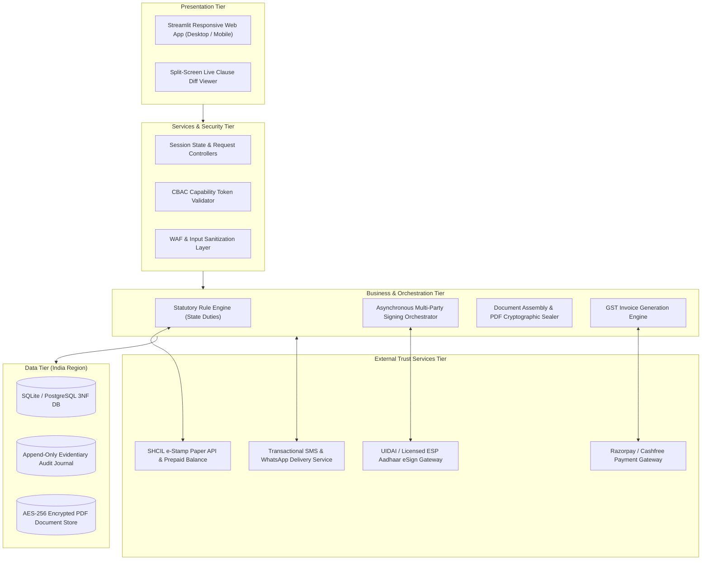
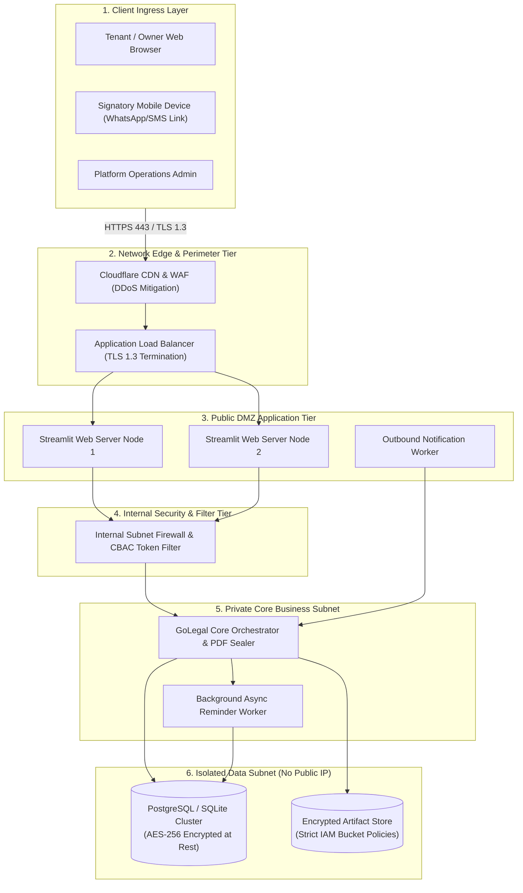
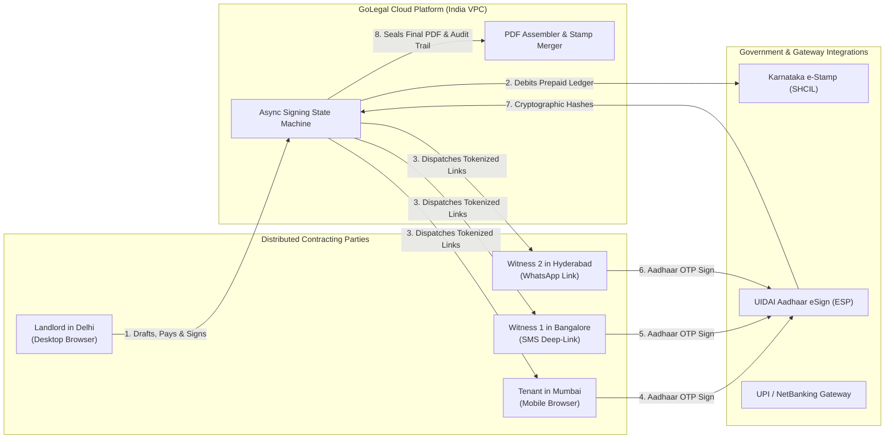

# GoLegal Web Application - System Architecture Document

> **Document Version**: 1.0 (Master Engineering Baseline)  
> **Status**: APPROVED ARCHITECTURAL SPECIFICATION  
> **Framework**: 5-Layer Decoupled Enterprise Model & Tiered Network Security Topology  
> **Jurisdiction Compliance**: India Region Localization (IT Act 2000, Indian Evidence Act 1872)  

---

## 1. 5-Layer Enterprise Architectural Model

The GoLegal system architecture decouples responsibilities across five distinct layers, ensuring horizontal scalability, zero lateral movement in security breaches, and modular testability.

```mermaid
graph TD
    classDef pres fill:#D4E6F1,stroke:#2980B9,stroke-width:2px;
    classDef srv fill:#D5F5E3,stroke:#27AE60,stroke-width:2px;
    classDef sec fill:#FCF3CF,stroke:#F39C12,stroke-width:2px;
    classDef biz fill:#E8DAEF,stroke:#8E44AD,stroke-width:2px;
    classDef data fill:#FADBD8,stroke:#C0392B,stroke-width:2px;

    subgraph Presentation_Layer ["1. Presentation Layer (Streamlit Frontend)"]
        UI["Multi-Page Web UI Components"]:::pres
        DocRender["Dynamic Split-Pane Clause & PDF Preview"]:::pres
        WorkflowUI["Interactive 5-Step Guided Wizard & Dashboard"]:::pres
        AdminConsole["Admin Stamping Ledger & Analytics Console"]:::pres
    end

    subgraph Services_Layer ["2. Services Layer (API & Communications)"]
        APIGateway["REST & Session Controller Gateway"]:::srv
        WebServers["Web Server Cluster & Request Router"]:::srv
        NotificationEng["Multi-Party Notification Dispatch (SMS, WhatsApp, Email)"]:::srv
        SecFilter["WAF Rules & Parameter Sanitization Filters"]:::srv
    end

    subgraph Security_Layer ["3. Security Layer (Capability-Based Access Control)"]
        AccessControl["CBAC Token Policy & Cryptographic Verification"]:::sec
        AuthAudit["Authentication & Security Ingress Auditing"]:::sec
        ResManager["Resource Gate & IDOR Prevention Shield"]:::sec
    end

    subgraph Business_Layer ["4. Business Layer (Domain & Orchestration)"]
        WorkflowEng["Declarative Signing State Machine Engine"]:::biz
        ComplianceEng["Statutory Stamp & Legal Rules Compliance Engine"]:::biz
        DocMerger["Document Assembly & Headless PDF Merger Engine"]:::biz
        CryptoSeal["SHA-256 Digest & X.509 PKCS#7 Sealing Engine"]:::biz
        EventMgmt["Section 65B Event & Audit Trail Publisher"]:::biz
        AsyncScheduler["Daily Reminder Scheduler & Retry Queue"]:::biz
    end

    subgraph Data_Layer ["5. Data Layer (Relational 3NF & Object Store)"]
        TxDB[("Primary 3NF Transactional Database<br/>(SQLite / PostgreSQL)")]:::data
        AuditDB[("Append-Only Audit Journal Tables<br/>(audit_logs, sysconfigTlb$jn)")]:::data
        DocStore[("Encrypted Document Store (AES-256)<br/>(Drafts, Certificates, Final Contracts)")]:::data
    end

    Presentation_Layer --> Services_Layer
    Services_Layer --> Security_Layer
    Security_Layer --> Business_Layer
    Business_Layer --> Data_Layer
```

---

## 2. 4-Tier Enterprise Architecture & External Trust Services

The application interacts with external government and banking trust utilities via strict gateway adapters:

---

## 3. Tiered Network Perimeter & DMZ Security Topology

Infrastructure security prevents unauthorized lateral traversal through four isolated operational zones:

---

## 4. Multi-Party Distributed Execution Topology

The platform coordinates geographically separated contracting parties in real time, upholding jurisdiction rules regardless of user location:

---

## 5. Operations Telemetry & System Health SLAs

| Metric / KPI | Threshold / Target SLA | Operational Action on Breach |
| :--- | :--- | :--- |
| **SHCIL Stamping Prepaid Balance** | Must remain $\ge$ ₹10,000 | Trigger visual warning banner in Admin Console and dispatch urgent SMS/email alert to finance team. |
| **Aadhaar eSign OTP Latency** | $< 3.5$ seconds (p95) | Failover to secondary licensed ESP gateway (eMudhra $\leftrightarrow$ NSDL). |
| **PDF Rendering & Sealing Turnaround** | $< 2.0$ seconds | Asynchronous offloading to background worker with polling status notification. |
| **Payment Webhook Confirmation** | $< 5.0$ seconds | Automatic webhook reconciliation poll every 30 seconds for pending payments. |
| **System Uptime & Availability** | $99.9\%$ Availability | Multi-AZ automated health check restart and load balancer rerouting. |
