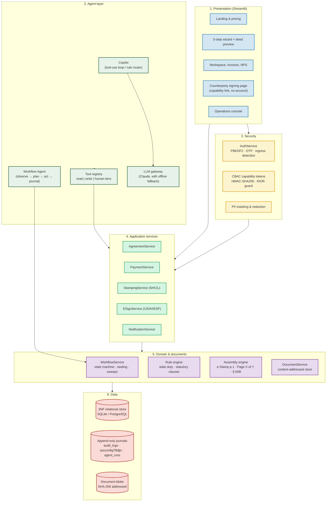
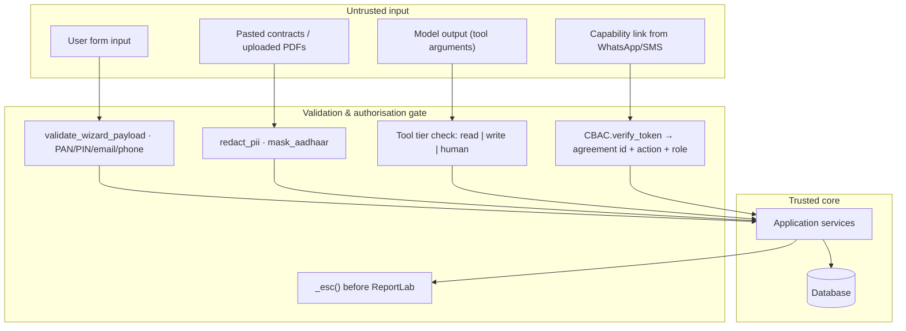
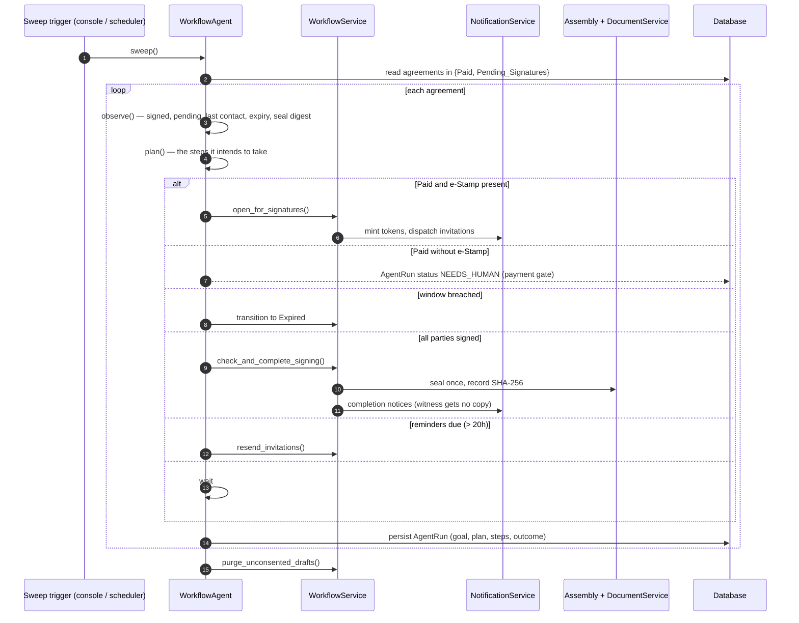
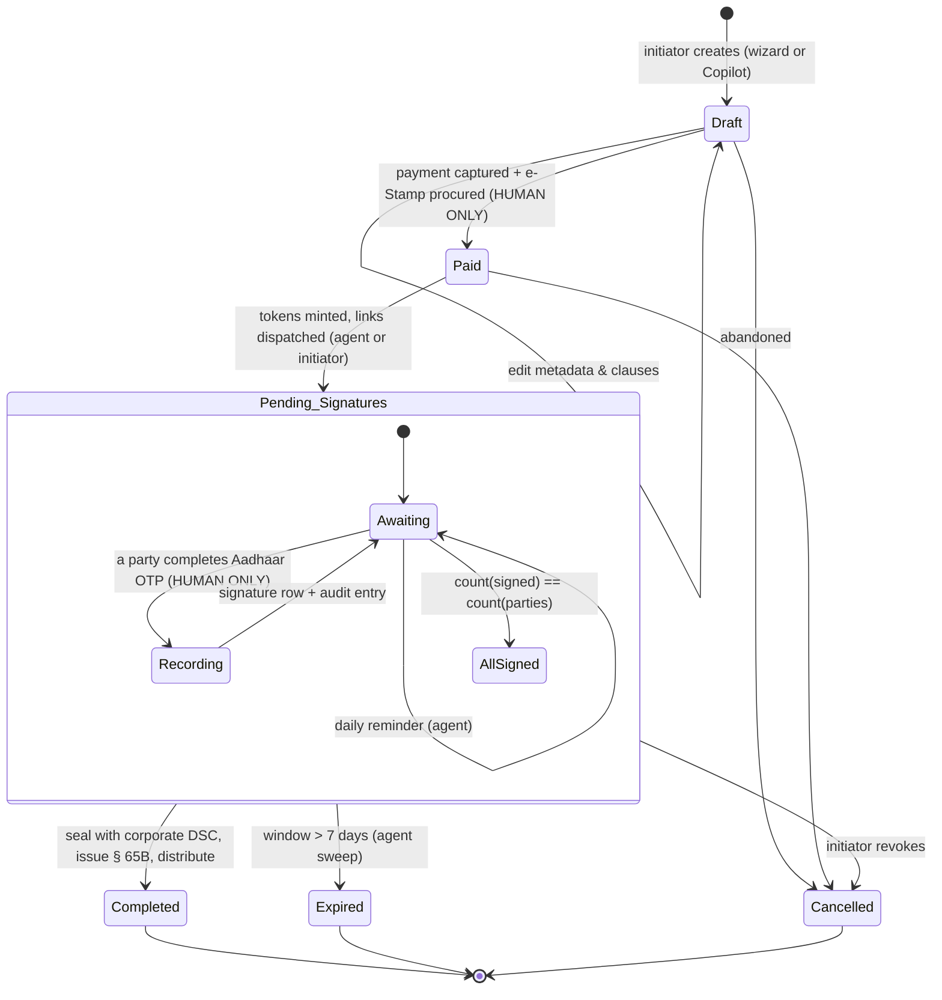
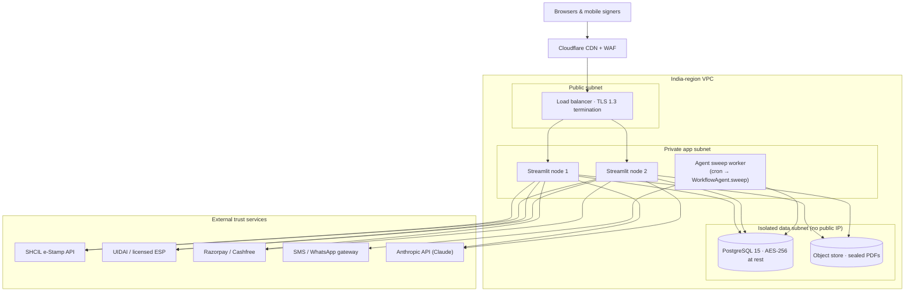

# GoLegal — System Architecture

> **Version**: 2.0 (agentic baseline)
> **Supersedes**: 1.0, which described a 5-layer model with no AI layer and no autonomy.
> **Jurisdiction**: India — IT Act 2000 §§ 4, 5, 10A; Indian Evidence Act 1872 § 65B; Indian Stamp Act 1899.

---

## 1. Shape of the system

Six layers. The **Agent layer** is new in 2.0 and sits *beside* the presentation layer rather than
under it: agents are peers of the human user, calling the same business services through a guarded
tool registry. Nothing an agent can do is outside what a user could do, and several things a user can
do are closed to agents by construction.

### Why the agent layer is a peer, not a controller

An agent that sits *above* the UI can do anything the UI can. An agent that sits *beside* it, reaching
the same services through a declared tool surface, can only do what that surface exposes. This is what
makes "the agent cannot pay or sign" a structural property rather than a prompt instruction: those
tools exist in the registry so the model knows they exist, and they have no handler.

---

## 2. Trust boundaries

Four rules the code enforces:

1. **A model's output is user input.** Tool arguments pass the same validation as a form. `prefill_agreement` strips `aadhaar` from anything the model supplies.
2. **A raw UUID never authorises anything.** Document and signing endpoints require a capability token that names the agreement, the party, the role and the permitted actions.
3. **Money is computed server-side.** `calculate_stamp_duty` reads the persisted agreement, never a client-supplied amount (PRD OWASP category 20).
4. **Nothing user-supplied reaches a parser unescaped.** ReportLab's mini-HTML and every HTML component are escaped at the boundary.

---

## 3. The autonomous workflow loop

The agent never calls a gateway directly. Everything routes through `WorkflowService`, so state-machine
validation, audit journaling and the notification ledger apply identically whether the actor is a
person, the Copilot, or the sweep.

---

## 4. Agreement lifecycle

Transitions are validated by `WorkflowService.VALID_TRANSITIONS`. Terminal states accept nothing.
Two transitions are marked HUMAN ONLY and are unreachable from any agent tool.

---

## 5. Deployment topology

**Notes on scaling.** The application is stateless apart from Streamlit session state; agreement state
lives in the database, so nodes are interchangeable. The agent sweep must run as a *single* worker
(or hold an advisory lock) so two nodes do not both dispatch the same reminder. Documents move from
the `documents` table to object storage by swapping `DocumentService`'s backend; its interface
(`store`, `latest`, `verify`) does not change.

---

## 6. Operational SLAs

| Indicator | Target | Breach action |
| :--- | :--- | :--- |
| SHCIL prepaid balance | ≥ ₹10,000 | Crimson banner in the console; stamping refuses rather than accepting a payment it cannot fulfil |
| Aadhaar eSign OTP latency | < 3.5 s (p95) | Fail over to the secondary ESP |
| Seal turnaround after final signature | < 2 s | Offload to the sweep worker |
| Copilot tool-loop turns | ≤ `agent_max_tool_calls` (12) | Loop exits and reports the tools it ran |
| Model unavailable | — | Copilot answers from the rule router; the notice names the reason |
| Signing window | 7 days | Agent transitions to Expired and notifies the initiator |
| Unconsented draft retention | 27 days | Agent purges on sweep |
