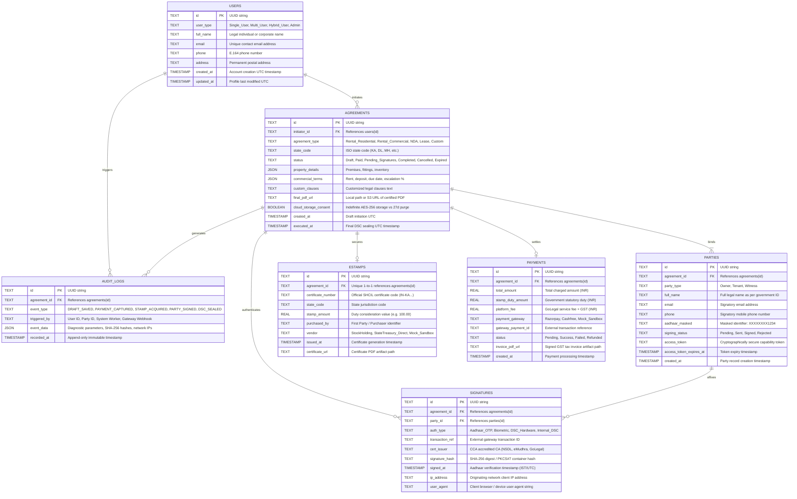

# GoLegal Web Application - Datasource & Persistence Plan

> **Version**: 2.0 (agentic baseline)  
> **Status**: APPROVED ARCHITECTURAL SPECIFICATION  
> **Database Engines**: SQLite 3 (Local Development & Staging) / PostgreSQL 15+ (Production Enterprise)  
> **ORM Layer**: SQLAlchemy 2.0+ (Declarative 3NF Models with JSON support)  

---

## 1. Entity-Relationship Architecture (3NF Normalization)

The GoLegal persistence architecture isolates entities into Third Normal Form (3NF) relational tables, while selectively utilizing dynamic JSON/JSONB document attributes for variable legal covenants, property inventories, and telemetry payloads.



---

## 2. Relational Data Definition Language (SQLite & PostgreSQL DDL)

### 2.1 SQLite DDL (Development & Staging Implementation)

```sql
-- Enforce Foreign Key Integrity
PRAGMA foreign_keys = ON;

-- 1. Users Master Table
CREATE TABLE IF NOT EXISTS users (
    id TEXT PRIMARY KEY,
    user_type TEXT NOT NULL CHECK (user_type IN ('Single_User', 'Multi_User', 'Hybrid_User', 'Admin')),
    full_name TEXT NOT NULL,
    email TEXT UNIQUE NOT NULL,
    phone TEXT NOT NULL,
    address TEXT,
    created_at TIMESTAMP DEFAULT CURRENT_TIMESTAMP,
    updated_at TIMESTAMP DEFAULT CURRENT_TIMESTAMP
);

-- 2. Agreements Master Table
CREATE TABLE IF NOT EXISTS agreements (
    id TEXT PRIMARY KEY,
    initiator_id TEXT NOT NULL REFERENCES users(id) ON DELETE CASCADE,
    agreement_type TEXT NOT NULL CHECK (agreement_type IN ('Rental_Residential', 'Rental_Commercial', 'NDA', 'Lease', 'Custom')),
    state_code TEXT NOT NULL,
    status TEXT NOT NULL DEFAULT 'Draft' CHECK (status IN ('Draft', 'Paid', 'Pending_Signatures', 'Completed', 'Cancelled', 'Expired')),
    property_details TEXT NOT NULL, -- JSON serialized string
    commercial_terms TEXT NOT NULL, -- JSON serialized string
    custom_clauses TEXT,
    final_pdf_url TEXT,
    cloud_storage_consent INTEGER NOT NULL DEFAULT 1, -- 1=True, 0=False
    created_at TIMESTAMP DEFAULT CURRENT_TIMESTAMP,
    executed_at TIMESTAMP
);

CREATE INDEX IF NOT EXISTS idx_agreements_initiator ON agreements(initiator_id);
CREATE INDEX IF NOT EXISTS idx_agreements_status ON agreements(status);

-- 3. Parties / Signatories Table
CREATE TABLE IF NOT EXISTS parties (
    id TEXT PRIMARY KEY,
    agreement_id TEXT NOT NULL REFERENCES agreements(id) ON DELETE CASCADE,
    party_type TEXT NOT NULL CHECK (party_type IN ('Owner', 'Tenant', 'Witness')),
    full_name TEXT NOT NULL,
    email TEXT NOT NULL,
    phone TEXT NOT NULL,
    aadhaar_masked TEXT, -- Stored strictly as XXXXXXXX1234
    signing_status TEXT NOT NULL DEFAULT 'Pending' CHECK (signing_status IN ('Pending', 'Sent', 'Signed', 'Rejected')),
    access_token TEXT UNIQUE,
    access_token_expires_at TIMESTAMP,
    created_at TIMESTAMP DEFAULT CURRENT_TIMESTAMP
);

CREATE INDEX IF NOT EXISTS idx_parties_agreement ON parties(agreement_id);
CREATE INDEX IF NOT EXISTS idx_parties_token ON parties(access_token);

-- 4. e-Stamps Records Table
CREATE TABLE IF NOT EXISTS estamps (
    id TEXT PRIMARY KEY,
    agreement_id TEXT UNIQUE NOT NULL REFERENCES agreements(id) ON DELETE CASCADE,
    certificate_number TEXT UNIQUE NOT NULL,
    state_code TEXT NOT NULL,
    stamp_amount REAL NOT NULL,
    purchased_by TEXT NOT NULL,
    vendor TEXT NOT NULL DEFAULT 'StockHolding',
    issued_at TIMESTAMP NOT NULL,
    certificate_url TEXT NOT NULL
);

-- 5. Digital Signatures Audit Table
CREATE TABLE IF NOT EXISTS signatures (
    id TEXT PRIMARY KEY,
    agreement_id TEXT NOT NULL REFERENCES agreements(id) ON DELETE CASCADE,
    party_id TEXT NOT NULL REFERENCES parties(id) ON DELETE CASCADE,
    auth_type TEXT NOT NULL CHECK (auth_type IN ('Aadhaar_OTP', 'Biometric', 'DSC_Hardware', 'Internal_DSC')),
    transaction_ref TEXT NOT NULL,
    cert_issuer TEXT NOT NULL,
    signature_hash TEXT NOT NULL,
    signed_at TIMESTAMP NOT NULL,
    ip_address TEXT NOT NULL,
    user_agent TEXT
);

CREATE INDEX IF NOT EXISTS idx_signatures_agreement ON signatures(agreement_id);
CREATE INDEX IF NOT EXISTS idx_signatures_party ON signatures(party_id);

-- 6. Payments & Invoices Table
CREATE TABLE IF NOT EXISTS payments (
    id TEXT PRIMARY KEY,
    agreement_id TEXT NOT NULL REFERENCES agreements(id) ON DELETE CASCADE,
    total_amount REAL NOT NULL,
    stamp_duty_amount REAL NOT NULL,
    platform_fee REAL NOT NULL,
    payment_gateway TEXT NOT NULL,
    gateway_payment_id TEXT UNIQUE NOT NULL,
    status TEXT NOT NULL CHECK (status IN ('Pending', 'Success', 'Failed', 'Refunded')),
    invoice_pdf_url TEXT,
    created_at TIMESTAMP DEFAULT CURRENT_TIMESTAMP
);

CREATE INDEX IF NOT EXISTS idx_payments_agreement ON payments(agreement_id);

-- 7. Section 65B Evidentiary Audit Trail (Append-Only)
CREATE TABLE IF NOT EXISTS audit_logs (
    id TEXT PRIMARY KEY,
    agreement_id TEXT NOT NULL REFERENCES agreements(id) ON DELETE CASCADE,
    event_type TEXT NOT NULL,
    triggered_by TEXT NOT NULL,
    event_data TEXT NOT NULL, -- JSON serialized string
    recorded_at TIMESTAMP DEFAULT CURRENT_TIMESTAMP
);

CREATE INDEX IF NOT EXISTS idx_audit_logs_agreement ON audit_logs(agreement_id);

-- 8. Platform System Configuration Table (sysconfigTlb)
CREATE TABLE IF NOT EXISTS sysconfigTlb (
    id TEXT PRIMARY KEY DEFAULT 'GLOBAL_CONFIG',
    lang TEXT NOT NULL DEFAULT 'en',
    dig_sign TEXT NOT NULL DEFAULT 'Aadhaar_eSign',
    estamp INTEGER NOT NULL DEFAULT 1,
    estamp_vendor TEXT NOT NULL DEFAULT 'StockHolding',
    currency TEXT NOT NULL DEFAULT 'INR',
    system_commission REAL NOT NULL DEFAULT 18.0,
    discount REAL NOT NULL DEFAULT 0.0,
    country TEXT NOT NULL DEFAULT 'IND',
    data_pruning_days INTEGER NOT NULL DEFAULT 27,
    agreement_retain_days INTEGER NOT NULL DEFAULT 2920,
    stockholding_prepaid_balance REAL NOT NULL DEFAULT 50000.0,
    low_balance_threshold REAL NOT NULL DEFAULT 10000.0,
    updated_at TIMESTAMP DEFAULT CURRENT_TIMESTAMP
);

-- 9. Append-Only System Configuration Audit Journal (sysconfigTlb$jn)
CREATE TABLE IF NOT EXISTS "sysconfigTlb$jn" (
    jn_id TEXT PRIMARY KEY,
    timestamp TIMESTAMP DEFAULT CURRENT_TIMESTAMP,
    operation TEXT NOT NULL CHECK (operation IN ('INSERT', 'UPDATE', 'DELETE')),
    updated_by_user TEXT NOT NULL,
    previous_value TEXT, -- JSON snapshot of old state
    new_value TEXT NOT NULL -- JSON snapshot of new state
);
```

---

## 3. Dynamic JSON Schemas (Covenants & Audit Payloads)

### 3.1 `property_details` JSON Schema
```json
{
  "$schema": "http://json-schema.org/draft-07/schema#",
  "title": "PropertyDetails",
  "type": "object",
  "required": ["address_line1", "city", "state", "pincode", "property_type"],
  "properties": {
    "premises_name": { "type": "string" },
    "address_line1": { "type": "string" },
    "address_line2": { "type": "string" },
    "city": { "type": "string" },
    "state": { "type": "string" },
    "pincode": { "type": "string", "pattern": "^[1-9][0-9]{5}$" },
    "property_type": { "type": "string", "enum": ["Apartment", "Independent_House", "Villa", "Commercial_Office"] },
    "bedroom_count": { "type": "integer", "minimum": 1 },
    "bathroom_count": { "type": "integer", "minimum": 1 },
    "parking_slots": { "type": "integer", "minimum": 0 },
    "fittings_and_fixtures": {
      "type": "array",
      "items": { "type": "string" }
    },
    "keys_handed_over": { "type": "integer", "minimum": 1 }
  }
}
```

### 3.2 `commercial_terms` JSON Schema
```json
{
  "$schema": "http://json-schema.org/draft-07/schema#",
  "title": "CommercialTerms",
  "type": "object",
  "required": ["monthly_rent", "security_deposit", "lease_period_months", "rent_commencement_date", "rent_due_day"],
  "properties": {
    "monthly_rent": { "type": "number", "minimum": 500 },
    "security_deposit": { "type": "number", "minimum": 0 },
    "maintenance_charges": { "type": "number", "minimum": 0 },
    "lease_period_months": { "type": "integer", "default": 11 },
    "lock_in_period_months": { "type": "integer", "default": 1 },
    "rent_commencement_date": { "type": "string", "format": "date" },
    "rent_due_day": { "type": "integer", "minimum": 1, "maximum": 31, "default": 5 },
    "notice_period_days": { "type": "integer", "default": 30 },
    "annual_escalation_pct": { "type": "number", "default": 5.0 },
    "payment_mode": { "type": "string", "enum": ["UPI", "Bank_NEFT_IMPS", "Cash"] }
  }
}
```

### 3.3 `audit_logs.event_data` JSON Schema
```json
{
  "$schema": "http://json-schema.org/draft-07/schema#",
  "title": "AuditEventData",
  "type": "object",
  "required": ["action", "status", "client_ip"],
  "properties": {
    "action": { "type": "string" },
    "status": { "type": "string", "enum": ["SUCCESS", "FAILURE", "WARNING"] },
    "client_ip": { "type": "string" },
    "user_agent": { "type": "string" },
    "document_sha256": { "type": "string" },
    "gateway_payload": { "type": "object" },
    "diagnostic_message": { "type": "string" }
  }
}
```

---

## 4. Evidentiary Cloud Storage Consent & Data Retention

### 4.1 Storage Consent Governance
1. **Explicit Cloud Storage Consent**: If `cloud_storage_consent == 1` (True), the final signed PDF and Section 65B certificate are archived indefinitely in AES-256 encrypted object storage for user access, tax filing, and dispute resolution.
2. **Zero Document Hoarding Policy**: If `cloud_storage_consent == 0` (False), drafts and uncompleted files are scheduled for automatic purge after `sysconfigTlb.data_pruning_days` (default 27 days).
3. **Sensitive Identifier Redaction**:
   - Aadhaar numbers are never stored in plain text.
   - The system strictly enforces regular expression masking to `XXXXXXXX1234` prior to writing to the `parties.aadhaar_masked` column.
   - Any raw Aadhaar passed in memory for mock UIDAI OTP validation is purged from heap space immediately following verification.

---

## 5. StockHolding Prepaid Balance Ledger Mechanics

To prevent transaction failures due to exhausted state stamping funds, the platform maintains a synchronized ledger within `sysconfigTlb`:
- **Real-Time Debit**: Upon calling the SHCIL e-Stamp issuance service, the statutory duty amount (e.g. ₹100) + platform fee is debited from `stockholding_prepaid_balance`.
- **Low-Balance Guard**: If `stockholding_prepaid_balance < low_balance_threshold` (₹10,000), the system generates an urgent visual alert in the Admin Console and dispatches an automated alert to finance administrators.
- **Audit Logging**: Every debit or top-up event records a full immutable entry in `sysconfigTlb$jn`.

---

## 6. Schema additions in v2.0 (agentic baseline)

Eight tables were added to make the platform stateful, auditable and agentic. Sections 1–5 above
remain accurate for the original nine entities.

### 6.1 Why each exists

| Table | Problem it solves |
| :--- | :--- |
| `documents` | PDFs were rebuilt on every page render, so no sealed artefact had a stable identity. Content-addressed storage makes `final_pdf_sha256` a real evidentiary reference. |
| `otp_challenges` | Rate limiting lived in a Python dict on an object the UI recreated each rerun, so the 5-attempt lockout could never fire. |
| `login_events` | Suspicious-ingress detection needs a history to compare against. |
| `notifications` | Every invitation, reminder and completion notice must be provable after the fact. |
| `feedback` | NPS was stored in session state and lost on refresh. |
| `agent_runs` | An autonomous agent that cannot be audited is not deployable. |

### 6.2 DDL (PostgreSQL)

```sql
-- 8. Content-addressed document store
CREATE TABLE documents (
    id UUID PRIMARY KEY DEFAULT gen_random_uuid(),
    agreement_id UUID NOT NULL REFERENCES agreements(id) ON DELETE CASCADE,
    doc_type VARCHAR(30) NOT NULL CHECK (doc_type IN ('DRAFT','FINAL','INVOICE','CERT_65B')),
    file_name VARCHAR(255) NOT NULL,
    mime_type VARCHAR(100) NOT NULL DEFAULT 'application/pdf',
    content BYTEA NOT NULL,
    sha256 CHAR(64) NOT NULL,
    size_bytes INTEGER NOT NULL,
    version INTEGER NOT NULL DEFAULT 1,
    created_at TIMESTAMPTZ DEFAULT CURRENT_TIMESTAMP
);
CREATE INDEX idx_documents_agreement_type ON documents(agreement_id, doc_type);

-- 9. OTP challenges (login and eSign) — survives process restarts
CREATE TABLE otp_challenges (
    id UUID PRIMARY KEY DEFAULT gen_random_uuid(),
    subject VARCHAR(255) NOT NULL,              -- phone (LOGIN) or masked Aadhaar (ESIGN)
    purpose VARCHAR(20) NOT NULL CHECK (purpose IN ('LOGIN','ESIGN')),
    otp_hash VARCHAR(128) NOT NULL,             -- SHA-256(secret:otp); the OTP is never stored
    attempts INTEGER NOT NULL DEFAULT 0,        -- carried forward across re-issued challenges
    locked_until TIMESTAMPTZ,
    expires_at TIMESTAMPTZ NOT NULL,
    consumed BOOLEAN NOT NULL DEFAULT FALSE,
    created_at TIMESTAMPTZ DEFAULT CURRENT_TIMESTAMP
);
CREATE INDEX idx_otp_subject_purpose ON otp_challenges(subject, purpose);

-- 10. Security ingress journal
CREATE TABLE login_events (
    id UUID PRIMARY KEY DEFAULT gen_random_uuid(),
    user_id UUID REFERENCES users(id) ON DELETE CASCADE,
    identifier VARCHAR(255) NOT NULL,
    method VARCHAR(30) NOT NULL,                -- OTP | PASSWORD
    ip_address VARCHAR(45) NOT NULL,
    user_agent TEXT,
    device_fingerprint VARCHAR(128),            -- SHA-256(user_agent | IP /24)
    geo_location VARCHAR(255),
    success BOOLEAN NOT NULL DEFAULT FALSE,
    suspicious BOOLEAN NOT NULL DEFAULT FALSE,
    risk_reasons JSONB NOT NULL DEFAULT '[]',
    alert_dispatched BOOLEAN NOT NULL DEFAULT FALSE,
    created_at TIMESTAMPTZ DEFAULT CURRENT_TIMESTAMP
);
CREATE INDEX idx_login_events_user ON login_events(user_id);

-- 11. Notification dispatch ledger
CREATE TABLE notifications (
    id UUID PRIMARY KEY DEFAULT gen_random_uuid(),
    agreement_id UUID NOT NULL REFERENCES agreements(id) ON DELETE CASCADE,
    party_id UUID REFERENCES parties(id) ON DELETE CASCADE,
    kind VARCHAR(30) NOT NULL,                  -- INVITE | REMINDER | COMPLETION | SECURITY
    channel VARCHAR(30) NOT NULL,               -- SMS | WHATSAPP | EMAIL | ALL
    recipient VARCHAR(255) NOT NULL,
    message TEXT NOT NULL,
    signing_url TEXT,
    status VARCHAR(20) NOT NULL DEFAULT 'SENT',
    triggered_by VARCHAR(100) NOT NULL DEFAULT 'SYSTEM',
    created_at TIMESTAMPTZ DEFAULT CURRENT_TIMESTAMP
);
CREATE INDEX idx_notifications_agreement ON notifications(agreement_id);

-- 12. Net Promoter Score
CREATE TABLE feedback (
    id UUID PRIMARY KEY DEFAULT gen_random_uuid(),
    user_id UUID REFERENCES users(id) ON DELETE SET NULL,
    agreement_id UUID REFERENCES agreements(id) ON DELETE SET NULL,
    score INTEGER NOT NULL CHECK (score BETWEEN 0 AND 10),
    category VARCHAR(100),
    comment TEXT,
    sentiment VARCHAR(20) NOT NULL DEFAULT 'Detractor',
    created_at TIMESTAMPTZ DEFAULT CURRENT_TIMESTAMP
);

-- 13. AI agent execution journal
CREATE TABLE agent_runs (
    id UUID PRIMARY KEY DEFAULT gen_random_uuid(),
    agent_type VARCHAR(30) NOT NULL,            -- COPILOT | WORKFLOW | CLAUSE_RISK | INGEST
    user_id UUID REFERENCES users(id) ON DELETE SET NULL,
    agreement_id UUID REFERENCES agreements(id) ON DELETE SET NULL,
    goal TEXT NOT NULL,
    model VARCHAR(100) NOT NULL DEFAULT 'rule-based',
    status VARCHAR(20) NOT NULL CHECK (status IN ('COMPLETED','FAILED','NEEDS_HUMAN','RUNNING')),
    steps JSONB NOT NULL DEFAULT '[]',          -- [{tool, input, output, ok}]
    outcome TEXT,
    input_tokens INTEGER NOT NULL DEFAULT 0,
    output_tokens INTEGER NOT NULL DEFAULT 0,
    created_at TIMESTAMPTZ DEFAULT CURRENT_TIMESTAMP,
    completed_at TIMESTAMPTZ
);
CREATE INDEX idx_agent_runs_agreement ON agent_runs(agreement_id);
```

### 6.3 Columns added to existing tables

| Table | Columns | Purpose |
| :--- | :--- | :--- |
| `users` | `state_code`, `password_hash`, `is_active`, `notification_prefs`, `last_login_at` | Real accounts, suspension, channel preferences |
| `agreements` | `title`, `clause_toggles`, `ai_risk_report`, `final_pdf_sha256`, `is_archived`, `expires_at`, `updated_at` | Naming, clause state, cached risk, evidentiary digest, soft delete, signing window |
| `parties` | `pan`, `address`, `last_notified_at`, `reminder_count` | Recitals and reminder cadence |
| `payments` | `invoice_number`, `gst_amount`, `payment_mode`, `paid_by_user_id` | GST invoicing and MyInvoices scoping |

`parties.access_token` widened to `VARCHAR(1024)`: a capability token is a base64url payload plus a
64-character HMAC, which does not fit the original 255.

### 6.4 Migration

`persistence.database._apply_additive_migrations()` inspects the live schema on startup and issues
`ALTER TABLE ... ADD COLUMN` for anything the models declare but the database lacks. This is
deliberately limited to additive column changes — SQLite cannot alter constraints — so an existing
`golegal.db` keeps working across upgrades. Constraint or type changes require a fresh database in
development, or Alembic in production.
