# GoLegal Web Application - Master Product Requirements Document (PRD) & Technical Specification Context

> **Document Type**: Master Unified Product Requirements Document (PRD), Software Architecture Document (SAD v0.3), and System Design Specification  
> **Target Audience**: AI Multi-Agent Coding Framework / Engineering Lead / Product Team / System Architects  
> **Purpose**: Authoritative context for Spec-Driven Development (SDD) of the GoLegal End-to-End Digital Contracting Web Application  
> **Status**: APPROVED & CONSOLIDATED SPECIFICATION (Incorporates Core PRD, Requirement Design Spec, and Software Architecture Document v0.3)  
> **Jurisdiction**: India (IT Act 2000, Indian Evidence Act 1872, Indian Stamp Act) with Global Extensibility  
> **Core Value Proposition**: 100% Digital, Contactless, 3-Click Legal Agreement Drafting, e-Stamping, and Multi-Party Aadhaar e-Signing  

---

## Controlled Document Notice & Software Architecture Baseline
> **Controlled Document**: Unauthorized access, copying, and replication are prohibited. This document contains proprietary architectural, design, and product specifications for the GoLegal Web Application developed by AAS Innovation Labs.

### Document Revision History

| Version # | Updated / Reviewed By | Revision Date | Update Notes |
| :--- | :--- | :--- | :--- |
| **0.1** | Lead Technical, GoLegal, *080 XXXX 87148 | 21-July-2020 | Initial Draft Architecture & Core Technical Scope |
| **0.2** | Lead Product, GoLegal, *080 XXXX 87148 | 25-July-2020 | Updated PM requirements, execution workflows, and product controls |
| **0.3** | Lead Technical, GoLegal, *080 XXXX 87148 | 27-Oct-2020 | Updated review comments, capability-based security, and network topology |
| **1.0 (Master)** | Product & Architecture Engineering Lead | Current Release | Master Consolidation: Unified PRD, Requirement Design Spec, and SAD v0.3 with complete Mermaid 11.14+ diagrams |

### Definitions, Acronyms and Abbreviations

| Abbreviations | Definitions |
| :--- | :--- |
| **REST** | Representational State Transfer |
| **UI** | User Interface |
| **API** | Application Programming Interface |
| **XML** | Extensible Markup Language |
| **SAD** | Software Architecture Document |
| **PRD** | Product Requirements Document |
| **SDD** | Spec-Driven Development |
| **ESP** | eSign Service Provider (Accredited by CCA) |
| **SHCIL** | Stock Holding Corporation of India Limited (Official e-Stamp Provider) |
| **UIDAI** | Unique Identification Authority of India (Aadhaar authentication) |
| **DSC** | Digital Signature Certificate (X.509 cryptographic certificate) |
| **CBAC** | Capability-Based Access Control |
| **NPS** | Net Promoter Score (10-point scale: 0-8 Detractors, 9 Happy, 10 Delighted) |

---

## Executive Table of Contents
1. [Executive Summary & Company Background](#1-executive-summary--company-background)
2. [Market Opportunity, Industry Analysis & Customer Research](#2-market-opportunity-industry-analysis--customer-research)
3. [User Personas & Target Audience Profiles](#3-user-personas--target-audience-profiles)
4. [Business Model Canvas, Pricing, Unit Economics & Revenue Streams](#4-business-model-canvas-pricing-unit-economics--revenue-streams)
5. [Product Scope: MVP1 vs MVP2 Feature Matrix & User Stories](#5-product-scope-mvp1-vs-mvp2-feature-matrix--user-stories)
6. [End-to-End User Workflows & Step-by-Step Journeys](#6-end-to-end-user-workflows--step-by-step-journeys)
7. [Screen-by-Screen UI/UX Specifications, User Pages & Admin Wireframes](#7-screen-by-screen-uiux-specifications-user-pages--admin-wireframes)
8. [System Architecture, 5-Layer Model & Tiered Network Security Topology](#8-system-architecture-5-layer-model--tiered-network-security-topology)
9. [Database Schema, Configuration Tables & Data Models](#9-database-schema-configuration-tables--data-models)
10. [Third-Party Integrations & Legal / Regulatory Compliance](#10-third-party-integrations--legal--regulatory-compliance)
11. [Security Architecture, Capability-Based Access & OWASP Vulnerability Matrix](#11-security-architecture-capability-based-access--owasp-vulnerability-matrix)
12. [Internal Analytics Dashboard, Data Pipeline & AI Capabilities](#12-internal-analytics-dashboard-data-pipeline--ai-capabilities)
13. [Project Roadmap, Agile Planning, Milestones & Financial Budget](#13-project-roadmap-agile-planning-milestones--financial-budget)
14. [Competitive Intelligence & Teardowns (Leegality, SpotDraft, Revv)](#14-competitive-intelligence--teardowns-leegality-spotdraft-revv)
15. [Mentor Feedback, Advisory Insights & Risk Mitigation](#15-mentor-feedback-advisory-insights--risk-mitigation)

---

# 1. Executive Summary & Company Background

## 1.1 Vision & Mission
GoLegal (developed by AAS Innovation Labs) is an intuitive, cloud-based platform for executing legally binding agreements and contracts online. It empowers individuals, tenants, landlords, and businesses to draft, review, pay state stamp duties, and execute multi-party agreements in minutes—100% digital, completely paperless, and contactless from anywhere, anytime.

### Core Brand Philosophy & Value Pillars
- **Speed of Execution**: From days/weeks to under 10 minutes (3-click intuitive DIY experience).
- **Location Independence**: Parties in different locations (e.g., Landlord in Delhi, Tenant in Bangalore, Witness in Mumbai) execute without physical co-presence.
- **Evidentiary Sanctity**: Built strictly in adherence to the Information Technology Act 2000 (Section 4, 5, 10A) and Section 65B of the Indian Evidence Act, 1872.
- **Cost Reduction**: Over 50% savings on execution costs, eliminating broker markups and intermediary overhead.
- **Security & Privacy**: Zero document hoarding policy, encrypted document repositories (AES-256 at rest, 256-bit SSL in transit), tamper-evident digital signatures, and strict access controls.

## 1.2 Founding Team & Leadership
- **AS (CEO / Strategy, New Business & AI)**: Executive MBA (IIM Bangalore), MCA (VIT), PMP. 16+ years of experience in Business Development, Software Products, Strategy, and M&A.
- **AC (COO / Cyber Security, Cyber Law & Forensics)**: Executive MBA (IIM Bangalore), MS (BITS Pilani), MCA (PTU Jalandhar), PMP. 17+ years of experience in Cyber Security, Software Development, Testing, and Digital Transformation.
- **SV (CTO / Product Evangelist & Growth Systems)**: Executive MBA (IIM Bangalore), B.Tech (CUSAT), IPL-Product Management. 20+ years of experience in Product Architecture, Software Development, and Hardware Systems.
- **Prerana Reddy (CLA / Corporate Legal Advisor & Arbitration)**: Specialist in Arbitration and International Law (NR).

## 1.3 Strategic Brand Framework & Strategy
The GoLegal brand strategy is built at the intersection of customer desires, business unique strengths, and competitor analysis:

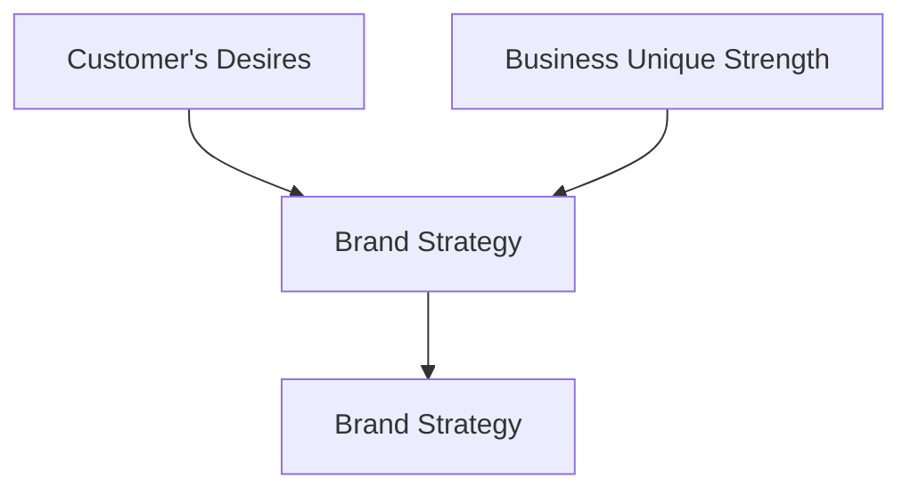

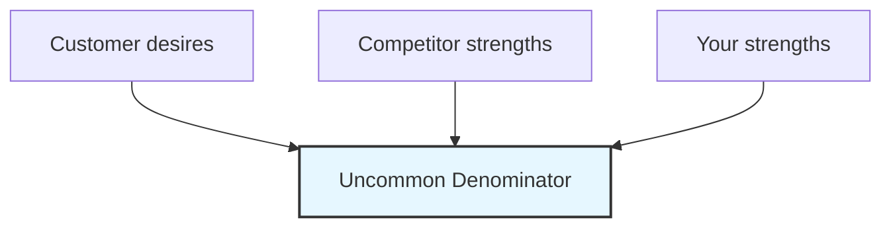

### Marketing Slogans & Launch Messaging
- *"Borderless, contactless contracting — Contracts in your pocket."*
- *"Be liberated from the slow and error-prone agreement and contracting process."*
- *"The future of online agreement and contracting signing — Reserve your spot for early BETA access."*

# 2. Market Opportunity, Industry Analysis & Customer Research

## 2.1 The Market Problem Space
Traditional contracting in India suffers from severe friction:
1. **Time to Execute**: Drafting, courier transit, manual stamping, and in-person wet signatures take 3 to 14 days on average.
2. **Managing Physical Documents**: Physical stamp papers degrade, get lost, cannot be easily verified, and multi-party duplicate copies require repeating the entire creation and stamping cycle.
3. **Broker Dependency & Lack of Cost Transparency**: Middlemen charge arbitrary stamp duty markups and notary fees while offering zero evidentiary guarantees.
4. **Information Asymmetry**: Non-standard clauses create legal risks and disputes for ordinary tenants and small businesses.

### Market Size
- Over **3 million contracts and rental agreements** are executed each month in India.
- Saving an average of 3 hours per contract amounts to **1,027 years of human effort saved each month**.
- Total Addressable Market (TAM) in global contract automation is estimated at **$80 Billion**.

## 2.2 Michael Porter's Five Forces Analysis (LegalTech Platform)
Analysis of industry attractiveness for online legal agreements and contract execution platforms:

| Force | Intensity / Attractiveness | Structural Dynamics in LegalTech |
|---|---|---|
| **Rivalry Among Competitors** | Moderate (Score 3/5) | Fragmented market between legacy legal document printing portals (LegalDesk, SignDesk) and enterprise CLM solutions (SpotDraft, SirionLabs). A high-volume B2C consumer niche remains underserved. |
| **Barriers to Entry** | High (Score 2/5) | High technological and regulatory barriers: API integrations with licensed Certifying Authorities (CCA/UIDAI Aadhaar eSign), state-level e-Stamping partnerships (SHCIL), and strict legal compliance standards. |
| **Threat of Substitutes** | Moderate (Score 3/5) | Offline stamp paper vendors, local notary publics, and informal un-stamped verbal/email agreements. High switching incentives due to COVID-19 and remote work trends. |
| **Bargaining Power of Buyers** | Moderate (Score 3/5) | Highly price-sensitive B2C consumers (tenants/landlords) seeking transparent flat pricing; enterprise/SMB buyers demand SOC2 security and API integrations. |
| **Bargaining Power of Suppliers** | High (Score 2/5) | Core infrastructure relies on government utilities: UIDAI for Aadhaar authentication, licensed Certifying Authorities (eMudhra, NSDL) for DSC issuance, and SHCIL for e-Stamping. |
| **Government Actions & Regulation** | Favorable (Score 4/5) | IT Act 2000 and the 2019 Aadhaar Amendment Act actively encourage paperless governance, e-KYC, and legally recognized digital signatures. |

## 2.3 Customer Survey Data & Demographics
Quantitative research across 100+ surveyed respondents in target urban centers (Bangalore, Delhi NCR, Mumbai):

### Key Survey Findings:
1. **Age Distribution**: Dominant demographic is **26–40 years** (working professionals, tenants, startup founders), followed by **41–60 years** (property owners and landlords).
2. **Preferred Device Mode**:
   - **Web / Laptop / Desktop**: 68% (preferred for in-depth reviewing and contract editing).
   - **Mobile / Tablet**: 28% (preferred for receiving sign links, OTP verification, and quick approvals).
   - **Manual**: <4%.
3. **Trust in Traditional Intermediaries**: High distrust toward local property brokers and agents due to excessive fees, data privacy risks, and lack of legal expertise. Over 78% expressed readiness to use a reliable, certified online contracting service.
4. **Physical Presence Pain Point**: 82% of respondents rated delays caused by requiring physical co-presence of all parties as **High** or **Critical**.

## 2.4 ERRC Grid (Eliminate - Reduce - Raise - Create)
Strategic Blue Ocean canvas for GoLegal:

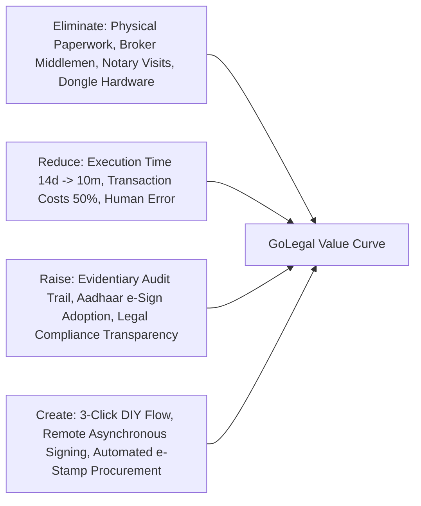

# 3. User Personas & Target Audience Profiles

Detailed personas developed from user interviews and demographic research:

### Persona 1: Mayank Tripathi — The Tech-Savvy Tenant (MVP1)
- **Demographics**: Age 24, Software Engineer at an early-stage startup, Bangalore (origin: Prayagraj, UP). Income: ₹45,000/month. Single.
- **Personality**: Tech-savvy, extrovert, mobile-first Android user, highly protective of personal data with strangers.
- **Goals**: Rent an apartment near work, split rent with roommates, execute rental agreement quickly without agent hassles, safe digital storage for HRA tax claims and city address proof.
- **Pain Points**: New to the city, language barrier with local Kannada brokers, fears identity theft and broker scams, lacks knowledge of local rental legalities.
- **Quote**: *"I just want a legally valid rent agreement done in 10 minutes so I can submit it for HRA without dealing with shady middlemen."*

### Persona 2: Anushka Verma — The High-Income Mobile Professional (MVP1)
- **Demographics**: Age 24, MNC Software Engineer, Bangalore (origin: Dwarka, New Delhi). Income: ₹1,00,000/month. In a relationship.
- **Personality**: iPhone/Mac user, studious, independent, values safety and seamless digital experiences.
- **Goals**: Rent a premium apartment with friends, zero physical contact with landlords/brokers, ensure no restrictive illegal clauses exist in the contract.
- **Pain Points**: Does not feel safe meeting unknown agents in person, highly skeptical of sharing physical identity documents (Aadhaar/PAN copies).

### Persona 3: Ramakiran Reddy — The Educated Property Owner / Landlord (MVP1)
- **Demographics**: Age 43, Engineering Director at an MNC, Bangalore Urban (Mahadevapura). Income: ₹2,50,000/month. Married with children.
- **Personality**: Tech-savvy, Apple ecosystem, hard bargainer, detail-oriented, owns multiple rental residential units.
- **Goals**: Ensure high occupancy, enforce strict property protection clauses (fixtures, maintenance, escalation %), get agreements signed remotely without traveling across the city.
- **Pain Points**: Wasting weekends meeting tenants and standing in queue at sub-registrar offices, fear of tenant disputes without enforceable stamp paper documentation.

### Persona 4: Srinivas Gowda — The Traditional Less-Educated Property Owner (MVP1/MVP2)
- **Demographics**: Age 48, FMCG wholesale distribution business owner, Bangalore (origin: Hubli, KA). Income: ₹2,00,000/month. 12th pass.
- **Personality**: Non-tech savvy, prefers local language (Kannada), deals heavily in cash, strong local network, traditional mindset.
- **Goals**: Keep rental floors occupied, steady monthly rental income, ensure property cannot be usurped by tenants.
- **Pain Points**: Intimidated by complex English software, hesitant with digital payments, struggles to communicate with young millennial tenants moving in from other states. Requires Vernacular Language UI and assisted phone/WhatsApp workflows.

### Persona 5: Manjunath Ramakrishnappa — The Local Real Estate Influencer / Broker (MVP2)
- **Demographics**: Age 45, Independent Real Estate Broker, Varthur, Bangalore Urban. Income: ₹1,50,000/month.
- **Personality**: Extroverted dealmaker, deeply connected with local corporators and RWAs, uses basic smartphone for WhatsApp and calling.
- **Goals**: Close rental deals faster, earn commission without spending hours doing paperwork, offer value-added digital stamping to clients.
- **Pain Points**: Low conversion rates due to cumbersome paperwork, client drop-offs during signing delays.

# 4. Business Model Canvas, Pricing, Unit Economics & Revenue Streams

## 4.1 Business Model Canvas (BMC)

| Canvas Component | Details |
|---|---|
| **Key Partners** | - **PSUs / Government Bodies**: Stock Holding Corporation of India Ltd (SHCIL) for e-Stamping.<br>- **Licensed Certifying Authorities (CAs)**: NSDL e-Gov, eMudhra for Aadhaar eSign ESP.<br>- **Identity**: UIDAI for Aadhaar eKYC.<br>- **Payment Processors**: Razorpay, Paytm, Cashfree.<br>- **Academic & Startup Ecosystem**: NSRCEL - IIM Bangalore.<br>- **Property Portals**: NoBroker, 99acres, MagicBricks for referral integrations. |
| **Key Activities** | - Agreement drafting engine & template management.<br>- e-Stamp certificate procurement & automated merging.<br>- Asynchronous multi-party digital signature orchestration.<br>- Secure document archiving and audit trail hashing.<br>- Customer acquisition, vernacular content generation, and support. |
| **Value Propositions** | - **100% Digital & Contactless**: End-to-end legal execution without physical presence.<br>- **3-Click Simplicity**: Pre-configured lawyer-vetted templates.<br>- **Legal Sanctity**: Incontestable evidence in court under IT Act 2000 & Section 65B.<br>- **24/7 Availability**: Instant generation, preview, signing, and download. |
| **Customer Relationships** | - Self-service DIY portal.<br>- Automated WhatsApp/SMS notifications with direct deep-links.<br>- AI chatbot for contract terminology and step-by-step guidance. |
| **Customer Segments** | - **Primary B2C (MVP1)**: Urban residential tenants and individual landlords.<br>- **Secondary SMB (MVP1.1/MVP2)**: Co-living startups, small businesses, commercial landlords.<br>- **Brokers & Channel Partners (MVP2)**: Real estate agents seeking assisted transaction tools. |
| **Key Resources** | - Secure cloud infrastructure (AWS/DigitalOcean VPC in India region).<br>- Proprietary workflow execution and document merging engine.<br>- Curated, state-compliant legal template library.<br>- Legal advisory & compliance panel. |
| **Channels** | - Responsive Web Application (Desktop/Mobile Web).<br>- Android / iOS Mobile Apps (Roadmap).<br>- Digital marketing (SEO, Google Ads, social media).<br>- Broker referral program & property portal APIs. |
| **Cost Structure** | - **Variable COGS**: E-Stamp paper actual cost, e-Stamp API transaction fee (~₹15), Aadhaar eSign verification fee per party (~₹15–25), SMS/WhatsApp gateway fees, payment gateway fee (1.8–2%).<br>- **Fixed OPEX**: Cloud hosting (India data localization), legal panel retainers, engineering & design team, compliance audits. |
| **Revenue Streams** | - **Direct Execution Fee**: ₹399 – ₹699 per executed agreement (includes stamp duty platform margin).<br>- **Agreement Renewals**: ₹299 per renewal with automated delta updates.<br>- **Value-Added Services**: Notary attestation add-on (₹200), physical doorstep delivery add-on (₹150), lawyer custom review add-on (₹499).<br>- **B2B API & Data Insights**: Aggregated rental yield index and pricing analytics. |

## 4.2 Alternate Revenue Streams Architecture
Beyond individual B2C agreement transactions, GoLegal captures recurring and high-margin B2B/B2C revenue through three strategic expansion channels:

1. **Background Information & Tenant Verification Check**:
   - Automated tenant credit health check and financial risk assessment.
   - Criminal record database scanning and employer verification.
   - Reference verification engine contacting previous landlords.
   - Monetized as a standalone premium add-on (₹299–₹499 per check) or bundled with premium lease packages.
2. **E-Sign & e-Stamp API (Contract-as-a-Service / Platform API)**:
   - Exposes GoLegal core digital execution APIs to prop-tech portals (NoBroker, MagicBricks, Housing.com), co-living operators (Zolo, Stanza Living), and HR-tech platforms.
   - Enables third-party developers and web platforms to embed seamless Aadhaar eSign and automated SHCIL stamping directly into their product flows.
   - Billed via consumption-based tiered API pricing (e.g., ₹25–₹45 per API signature call).
3. **Property Search & Tenant-Owner Direct Mapping Service**:
   - Intelligent matchmaking connecting verified, e-KYC vetted tenants directly with verified individual landlords.
   - Zero brokerage model charging nominal connection or listing fees, creating an organic customer acquisition funnel for digital agreement execution.

## 4.3 Unit Economics, LTV & CAC Architecture

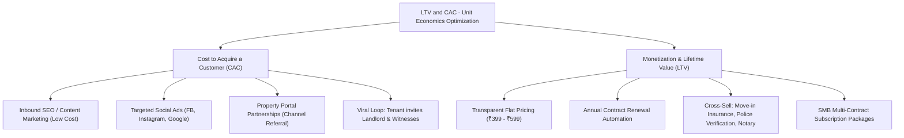

### Key SaaS & Platform Metrics
- **CAC Target**: ₹120 – ₹180 per paying transaction (leveraged heavily by viral loops where 1 initiator brings 2–3 other signatories onto the platform).
- **Average Revenue Per Transaction (ARPT)**: ₹450 gross margin.
- **Gross Margin**: (Revenue - COGS) / Revenue ≥ 65%.
- **Net Promoter Score (NPS) Goal**: > 60 through frictionless 10-minute completion.

## 4.4 3-Year Growth & Revenue Projections

| Projection Metric | Year 1 (2020–2021) | Year 2 (2021–2022) | Year 3 (2022–2023) |
|---|---|---|---|
| **Target Cities** | Bangalore, Hyderabad | Delhi NCR, Mumbai, Chennai | Kolkata, Pune, Tier-2 Cities |
| **Active Users** | 0 – 10,000 | 10,000 – 100,000 | 100,000 – 1,000,000 |
| **Annual Revenue** | ₹10 Lakhs (0.01 Cr) | ₹50 Lakhs (0.5 Cr) | ₹1.0 – ₹2.5 Crore |
| **Product Phase** | MVP1 Public Beta & GA | MVP2 Smart Contracts & API | Scale & B2B White-Labeling |

# 5. Product Scope: MVP1 vs MVP2 Feature Matrix & User Stories

## 5.1 Comprehensive Release Scope Classification

The GoLegal platform is phased into structured releases balancing time-to-market with functional depth:

### 1. User Pages Scope Breakdown
- **Home / Landing Page** (*MVP1*): Core brand positioning, What/Why/How explanation, video walkthrough, trust badges, top navigation, and prominent CTAs.
- **User Authentication & Security Pages** (*MVP1*):
  - Multi-method login: Mobile Phone OTP (first-time forced password change), Email/Password, and Google/Facebook OAuth.
  - New User Registration: Welcome message, email/mobile setup for agreement dispatch, password definition. Registration is mandatory for initiating party and optional for invited signers.
  - **Suspicious Ingress & Account Hack Alert System**: Automated real-time email warning dispatched whenever a login occurs from an unverified device, unrecognized browser, or anomalous IP address.
  - User Administration: Profile photo management, password change facility, and setup of security questions.
- **Document Management Interface** (*MVP1*):
  - View, rename, download PDF, print, email to counterparties, and share directly via WhatsApp.
  - Soft Delete / Archive: Initiating user can soft delete from their workspace while keeping the document safely accessible to other counterparties.
  - Multi-attribute sorting: Sort contracts by Date, Counterparty Name, or Agreement Type (*MVP1*).
  - Advanced full-text contract search (*MVP2*).
- **About Us & Company Pages** (*MVP1*): Company background, leadership team (IIMB alumni), vision, core values, and contact channels.

### 2. Primary Workflow Pages
- **Metadata Ingestion Wizard** (*MVP1*): Structured input capturing First Party (Owner), Second Party (Tenant), Witnesses, Property Details, and Commercial Terms.
- **Clause Template Editor** (*MVP1*): Pre-configured standard clauses with interactive toggles and customization; save customized version as final contract text.
- **Preview Engine** (*MVP1*): Watermarked live preview combining sample state e-Stamp header, populated metadata, and customized legal text.
- **Single-Step Signature Page** (*MVP1*): Combined KYC verification and Aadhaar eSign interface for initiating party.
- **Payment & Invoicing Gateway** (*MVP1*): Multi-mode checkout (UPI, Cards, NetBanking); automated generation of GST-compliant PDF invoice delivered via email and permanently archived in `MyInvoices`.
- **Final Agreement Rendering Engine** (*MVP1*): Automated procurement of official StockHolding e-Stamp paper, document assembly, multi-party Aadhaar e-Sign stamping, and application of GoLegal Corporate Digital Signature Seal.
- **Customer Feedback & NPS Capture** (*MVP1*): 10-point Net Promoter Score rating with root-cause diagnostic feedback.

### 3. Alternate Workflows & Extended Services
- **OCR Digitization of Existing Contracts** (*MVP1*): Upload existing paper/PDF contract -> OCR extraction of terms and metadata -> Conversion into reusable digital template.
- **Vernacular Language Support**: Multi-lingual clause validation (*MVP1*); full native Kannada, Hindi, Tamil, and Telugu drafting templates (*MVP2*).
- **Generic Contracts & Custom Templates** (*MVP1*): Remote execution of user-provided custom agreements (available with or without e-Stamp duty).
- **Non-Disclosure Agreement (NDA) Engine** (*MVP1*): Standard bilateral and unilateral business NDA templates.
- **Manual Contract Physical Delivery** (*MVP2*): Print stamped contract on physical paper, legal notary attestation, and courier dispatch with real-time tracking page.
- **Platform B2B APIs** (*MVP2*): Expose GoLegal e-Sign and e-Stamp capabilities as an embeddable API for prop-tech portals and enterprise systems.
- **SME Contract Management Portal** (*MVP3*): Comprehensive multi-user dashboard for small and medium enterprises.
- **Institutional Contact & Support Pages** (*MVP1*): Contact Us (Office address, phone, email, WhatsApp), customer feedback portal, and bot-enabled customer support assistant.
- **Legal Policy & Compliance Center** (*MVP1*): Privacy Policy, Terms & Conditions, Refund & Cancellation Policy, Statutory Disclaimer, Intellectual Property Statement, and Data Security & Encryption Standards (AES-256 at rest, 256-bit SSL in transit).
- **Dynamic FAQ Hub** (*MVP1*): Frequently asked questions on legal validity, stamping rules, and co-tenant signing procedures.

### 4. Administration & Platform Operations Pages
- **Manage Users** (*MVP1*): Administrative user listing, verification status, activity history, and account disablement.
- **Manage Templates** (*MVP1*): Dynamic clause library editor, state-specific template configuration, and legal approval status.
- **Manage StockHolding Prepaid Balance** (*MVP1*): Real-time balance monitor, automated low-balance threshold alerts, top-up tracking, and reconciliation ledger.
- **Sales Transaction Dashboard** (*MVP1*): Daily, hourly, and regional gross merchandise value (GMV), platform fee collections, and gateway reconciliations.
- **Consolidated User Feedback Portal** (*MVP1*): Centralized review of user feedback and NPS ratings; interactive reply mechanism (*MVP2*).
- **Consolidated Contact-Us Inquiries** (*MVP1*): Lead and support inquiry tracker; automated ticket resolution engine (*MVP2*).
- **User Role Management (RBAC)** (*MVP2*): Granular administrative role assignments and permission controls.

## 5.2 User Stories & Acceptance Criteria

| ID | User Story | Priority | Detailed Acceptance Criteria |
|---|---|---|---|
| **US-01** | *As an unauthenticated visitor, I want to view template previews and legal requirements without logging in, so that I can evaluate the service without friction.* | High (MVP1) | - Publicly accessible landing page and template catalogue.<br>- Interactive calculator displaying estimated stamp duty and platform fees.<br>- Authentication required only upon saving or proceeding to payment. |
| **US-02** | *As a user, I want to sign up/sign in via Google, Facebook, or Mobile OTP, so that I can securely manage my contracts.* | High (MVP1) | - One-click social auth via OAuth 2.0.<br>- Mobile OTP via SMS gateway with 60-second retry timer.<br>- Profile creation capturing Name, Email, Mobile, and State.<br>- Trigger suspicious login alert email if device/IP changes. |
| **US-03** | *As an Initiator (Landlord or Tenant), I want to input party, property, and rent details in a structured form, so that the contract is generated without manual drafting errors.* | High (MVP1) | - Form validation for PAN format, PIN code, and email.<br>- Dynamic addition of multiple tenants or owners (`1..n`).<br>- Dynamic rent, deposit, and maintenance breakdown.<br>- Auto-prefill functionality for returning customers. |
| **US-04** | *As an Initiator, I want to customize specific terms (e.g. pet policy, notice period, rent escalation %), so that the agreement reflects our exact mutual agreement.* | High (MVP1) | - Standard non-editable legal header/boilerplate.<br>- Editable terms section with live draft preview.<br>- Reset-to-default clause capability.<br>- Anonymized draft saving for NLP analytics in backend data lake. |
| **US-05** | *As an Initiator, I want to pay the platform fee and stamp duty online via UPI/Card, so that the e-stamp can be procured immediately.* | High (MVP1) | - Integrated checkout supporting UPI, Credit/Debit, NetBanking.<br>- Instant generation of GST invoice signed with GoLegal DS.<br>- Invoice sent via email and permanently available under `MyInvoices`.<br>- Webhook handling for asynchronous payment confirmation. |
| **US-06** | *As a Signatory (Owner, Tenant, or Witness), I want to receive a secure link to review and sign the agreement using Aadhaar OTP, so that I don't have to print or scan anything.* | High (MVP1) | - Tokenized single-use link delivered via SMS, WhatsApp, and Email.<br>- Mobile-optimized PDF review viewer.<br>- Choice between Full Document Review & Sign or Direct e-Sign.<br>- Aadhaar OTP modal with eSign consent and virtual signature placement. |
| **US-07** | *As any party to an executed contract, I want to download the final tamper-proof signed PDF with audit trail, so that I have valid legal proof.* | High (MVP1) | - Merged PDF containing official SHCIL e-Stamp certificate on Page 1.<br>- All digital signatures stamped with timestamp and Certifying Authority metadata.<br>- Cryptographic seal applied to prevent subsequent alterations.<br>- Continuous pagination (`Page X of Y`). |
| **US-08** | *As an Administrator, I want to monitor the Stockholding prepaid account balance, so that customer transactions never fail due to depleted stamping funds.* | High (MVP1) | - Real-time prepaid balance indicator on Admin dashboard.<br>- Automated threshold warning when balance drops below ₹10,000.<br>- Transaction-level audit ledger linking agreement IDs with SHCIL debit records. |

# 6. End-to-End User Workflows & Step-by-Step Journeys

## 6.1 Primary High-Level 5-Step Execution Journey
The platform follows an intuitive 5-step lifecycle:

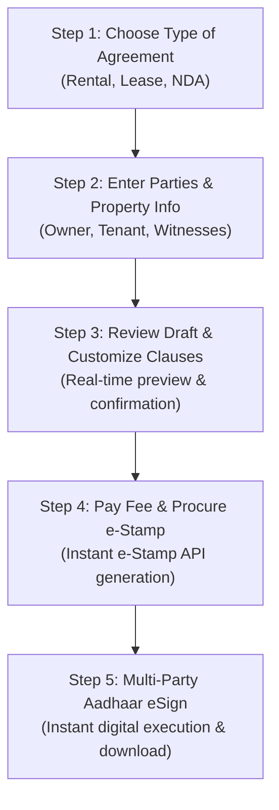

---

## 6.2 Rental Workflow Complete Lifecycle

The following end-to-end flowchart depicts the full operational lifecycle of a rental agreement transaction—from initial metadata input and template customization through Stockholding e-Stamp integration, asynchronous multi-party signing, final cryptographic sealing, invoice archiving, and NPS feedback:

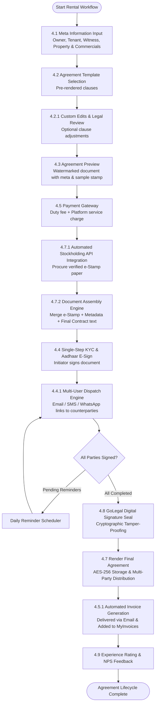

---

## 6.3 Detailed Initiator Workflows

### Flow A: Owner / Landlord is the Initiator
1. **Landing & Authentication**: Landlord logs in or continues as guest; selects "Create Rental Agreement".
2. **Select Jurisdiction & State**: Chooses state (e.g. Karnataka, Delhi, Maharashtra) determining applicable stamp duty rules.
3. **Form Metadata Entry**:
   - Owner Info: Full name, father's/spouse's name, permanent address, contact number, email, Aadhaar/PAN.
   - Tenant Info: Full name, father's name, contact number, email, permanent address.
   - Property Details: Complete rental address, flat/house number, inclusions (fixtures, parking).
   - Commercial Terms: Monthly rent, security deposit amount, lease duration (11 months), lock-in period, rent commencement date, notice period, annual escalation percentage (e.g. 5% or 10%).
   - Witness Details: Names, phone numbers, and emails of 2 witnesses.
4. **Clause Review & Customization**: Inspects preview; adds custom covenants (e.g., painting charges, pet policy).
5. **Checkout & Payment**: Pays platform and stamp duty fee.
6. **Initiator Aadhaar e-Sign**: Owner signs first via Aadhaar OTP.
7. **Automated Notification Dispatch**: System sends unique signing links via SMS, WhatsApp, and Email to the Tenant and both Witnesses.
8. **Asynchronous Signing Queue**: Parties sign independently at their convenience within a configurable expiration window (e.g., 7 days).
9. **Final Assembly & Sealed Document**: When all required signatures are captured, GoLegal applies its corporate Digital Signature (DSC), locks the PDF, and notifies all parties for instant download.

### Flow B: Tenant is the Initiator
- Follows an identical sequence, except the Tenant fills in their own details as the Second Party, specifies the Landlord's details as the First Party, pays the fee, and signs. The Landlord receives the review-and-sign request with full editing verification.

---

## 6.4 State-Specific Statutory Execution (Karnataka Example)

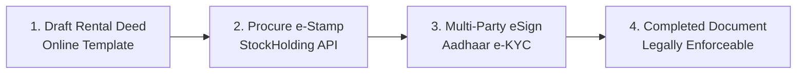

---

## 6.5 Asynchronous Multi-Party Signature & Stamping Sequence

Executing multi-party legal agreements in consumer environments requires handling asynchronous timelines. Counterparties are not co-located and may review or execute signatures hours or days apart. The sequence diagram below details the technical message flows between actors, the GoLegal Core Engine, the Stockholding API, and UIDAI / ESP services:

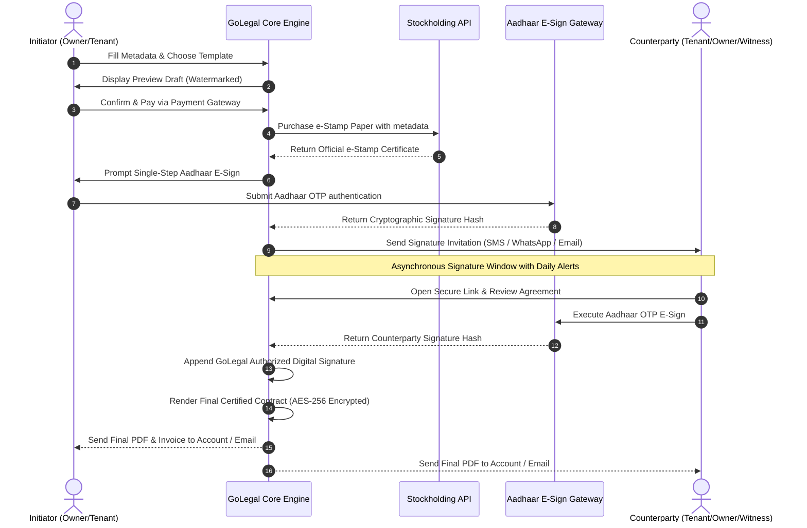

---

## 6.6 Asynchronous Signature Orchestration Logic

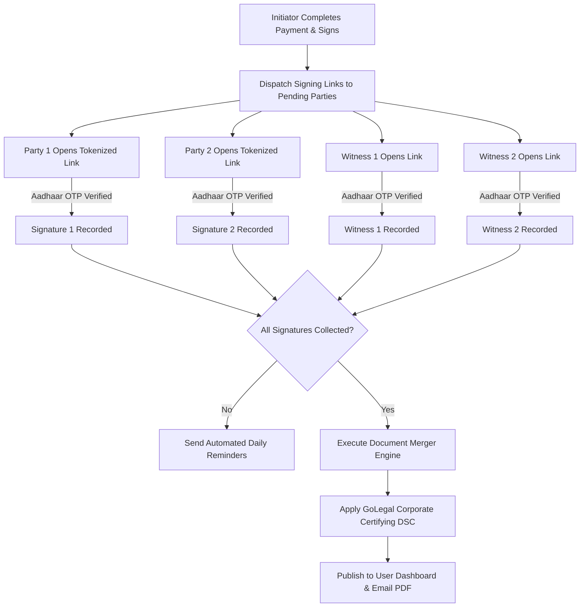

---

## 6.7 Detailed Metadata Specifications

### 1. Owner Information (`1..n`)
- **Personal Attributes**: Full Legal Name, Age / Date of Birth, Father's / Spouse's Name, Permanent Residential Address, PAN Card Number, Masked Aadhaar Number, Mobile Phone Number, Email Address.
- **Property Details**: Premises Name, Complete Postal Address, Property Category (Apartment, Independent Villa, Floor), Total Rooms, Bathrooms, Dedicated Parking Slots, Inventory of Electrical Fittings & Fixtures, Count of Physical Keys Handed Over.
- **Agreement Parameters**: Lease Start Date, Lease End Date (system auto-computes Start Date + 11 months for residential standard deeds), Agreement Category, Stamp Duty State/Region, Applicable Stamp Duty Consideration.
- **Commercial & Financial Terms**: Monthly Rental Amount, Refundable Security Deposit, Monthly Rent Due Date (e.g. 5th of each calendar month), Lock-in Period (months), Annual Escalation Rate (default 5% or 10%), Rent Payment Mode (UPI, Bank NEFT/IMPS).
- **Evidentiary Cloud Storage Consent**: Mandatory user authorization allowing GoLegal to archive the encrypted digital agreement for future cloud access.

### 2. Tenant Information (`1..n`)
- **Personal Attributes**: Full Legal Name, Age / Date of Birth, Father's Name, Current Residential Address, Permanent Home Address, Workplace / Office Address, Employer / Corporate Name, PAN Number, Masked Aadhaar Number, Mobile Number, Email Address.
- **Multi-Tenant Support**: Supports co-tenants and flatmates sharing lease liabilities with independent identity validation.

### 3. Witness Information (`1..2`)
- **Attributes**: Full Legal Name, Masked Aadhaar Number, Email, Mobile Phone Number.
- **Optional Witness Service**: GoLegal provides an optional, chargeable institutional witness facility for users without immediate co-located witnesses.

---

## 6.8 Agreement Drafting, Preview & Asynchronous Signing Logic

### 1. Pre-Configured Clause Library & Editor
- **Standard Clause Sets**:
  - General Covenants and Tenancy Rights
  - Rent, Security Deposit, and Utility Payment Terms
  - Property Maintenance, Fixtures, and Painting Liabilities
  - Breach, Forfeiture, and Penalty Provisions
  - Advance Repayment, Termination Notice Period, and Handover Protocol
  - Lease Extension, Annual Rent Escalation, and Renewal Mechanics
- **Save Edited Version & NLP Analytics**:
  - Custom modifications are temporarily persisted against the active draft transaction.
  - Anonymized clause modifications are ingested into GoLegal's backend data lake for NLP analytics to identify frequently customized clauses and improve default template offerings.

### 2. Preview Engine
- Dynamically renders a complete draft incorporating:
  - Sample state-specific e-Stamp banner
  - Merged party, property, and financial metadata
  - Configured legal clauses and user custom covenants
  - Distinct draft watermarking (*"UNEXECUTED DRAFT - FOR PREVIEW ONLY"*)
  - Export capabilities: Download Draft PDF, Print, Share via Email and WhatsApp.

### 3. Asynchronous Multi-Party Signature Orchestration
- **Single-Step KYC & Aadhaar eSign**: Initiator completes identity review and triggers UIDAI Aadhaar eSign via an instant OTP modal.
- **Non-Atomic Signing Lifecycle**: Counterparties (tenants, co-owners, witnesses) can sign independently in any sequence within a configurable window (default 7 days).
- **Flexible Counterparty Experience**: Counterparties can choose between **Full Review & Sign** (reviewing clause by clause) or **Direct eSign** (instant jump to Aadhaar authentication).
- **Automated Reminder Cron**: Configurable automated reminders dispatched daily via SMS, WhatsApp, and Email to pending signatories.
- **Initiator Progress Summaries**: Daily transaction status digest emailed to the initiator detailing who has signed and who is pending.

---

## 6.9 Document Assembly, Stamping & Evidentiary Storage Policies

### 1. Automated StockHolding e-Stamp Integration
- Direct backend API invocation to purchase official state e-Stamp certificates.
- Automated pre-validation of GoLegal's corporate prepaid balance with Stockholding before initiating duty transactions.
- Exact capture of First Party, Second Party, Stamp Duty Consideration, and Stamp Article.
- Real-time internal ledger recording for financial reconciliation and regulatory audit.

### 2. Section 65B Tamper-Proof Signature Table
The final rendered agreement incorporates a tamper-proof signature summary table on the execution page:

| Name | Signature Date (IST) | Signature Verification Hash | Status |
| :--- | :--- | :--- | :--- |
| **First Party (Owner)** | *System Timestamp* | Aadhaar e-Sign PKCS#7 Hash | Certified Completed |
| **Second Party (Tenant)** | *System Timestamp* | Aadhaar e-Sign PKCS#7 Hash | Certified Completed |
| **Witness 1 & 2** | *System Timestamp* | Aadhaar e-Sign PKCS#7 Hash | Certified Completed |
| **GoLegal DS** | *System Timestamp* | Authorized Digital Signature (X.509 GoLegal DSC) | Tamper-Proof Sealed |

### 3. Document Access & Storage Permissions
- **Parties Access**: The fully executed agreement is accessible to all verified First Party (Owner) and Second Party (Tenant) accounts.
- **Invoice Segregation**: Tax invoices are restricted strictly to the paying initiator and archived under their personal `MyInvoices` profile.
- **Witness Privacy Policy**: Witness accounts do **not** retain ongoing document archive access after their signature is affixed.
- **Retention Governance**: Agreements with explicit cloud storage consent are archived indefinitely with AES-256 encryption. Agreements without consent follow a configurable time-limited retention window (e.g. 4 weeks) before permanent purging.

### 4. Net Promoter Score (NPS) Experience Scale
Upon workflow completion, users are presented with an intuitive 10-point NPS rating modal:
- **`0 - 8` (Detractor / Not Happy)**: Automatically triggers an empathetic root-cause diagnostic prompt (*"What could we have improved?"*).
- **`9` (Happy)**: Captures positive sentiment.
- **`10` (Delighted)**: Prompts user to share a Google/Social review or refer a friend.

---

## 6.10 Multi-Tenant & Co-Living FAQs

### Q1: How do flatmates sharing the same property execute rental agreements at different times?
The platform employs a non-atomic multi-party execution engine. Each co-tenant receives an independent, tokenized signing link. Co-tenants can review and e-sign asynchronously from their personal devices over several days without invalidating the contract terms or requiring other flatmates to wait in person.

### Q2: How does a multi-tenant, single-owner contract structure operate?
GoLegal dynamically maps `1..n` tenants against `1..n` property owners within a single unified contract document. The system tracks each party's individual identity validation, maintains a live signature progress tracker, and seals the final document only when all designated co-tenants and owners have executed their Aadhaar e-Sign.

# 7. Screen-by-Screen UI/UX Specifications, User Pages & Admin Wireframes

## 7.1 Global Design System & UX Standards
- **Typography**: Clean sans-serif (Inter or Roboto) with high contrast for legal legibility.
- **Color Palette**: Trust-inducing deep blues (`#1E3A8A`), clean white backgrounds, slate gray text (`#334155`), and success emerald greens (`#059669`).
- **Responsive Breakpoints**: Mobile (320px–640px), Tablet (641px–1024px), Desktop (1025px+).
- **Navigation**: Clean sticky header with Logo, Templates dropdown, Pricing, Security/Trust center, and Login/Sign Up CTAs.

---

## 7.2 Core User Facing Screens

### Screen 1: Landing Page & Hero Section
- **Brand Messaging**: Answers *What we do*, *Why we do*, and *How we do*:
  - *What we do*: Execute legally valid agreements online in 10 minutes without middlemen.
  - *Why we do*: Eliminate 14-day delays, save 50%+ on execution fees, and guarantee legal enforceability.
  - *How we do*: Integrated UIDAI Aadhaar eSign and StockHolding Government e-Stamping under IT Act 2000.
- **Visuals**: Embedded product explainer video highlighting speed, convenience, and security.
- **Navigation**: Top navbar with Login, Register, Template Catalogue, Pricing, About Us, and Contact Us.
- **Hero CTAs**: `[Create Agreement Now]` (Primary Blue), `[View Sample Agreement]` (Ghost button).
- **Trust Badges**: UIDAI Compliant, IT Act 2000 Approved, StockHolding e-Stamp Partner, 256-Bit SSL Encrypted.

### Screen 2: Authentication, Registration & Security Alert
- **Authentication Options**:
  - `[Continue with Mobile OTP]`: 10-digit mobile number -> 6-digit OTP. Forced password definition on first-time login.
  - `[Continue with Google]` / `[Continue with Facebook]`: One-click social auth.
  - `[Email & Password]`: With self-service "Forgot Password?" OTP reset flow.
- **Suspicious Ingress Alert**: Automated email notification triggered whenever an account login originates from an unrecognized browser, new device fingerprint, or novel IP location.

### Screen 3: User Profile & Administration (`/profile`)
- Profile photo upload and management.
- Password change and security questions setup.
- Contact preferences (SMS, Email, WhatsApp notifications).

### Screen 4: Template & Jurisdiction Selection
- State selector with automated statutory stamp duty fee calculation (e.g., Karnataka ₹100, Maharashtra Leave & License).
- Agreement category tabs: Residential Tenancy, Commercial Lease, Business NDA, Custom Contract.

### Screen 5: Multi-Step Metadata Wizard
- **Step 1: First Party (Owner / Landlord)**: Name, Age, Father's Name, Address, PAN, Aadhaar, Phone, Email.
- **Step 2: Second Party (Tenant / Co-Tenants)**: Identical fields with `[+ Add Co-Tenant]` capability.
- **Step 3: Property & Commercial Terms**: Property address, inclusions/fixtures checklist, rent amount, security deposit, due date, lock-in period, escalation %.
- **Step 4: Witnesses (1 or 2)**: Name, Aadhaar, Phone, Email; or option to select GoLegal Institutional Witness service.

### Screen 6: Split-Pane Clause Editor & Live Synchronized Preview
- **Left Pane**: Clause toggles (Pets allowed, painting charges, lock-in waivers) and custom covenants text area.
- **Right Pane**: Synchronized PDF preview with dynamic field highlighting and draft watermark.

### Screen 7: Checkout & Payment Gateway
- Breakdown of State Stamp Duty, Platform Fee, and GST.
- Multi-payment support: UPI QR/VPA, Credit/Debit Cards, NetBanking.
- Instant automated generation of cryptographically signed GST invoice.

### Screen 8: Aadhaar eSign Modal & Verification
- UIDAI mandatory consent disclaimer in English and Hindi.
- 12-digit Aadhaar / 16-digit VID entry.
- 6-digit OTP verification with instant visual placement of digital signature certificate block.

### Screen 9: User Dashboard & Contract Management (`/dashboard`)
- **Status Sections**: Drafts, Pending Signatures (with party-level status and `[Resend Notification]` triggers), Completed Agreements.
- **Operations**: Rename, Download Sealed PDF, Print, Share via WhatsApp/Email, Soft Delete (preserves counterparty access).
- **Sort Controls**: Sort by Date, Counterparty Name, Agreement Type.
- **MyInvoices Repository**: Downloadable archive of all platform execution receipts.

---

## 7.3 Administration & Operations Screens

### Admin Screen 1: User Administration (`/admin/users`)
- Master listing of registered users with search, filter, and verification badges.
- View user-initiated contracts, verification logs, and account status controls (Activate / Suspend).

### Admin Screen 2: Template & Clause Management (`/admin/templates`)
- Rich text clause editor with placeholder tokens (`{{owner_name}}`, `{{rent_amount}}`).
- State-specific regulatory rule assignment and version history tracking.

### Admin Screen 3: StockHolding Prepaid Balance & Ledger (`/admin/stamping`)
- Live prepaid cash balance with StockHolding Corporation of India (Manage Stockholding Pre-paid balance).
- Visual alerts when balance drops below critical threshold (e.g. < ₹10,000).
- Detailed debit ledger recording every purchased e-Stamp certificate number, transaction date, and associated agreement ID.

### Admin Screen 4: Sales Transaction Dashboard (`/admin/sales`)
- Real-time revenue metrics, daily/hourly transaction velocity, stamp-size distribution, and payment gateway settlement status.

### Admin Screen 5: Feedback & Inquiries Console (`/admin/feedback`)
- Aggregated NPS ratings, detractor root-cause categorization, and customer contact inquiries with resolution status.

# 8. System Architecture, 5-Layer Model & Tiered Network Security Topology

## 8.1 5-Layer Architectural Model

The GoLegal system architecture is organized into five decoupled, highly scalable layers designed to process high transaction volumes while maintaining strict capability-based security:

```mermaid
graph TD
    classDef pres fill:#D4E6F1,stroke:#2980B9,stroke-width:1px;
    classDef srv fill:#D5F5E3,stroke:#27AE60,stroke-width:1px;
    classDef sec fill:#FCF3CF,stroke:#F39C12,stroke-width:1px;
    classDef biz fill:#E8DAEF,stroke:#8E44AD,stroke-width:1px;
    classDef data fill:#FADBD8,stroke:#C0392B,stroke-width:1px;

    subgraph Presentation_Layer ["Presentation Layer"]
        UI["Web UI Components"]:::pres
        DocRender["Document Rendering & Display"]:::pres
        WorkflowUI["Workflow UI & Certified Files Interface"]:::pres
    end

    subgraph Services_Layer ["Services Layer"]
        APIGateway["REST API Gateway"]:::srv
        WebServers["Web Servers (Browser / API Handlers)"]:::srv
        EmailServers["Email Servers (Inbound / Outbound)"]:::srv
        SecFilter["Security Filtering & Firewall Rules"]:::srv
    end

    subgraph Security_Layer ["Security Layer (Capability-Based)"]
        AccessControl["Access Control & Operations Policy"]:::sec
        AuthAudit["Authentication & Resource Auditing"]:::sec
        ResManager["Resource Gate (Docs, User Info, Metadata, APIs)"]:::sec
    end

    subgraph Business_Layer ["Business Layer"]
        WorkflowEng["Workflow Engine (Declarative XML-based)"]:::biz
        ComplianceEng["Compliance Engine"]:::biz
        EventMgmt["Event Management & Audit Trail"]:::biz
        AsyncMsgSys["Asynchronous Messaging Distribution"]:::biz
        FileMgmt["File Access & Manipulation Engine"]:::biz
        LoggingEng["Logging & Monitoring Functions"]:::biz
    end

    subgraph Data_Layer ["Data Layer (Distributed Redundant Database Clusters)"]
        TxDB[("Transactional Database Access")]:::data
        MsgDB[("Asynchronous Messaging System DB")]:::data
        DocStore[("Document Store (Original, Intermediate, Signed)")]:::data
    end

    Presentation_Layer --> Services_Layer
    Services_Layer --> Security_Layer
    Security_Layer --> Business_Layer
    Business_Layer --> Data_Layer
```

---

## 8.2 4-Tier Enterprise Layered Architecture Overview

The following diagram illustrates the relationship between the application layers and external third-party trust services:

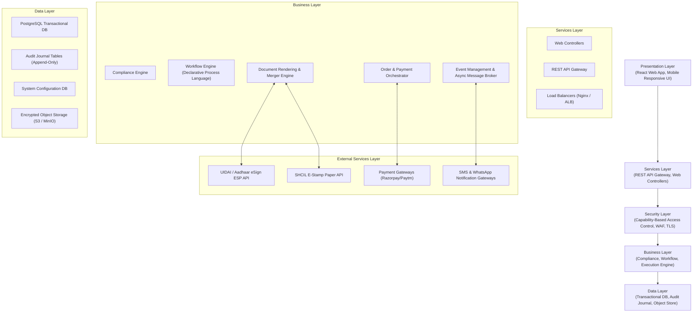

---

## 8.3 In-Depth Architectural Layer Specifications

### 1. Presentation Layer
- **Web UI Components**: Modern Single Page Application (SPA) responsive across desktop, tablet, and mobile browsers.
- **Document Rendering & Display**: Real-time canvas and PDF rendering engine for clause editing, draft previews, and digital signature placement.
- **Workflow UI & Certified Files Interface**: Secure interactive interface for executing signatures, tracking counterparties, and downloading cryptographically certified PDF documents.

### 2. Services Layer
- **REST API Gateway**: Central entry point terminating TLS 1.3, enforcing rate limits, request schema validation, and routing to application services.
- **Web Servers**: High-throughput web server cluster handling dynamic HTTP/REST traffic and distributing requests to the business layer via load balancers.
- **Email & Notification Servers**: Dedicated messaging tier managing high-priority transactional emails, SMS alerts, and WhatsApp execution links.
- **Security Filtering & Firewall Rules**: Edge web application firewall (WAF) filtering malicious traffic, cross-site scripting attempts, and malformed requests.

### 3. Security Layer (Capability-Based Access Control)
- **Access Control & Operations Policy**: Capability-based security model evaluating tokenized privileges on a per-document and per-operation basis rather than generic static roles.
- **Authentication & Resource Auditing**: Real-time evaluation of user credentials, multi-factor OTP validation, and security event logging.
- **Resource Gate**: Strict capability boundary protecting contracts, party identities, metadata, and backend APIs against Horizontal Privilege Escalation (IDOR).

### 4. Business Layer
- **Workflow Engine (Declarative XML-Based)**: Governs agreement lifecycles using declarative definitions that articulate state preconditions, signing sequences, and approval transitions.
- **Compliance Engine**: Validates state-specific stamp duty requirements, mandatory statutory covenants, and legal rules under the Indian Stamp Act and IT Act 2000.
- **Event Management & Audit Trail**: Asynchronous event bus recording immutable audit entries for every transaction milestone, user action, and gateway webhook.
- **Asynchronous Messaging Distribution**: Message broker decoupling heavy document generation and third-party API dispatches from user-facing HTTP requests.
- **File Access & Manipulation Engine**: Headless PDF processing engine that merges SHCIL e-Stamp certificates, dynamic legal clauses, and PKCS#7 digital signature containers.
- **Logging & Monitoring Functions**: Centralized telemetry tracking transaction health, error budgets, and performance metrics.

### 5. Data Layer (Distributed Redundant Database Clusters)
- **Transactional Database Access**: Primary relational database cluster storing user profiles, agreement states, party records, and financial payments.
- **Asynchronous Messaging System DB**: Dedicated persistence layer for message broker queues, retry queues, and scheduled reminder jobs.
- **Encrypted Document Store**: Multi-region, AES-256 encrypted object storage preserving original customer inputs, intermediate unsigned drafts, and final certified contracts.
- **High Availability**: All database clusters operate in multi-zone configurations with automated failover, read replicas, and continuous point-in-time recovery.

---

## 8.4 Tiered Network Perimeter & DMZ Security Topology

To ensure strict network isolation, zero lateral movement, and data sovereignty, the infrastructure is segmented into multi-tier security zones:

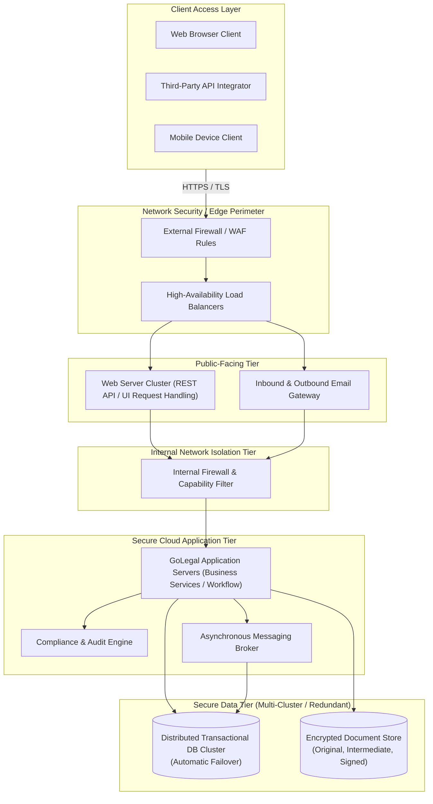

---

## 8.5 Cloud Instance VPC & Network Infrastructure Deployment

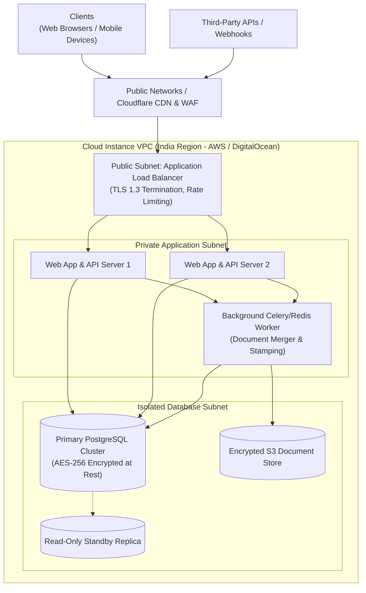

---

## 8.6 Multi-Party Distributed Execution Topology

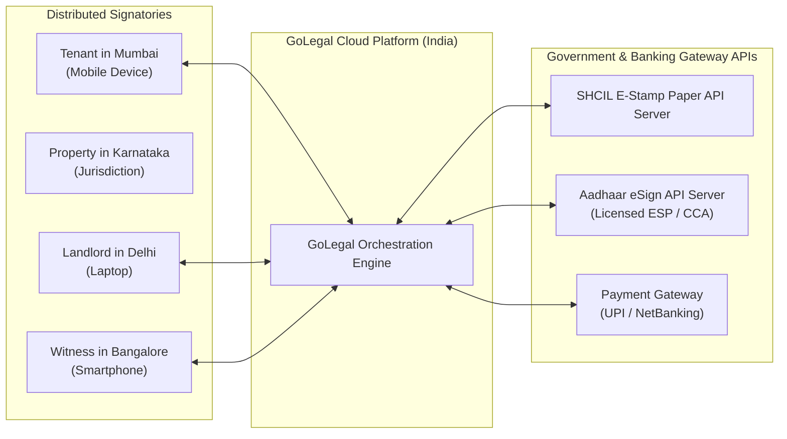

---

## 8.7 Operations Monitoring & System Health Dashboard
Each architectural tier is continuously monitored by automated observability systems:
- **Real-Time Key Indicators**: CPU, memory, database connection pool utilization, Redis queue depth, and external API response latencies (SHCIL, UIDAI, Payment Gateways).
- **Operations Dashboard**: Dedicated console allowing site reliability engineers (SREs) to monitor overall system health, transaction throughput, and error rates.
- **Automated Alerts**: Real-time PagerDuty/Slack notifications triggered when key operational indicators exceed defined SLA thresholds (e.g., API latency > 3s, error rate > 0.5%, prepaid stamping balance < ₹10,000).

# 9. Database Schema, Configuration Tables & Data Models

## 9.1 Core Entity Relational Design (ER Diagram)

The relational schema strictly observes third normal form (3NF) while leveraging PostgreSQL JSONB for flexible legal covenants and audit payloads:

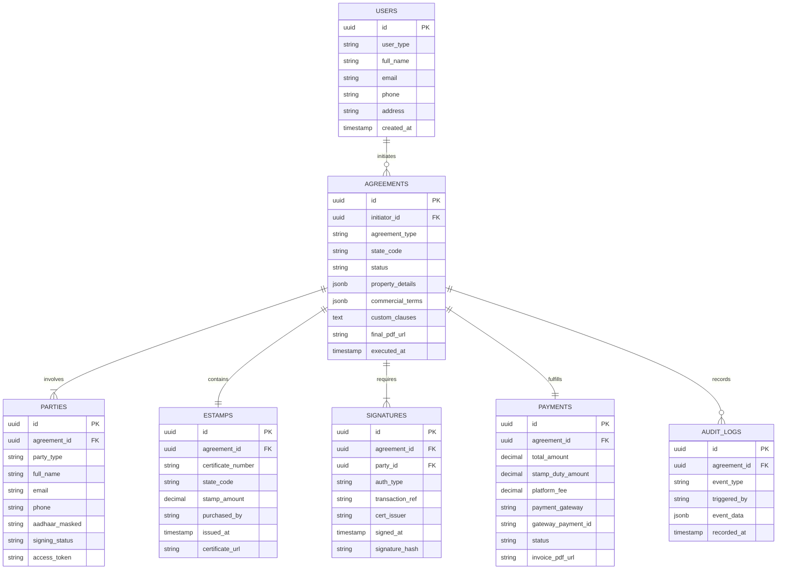

---

## 9.2 Relational Data Definition Language (PostgreSQL DDL)

```sql
-- 1. Users Master Table
CREATE TABLE users (
    id UUID PRIMARY KEY DEFAULT gen_random_uuid(),
    user_type VARCHAR(20) NOT NULL CHECK (user_type IN ('Single_User', 'Multi_User', 'Hybrid_User', 'Admin')),
    full_name VARCHAR(255) NOT NULL,
    email VARCHAR(255) UNIQUE NOT NULL,
    phone VARCHAR(20) NOT NULL,
    address TEXT,
    created_at TIMESTAMP WITH TIME ZONE DEFAULT CURRENT_TIMESTAMP,
    updated_at TIMESTAMP WITH TIME ZONE DEFAULT CURRENT_TIMESTAMP
);

-- 2. Agreements Master Table
CREATE TABLE agreements (
    id UUID PRIMARY KEY DEFAULT gen_random_uuid(),
    initiator_id UUID NOT NULL REFERENCES users(id) ON DELETE CASCADE,
    agreement_type VARCHAR(50) NOT NULL CHECK (agreement_type IN ('Rental_Residential', 'Rental_Commercial', 'NDA', 'Lease', 'Custom')),
    state_code VARCHAR(10) NOT NULL,
    status VARCHAR(30) NOT NULL DEFAULT 'Draft' CHECK (status IN ('Draft', 'Paid', 'Pending_Signatures', 'Completed', 'Cancelled', 'Expired')),
    property_details JSONB NOT NULL,
    commercial_terms JSONB NOT NULL,
    custom_clauses TEXT,
    final_pdf_url TEXT,
    cloud_storage_consent BOOLEAN NOT NULL DEFAULT TRUE,
    created_at TIMESTAMP WITH TIME ZONE DEFAULT CURRENT_TIMESTAMP,
    executed_at TIMESTAMP WITH TIME ZONE
);
CREATE INDEX idx_agreements_initiator ON agreements(initiator_id);
CREATE INDEX idx_agreements_status ON agreements(status);

-- 3. Parties / Signatories Table
CREATE TABLE parties (
    id UUID PRIMARY KEY DEFAULT gen_random_uuid(),
    agreement_id UUID NOT NULL REFERENCES agreements(id) ON DELETE CASCADE,
    party_type VARCHAR(20) NOT NULL CHECK (party_type IN ('Owner', 'Tenant', 'Witness')),
    full_name VARCHAR(255) NOT NULL,
    email VARCHAR(255) NOT NULL,
    phone VARCHAR(20) NOT NULL,
    aadhaar_masked VARCHAR(12),
    signing_status VARCHAR(20) NOT NULL DEFAULT 'Pending' CHECK (signing_status IN ('Pending', 'Sent', 'Signed', 'Rejected')),
    access_token VARCHAR(255) UNIQUE,
    access_token_expires_at TIMESTAMP WITH TIME ZONE,
    created_at TIMESTAMP WITH TIME ZONE DEFAULT CURRENT_TIMESTAMP
);
CREATE INDEX idx_parties_agreement ON parties(agreement_id);

-- 4. e-Stamps Records Table
CREATE TABLE estamps (
    id UUID PRIMARY KEY DEFAULT gen_random_uuid(),
    agreement_id UUID UNIQUE NOT NULL REFERENCES agreements(id) ON DELETE CASCADE,
    certificate_number VARCHAR(100) UNIQUE NOT NULL,
    state_code VARCHAR(10) NOT NULL,
    stamp_amount DECIMAL(10, 2) NOT NULL,
    purchased_by VARCHAR(255) NOT NULL,
    vendor VARCHAR(50) NOT NULL DEFAULT 'StockHolding',
    issued_at TIMESTAMP WITH TIME ZONE NOT NULL,
    certificate_url TEXT NOT NULL
);

-- 5. Digital Signatures Audit Table
CREATE TABLE signatures (
    id UUID PRIMARY KEY DEFAULT gen_random_uuid(),
    agreement_id UUID NOT NULL REFERENCES agreements(id) ON DELETE CASCADE,
    party_id UUID NOT NULL REFERENCES parties(id) ON DELETE CASCADE,
    auth_type VARCHAR(30) NOT NULL CHECK (auth_type IN ('Aadhaar_OTP', 'Biometric', 'DSC_Hardware', 'Internal_DSC')),
    transaction_ref VARCHAR(255) NOT NULL,
    cert_issuer VARCHAR(255) NOT NULL,
    signature_hash VARCHAR(255) NOT NULL,
    signed_at TIMESTAMP WITH TIME ZONE NOT NULL,
    ip_address VARCHAR(45) NOT NULL,
    user_agent TEXT
);
CREATE INDEX idx_signatures_agreement ON signatures(agreement_id);

-- 6. Payments & Invoices Table
CREATE TABLE payments (
    id UUID PRIMARY KEY DEFAULT gen_random_uuid(),
    agreement_id UUID NOT NULL REFERENCES agreements(id) ON DELETE CASCADE,
    total_amount DECIMAL(10, 2) NOT NULL,
    stamp_duty_amount DECIMAL(10, 2) NOT NULL,
    platform_fee DECIMAL(10, 2) NOT NULL,
    payment_gateway VARCHAR(50) NOT NULL,
    gateway_payment_id VARCHAR(255) UNIQUE NOT NULL,
    status VARCHAR(20) NOT NULL CHECK (status IN ('Pending', 'Success', 'Failed', 'Refunded')),
    invoice_pdf_url TEXT,
    created_at TIMESTAMP WITH TIME ZONE DEFAULT CURRENT_TIMESTAMP
);

-- 7. Section 65B Evidentiary Audit Trail
CREATE TABLE audit_logs (
    id UUID PRIMARY KEY DEFAULT gen_random_uuid(),
    agreement_id UUID NOT NULL REFERENCES agreements(id) ON DELETE CASCADE,
    event_type VARCHAR(100) NOT NULL,
    triggered_by VARCHAR(255) NOT NULL,
    event_data JSONB NOT NULL,
    recorded_at TIMESTAMP WITH TIME ZONE DEFAULT CURRENT_TIMESTAMP
);
CREATE INDEX idx_audit_logs_agreement ON audit_logs(agreement_id);
```

---

## 9.3 System Configuration Tables (`sysconfigTlb`)

Allows runtime platform reconfiguration without software redeployment:

| Column Name | Data Type | Permitted Values / Description |
|---|---|---|
| `Lang` | VARCHAR(10) | Default `en`; extensible to `kn` (Kannada), `hi` (Hindi), `ta` (Tamil). |
| `DigSign` | VARCHAR(50) | `Aadhaar_eSign`, `DocuSign`, `PandaDoc`, `Internal_DSC`. |
| `eStamp` | BOOLEAN | `true` / `false` (Controls whether stamping is mandatory for doc type). |
| `eStampVendor` | VARCHAR(30) | `StockHolding` (SHCIL), `StateTreasury_Direct`, `Mock_Sandbox`. |
| `Currency` | VARCHAR(10) | `INR`, `USD`. |
| `System_Commission` | DECIMAL(5,2) | Platform processing margin percentage. |
| `Discount` | DECIMAL(5,2) | Promotional discount percentage. |
| `Country` | VARCHAR(10) | Default `IND`. |
| `Data_Pruning_Days` | INTEGER | Retention period for uncompleted drafts before purge (e.g. 27 days). |
| `Agreement_Retain_Days`| INTEGER | Evidentiary retention period for completed agreements (e.g. 8 years / 2,920 days). |

### Configuration Audit Journal (`sysconfigTlb$jn`)
Every configuration change is recorded in an append-only journal:
`sysconfigTlb$jn(id, timestamp, operation, updated_by_user, previous_value, new_value)`

---

## 9.4 Dynamic Legal Rule Engine

Validates mandatory statutory terms based on state and contract type:

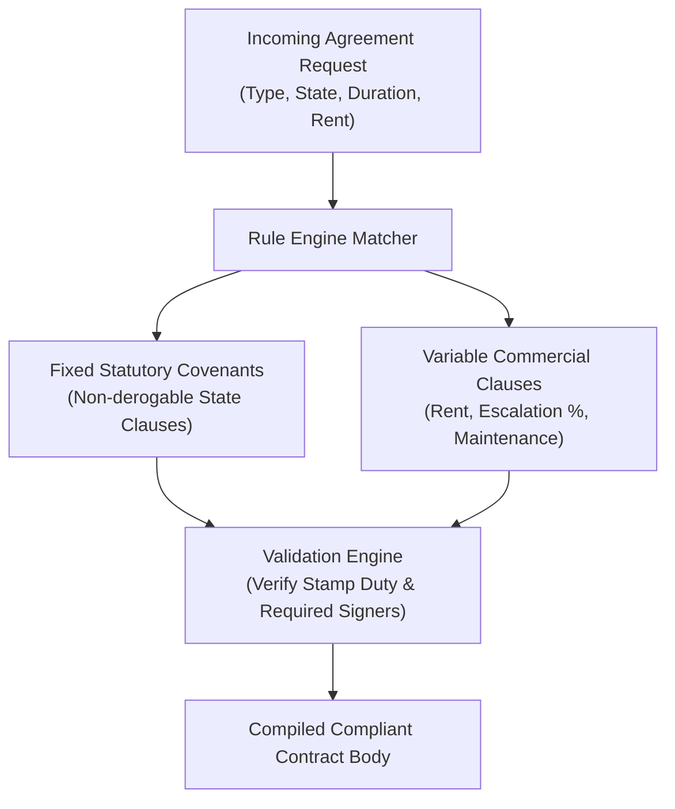

# 10. Third-Party Integrations & Legal / Regulatory Compliance

## 10.1 Indian Legal Framework for Electronic Agreements
GoLegal operates within the statutory boundaries established by Indian legislation:

### 1. Information Technology Act, 2000 (IT Act)
- **Section 4 (Legal Recognition of Electronic Records)**: Mandates that where any law provides that information or matter shall be in writing or typewritten, such requirement is satisfied if rendered or made available in electronic form.
- **Section 5 (Legal Recognition of Electronic Signatures)**: Equates electronic signatures (affixed in accordance with prescribed rules) with handwritten signatures.
- **Section 10A (Validity of Contracts Formed Electronically)**: Explicitly confirms that contracts and agreements concluded in electronic form cannot be denied validity, enforceability, or binding effect solely on the ground of electronic execution.

### 2. Indian Evidence Act, 1872 — Section 65B
- Digital contracts and their execution metadata are admissible in court as primary documentary evidence.
- GoLegal automatically generates a tamper-proof **Certificate under Section 65B**, detailing:
  - System server logs, UTC timestamps, and IP addresses of all signing parties.
  - Verification tokens returned by the licensed Certifying Authority and UIDAI.
  - Cryptographic checksums (SHA-256) of intermediate and final document states.

### 3. Excluded Transactions (Schedule I of IT Act)
Electronic signatures cannot be used for the following categories (which are explicitly out of scope for GoLegal):
1. Negotiable instruments (other than a cheque).
2. Powers of Attorney (PoA).
3. Trust deeds.
4. Wills and testamentary dispositions.
5. Contracts for the sale or conveyance of immovable property or interest in such property (deeds requiring mandatory sub-registrar registration under Section 17 of Registration Act 1908).

> **Note on Rental Agreements**: 11-month rental agreements and Leave & License agreements are not sales of property; they are contractual licenses. They are 100% valid and legally enforceable when executed on appropriate e-Stamp paper with Aadhaar eSign.

---

## 10.2 Technical Integration Specifications

### 1. Aadhaar eSign Integration (via Licensed ESP)
- **Architecture**: GoLegal acts as an Application Service Provider (ASP). It integrates via secure REST APIs with a licensed eSign Service Provider (ESP) empanelled by the Controller of Certifying Authorities (CCA)—such as NSDL e-Gov or eMudhra.
- **Protocol**:
  1. GoLegal calculates the SHA-256 digest of the PDF document.
  2. The document hash (not the full document) is sent to the ESP.
  3. The signer is redirected to the UIDAI eSign interface or completes OTP entry via an authenticated iframe/modal.
  4. Upon successful OTP verification, the Certifying Authority generates a dynamic, short-lived Digital Signature Certificate (DSC) in the name of the user.
  5. The ESP affixes the digital signature to the document container and returns the PKCS#7 signed hash back to GoLegal.

### 2. Stock Holding Corporation of India Ltd (SHCIL) e-Stamp API
- **Workflow**:
  - API call transmits First Party Name, Second Party Name, Consideration Amount (Annual Rent), Stamp Duty Value (e.g., ₹100 or ₹500), and State Code.
  - SHCIL API verifies funds, generates a unique e-Stamp Certificate Number, and returns a high-resolution, secure PDF certificate.
  - GoLegal merges this certificate as the first page of the legal agreement.
- **Prepaid Balance & Automated Ledger Management**:
  - The platform maintains an active prepaid deposit account with StockHolding (Manage Stockholding Pre-paid balance).
  - Before initiating any stamping call, the system pre-validates that available balance exceeds the required duty plus handling fee.
  - When balance breaches the low-threshold limit (< ₹10,000), automated alerts are dispatched to finance administrators to trigger balance replenishment.

### 3. Payment Gateway Integration
- REST API integration with Razorpay / Cashfree.
- Supports Webhooks for asynchronous capture notifications (`payment.authorized`, `payment.captured`, `payment.failed`).
- Automated GST invoicing engine creating a cryptographically sealed PDF receipt archived under user profile `MyInvoices`.

# 11. Security Architecture, Capability-Based Access & OWASP Vulnerability Matrix

## 11.1 Security Principles
- **Defense in Depth**: Multi-layered protection across network, host, application, and data tiers.
- **Capability-Based Access Control (CBAC)**: Granular, cryptographically signed tokens grant access to specific document operations without relying on broad role assumptions.
- **Data Minimization & Zero Hoarding**: Aadhaar numbers are never stored in plain text (only last 4 digits displayed; full numbers discarded immediately after eSign handoff).
- **Encryption Everywhere**: TLS 1.3 for all data in transit; AES-256 encryption at rest for all database tables, identity artifacts, and PDF storage buckets.
- **Suspicious Ingress Monitoring**: Automated detection and email alerts triggered upon logins from unverified devices, novel browsers, or anomalous IP locations.

---

## 11.2 Architecturally Significant Use Case: User Login & Capability Authentication

The sequence diagram below models secure authentication across the 5 architectural layers, illustrating capability rule evaluation, token generation, audit journal logging, and security failure handling:

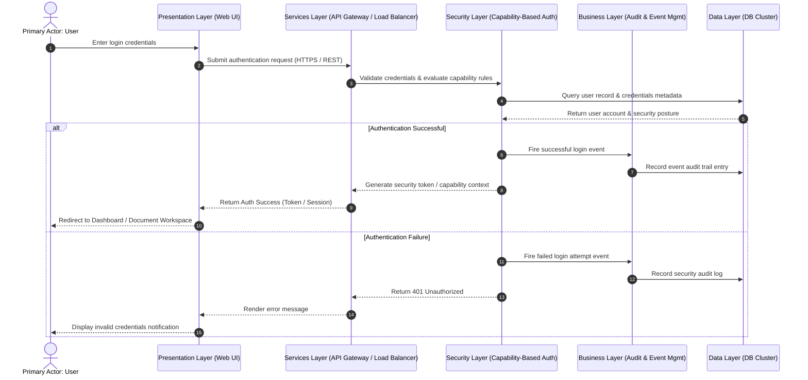

---

## 11.3 OWASP & Application Security Test Matrix (22 Categories)

| Category | Security Vulnerability Test | Expected Production Standard / Mitigation |
|---|---|---|
| **1. Information Gathering** | Server header inspection (`Server`, `X-Powered-By`). | All identifying server tokens stripped by reverse proxy. |
| **2. Authentication** | Brute force, credential stuffing, dictionary attacks. | Rate limiting (max 5 failed attempts per 15 min), account lockout, secure OTP expiration (5 min). |
| **3. Architecture** | Exposure of internal network resources. | Strict VPC isolation; DB placed in private subnet with no public IP. |
| **4. Encryption** | SSL/TLS posture and cipher suites. | Modern TLS 1.3 only; HSTS enabled with 1-year max-age; Grade A+ SSL Labs rating. |
| **5. Network Segmentation** | Inter-tier lateral movement. | Security groups restrict traffic strictly: LB -> App Subnet -> DB Subnet. |
| **6. Cache Management** | Sensitive contract data in browser/proxy caches. | `Cache-Control: no-store, no-cache, must-revalidate, private` on all document endpoints. |
| **7. Session Management** | Session hijacking, session fixation. | Cryptographically random session IDs; `HttpOnly`, `Secure`, and `SameSite=Strict` flags. |
| **8. Logout Security** | Server-side session invalidation on logout. | Immediate token revocation in Redis blacklist upon logout. |
| **9. Server Hardening** | Known unpatched OS/container vulnerabilities. | Automated vulnerability scanning in CI/CD pipeline; minimal Alpine-based Docker containers. |
| **10. Directory Traversal** | Path manipulation in file download endpoints (`../../`). | Documents addressed solely by UUIDs; strict path sanitization. |
| **11. Malformed Requests** | Fuzzing and buffer overflow attempts. | Strict JSON schema validation at API gateway level before application controllers. |
| **12. Credential Storage** | Weak password hashing. | Argon2id or bcrypt (cost factor 12) with unique per-user salt. |
| **13. Cross-Site Scripting (XSS)** | Stored or reflected XSS in user input fields. | React DOM automatic output encoding; strict Content Security Policy (CSP); HTML sanitization. |
| **14. SQL Injection** | SQL query tampering via parameters. | 100% parameterized queries via modern ORM (Prisma / SQLAlchemy); zero raw SQL concatenation. |
| **15. Authorization (IDOR)** | Horizontal privilege escalation by altering document UUID. | Capability token validation ensuring requester is explicitly listed as a party or owner of the contract. |
| **16. CSRF / XSRF** | Cross-site forged requests. | Anti-CSRF double-submit cookies and SameSite cookie policies for state-changing requests. |
| **17. File Upload / Download** | Uploading malicious executable scripts. | MIME-type verification, extension whitelisting (.pdf, .docx only), file size limit (10MB), virus scanning. |
| **18. Open Redirects** | Redirect manipulation via `return_url`. | Whitelist strictly internal relative URLs for authentication redirects. |
| **19. Error Handling** | Stack trace disclosure in HTTP 500 responses. | Generic error messages returned to clients; detailed traces logged to secure internal APM. |
| **20. Hidden Fields Tamper** | Manipulating hidden form fields (e.g. stamp duty fee). | All pricing, fees, and state rules computed and enforced server-side. |
| **21. Source Code Security** | Hardcoded secrets or API tokens in git repo. | Automated secret scanning (GitGuardian/TruffleHog); secrets injected via environment variables. |
| **22. Audit Logging** | Tampering with audit logs. | Append-only database journal (`userDataTlb$jn`, `sysconfigTlb$jn`) replicated to write-once storage. |

# 12. Internal Analytics Dashboard, Data Pipeline & AI Capabilities

## 12.1 Internal Analytics Architecture & KPI Suite

To understand user behavior, eliminate drop-off bottlenecks in the 5-step signing journey, and support executive decision-making, GoLegal incorporates an analytics pipeline and administrative dashboard:

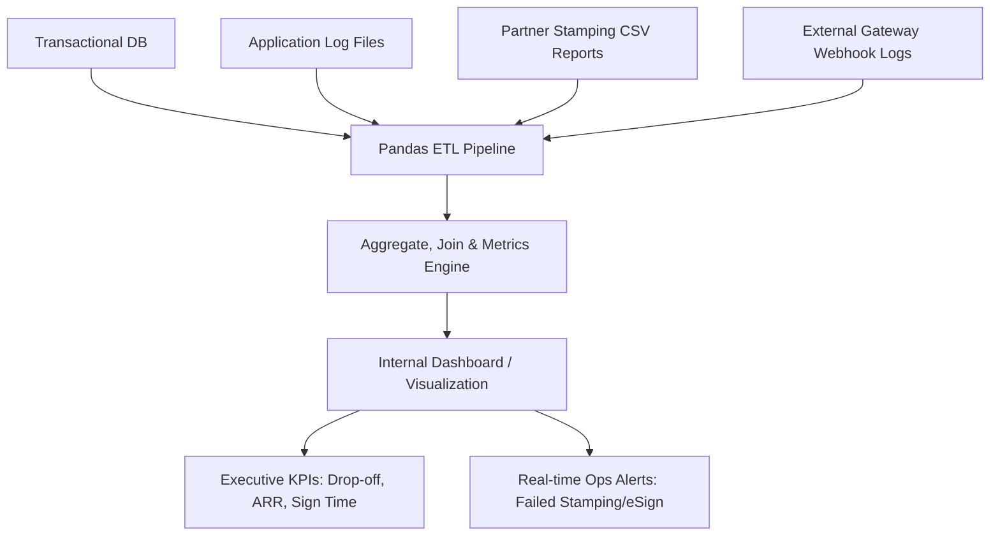

### Analytics Dashboard Core Specifications
1. **User Navigation Flow Path & Drop-off Analysis** (*MVP1*): Visual funnel tracking user progression across Step 1 (Template) -> Step 2 (Metadata) -> Step 3 (Preview) -> Step 4 (Payment) -> Step 5 (eSign). Identifies highest churn screens.
2. **Visitor & Traffic Volume** (*MVP1*): Unique visitors, total visits per day, and hourly traffic distribution patterns.
3. **Transaction Velocity & Throughput** (*MVP1*): Completed transactions per day, transaction success rate, and peak-hour load metrics.
4. **Stamp-Size & Revenue Breakdown** (*MVP1*): Categorization of transactions by stamp duty denomination (₹100, ₹200, ₹500, ₹1000) and revenue yield.
5. **Net Promoter Score (NPS) Sentiment Analytics** (*MVP1*): Real-time distribution of NPS ratings (0-8 Detractors with root-cause tags, 9 Happy, 10 Delighted) and qualitative feedback logs.
6. **Regional Geographic Distribution** (*MVP2*): State-wise and city-wise transaction heatmaps (Bangalore, Delhi NCR, Mumbai, Hyderabad).
7. **Manual vs. Online Execution Comparison** (*MVP2*): Volume comparison between 100% digital Aadhaar execution and physical doorstep courier requests.
8. **Dwell Time Analysis** (*MVP2*): Average time spent on each form step to optimize UI layout and reduce user cognitive burden.

---

## 12.2 Contract Lifecycle Management (CLM) & AI Roadmap

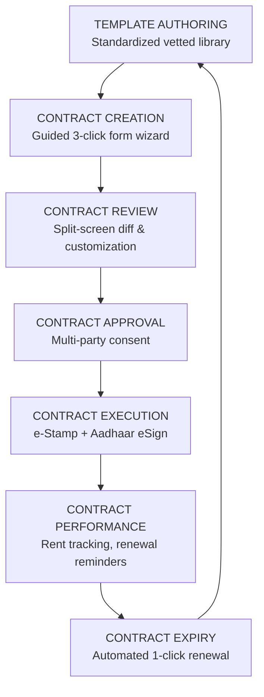

### Operational Data Store (ODS) & Analytics Hub

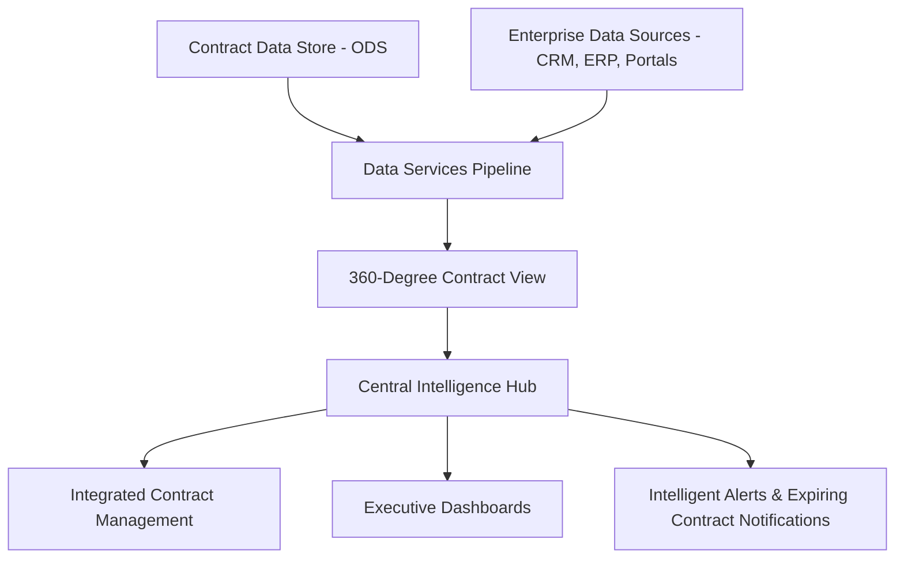

### Phase 2 AI/ML Capabilities
- **Clause Risk Scoring**: Automatically flags non-standard or harsh legal clauses (e.g., unfair deposit forfeiture, abnormal notice periods).
- **Auto-Suggest & Smart PII Redaction**: Automated masking of Aadhaar/PAN numbers in uploaded legacy contracts and renewal documents.
- **Rental Rate Negotiation Assist**: AI recommendations for fair market rents and standard security deposits based on neighborhood micro-market data.

# 13. Project Roadmap, Agile Planning, Milestones & Financial Budget

## 13.1 Development Gantt Schedule & Milestones

| Step | Milestone / Task | Owner | Start Date | Duration | End Date | Status |
|---|---|---|---|---|---|---|
| **1** | Project Kickoff & Spec Alignment | Amit Singh | Day 1 | 1 day | Day 1 | Complete |
| **2** | UI/UX Wireframe Freeze | Satish / Shine | Day 2 | 4 days | Day 5 | Complete |
| **3** | Requirement Specification Freeze | Lakshmi | Day 2 | 4 days | Day 5 | Complete |
| **4** | Technical Architecture & Design Freeze | Lakshmi / Ashu | Day 6 | 3 days | Day 8 | Complete |
| **5** | Core Web Application Development (MVP1) | Engineering Team | Day 4 | 30 days | Day 34 | In Progress |
| **6** | Legal Compliance & Clause Freezing | Prerana Reddy | Day 2 | 15 days | Day 17 | Complete |
| **7** | Cloud Staging Deployment & Infosec Review | Ashutosh Chandra | Day 12 | 30 days | Day 42 | In Progress |
| **8** | End-to-End User Acceptance Testing (UAT) | Ashutosh Chandra | Day 31 | 14 days | Day 45 | Planned |
| **9** | Public Beta Launch (MVP1 Beta) | Amit Singh | Day 47 | 2 days | Day 49 | Planned |
| **10**| Feedback Churn & MVP1.1 Enhancements | Engineering Team | Day 46 | 20 days | Day 66 | Planned |
| **11**| General Availability (GA) Commercial Launch | Amit / Shine | Day 75 | 2 days | Day 77 | Target |

### Key Deliverables & Backlog Velocity Targets
- **Release 1 (MVP1 Beta)**: Complete consumer rental workflow, e-Stamping, Aadhaar eSign, and payment invoicing.
- **50% of Backlog Value**: Completed by end of Iteration 2 (Sprint 4).
- **25% of User Stories Implemented**: Verified in staging by Day 20.

---

## 13.2 Financial Budget & Capital Allocation (INR)

| Budget Category | Line Item Description | MVP1 Budget (₹) | MVP1.1 / MVP2 (₹) | Remarks |
|---|---|---|---|---|
| **R&D / Development** | UI/UX Design Consultant Fees | ₹22,500 | ₹7,500 | 3-month engagement |
| | Full-Stack Web App Development | ₹3,50,000 | ₹70,000 | Core application build |
| | Cloud Infrastructure (DO / AWS VPC) | ₹3,000 | ₹10,000 | Staging & production cluster |
| **Product Management**| Vernacular Translation (Kannada/Hindi) | — | ₹10,000 | Language expansion |
| | e-Stamping API License & Deposit | — | ₹15,000 | SHCIL gateway deposit |
| | Aadhaar eSign ESP Fees & Deposit | — | ₹25,000 | ESP integration deposit |
| **Marketing & GTM** | Domain Registration & SSL | ₹882 | — | golegal.in / branding |
| | Digital Advertising & Growth Promotion | ₹75,000 | ₹25,000 | Targeted social campaigns |
| **SG&A / Legal** | Company Registration (Pvt Ltd) | — | ₹35,000 | Entity incorporation |
| | Founders' Agreement & Legal Stamping | ₹250 | — | Co-founders agreement |
| | Chartered Accountant Retainer | — | ₹20,000 | Financial compliance |
| | Office & Operational Contingency | — | ₹5,000 | Operational expenses |
| **Total Project Spend**| **Consolidated Project Allocation** | **₹4,51,632** | **₹1,97,500** | **Total: ₹6,49,132** |

---

## 13.3 Risk Analysis & Mitigation Matrix

| Sl. No | Risk Description | Probability | Impact | Planned Mitigation Strategy |
| :--- | :--- | :--- | :--- | :--- |
| **1** | **UIDAI / ESP Downtime**: Aadhaar OTP verification gateway latency or service disruption. | Moderate | High | Multi-ESP fallback (eMudhra + NSDL); asynchronous retry queue with SMS notifications to user upon gateway restoration. |
| **2** | **SHCIL e-Stamp Account Depletion**: High transaction surge depletes corporate prepaid balance. | Low | Critical | Real-time automated threshold monitoring (< ₹10,000); dual prepaid accounts and auto-recharge credit triggers. |
| **3** | **Evidentiary Legal Dispute**: Counterparty disputes electronic execution validity in court. | Low | High | Cryptographically sealed Section 65B Certificate automatically bundled with every contract, preserving server timestamps, IP logs, and CA certificates. |
| **4** | **Data Breach / Document Interception**: Unauthorized access to private customer lease deeds. | Very Low | Critical | AES-256 encryption at rest, TLS 1.3 in transit, strict capability tokens (CBAC), and automated PII masking of Aadhaar digits. |

---

## 13.4 Appendix A: Product Management Planning and Controls Matrix

GoLegal development adheres to a disciplined Agile framework comprising 14 ceremonies and governance checkpoints:

| Agile Practices / Events | When? Day of Iteration? | Duration | Mandatory Participants |
| :--- | :--- | :--- | :--- |
| **Product conceptualization (Epic / Features)** | Pre-contract (done by customer) OR during Startup / planning | 1 Week | Product management, Product owner, Portfolio manager etc. |
| **Product release planning** | Last Iteration of each release, 8th day | 8 Hr. / 2 Hr. | Product owner |
| **Story workshop** | Last Iteration of each release, 9th day | 2 days / 4 Hr. | Product owner, Stakeholders, Business Analyst |
| **Backlog creation** | Iteration | *As scheduled* | Product owner |
| **Backlog churning and Refinement, Story elicitation** | Last Iteration of each release: 5th day, 8th day, 9th day | 8 Hr. / 2 Hr. / 4 Hr. | Product owner, Team |
| **Iteration planning** | All Iterations, 1st day | 6 Hr. | Product owner, Team |
| **Daily standup** | All Iterations, Every day | 0.5 hr. | Scrum Master, Team |
| **Scrum of Scrum** | All Iterations, 4th and 8th day | 1 Hr. | Scrum Masters, Team Ambassadors |
| **Product DEMO** | All Iterations, 9th day | 4 Hr. | Product owner, Team, Stakeholders / user, Scrum Master |
| **Cadence / hardening** | All Releases, 4th Iteration, 1st – 6th days | 6 days | Team |
| **Release DEMO** | All Releases, 4th Iteration, 7th day | 4 Hr. | Product owner, Team, Stakeholders / user, Scrum Master |
| **Look-ahead / forward planning** | All Releases, 4th Iteration, 8th/9th day | 6 Hr. | Product owner, Team |
| **Iteration retrospective** | All Iterations, 10th day | 2 Hr. | Product owner, Team, Scrum Master |
| **Release retrospective** | All Releases, 4th Iteration, 10th day | 1 Hr. | Product owner, Team, Scrum Master |

# 14. Competitive Intelligence & Teardowns (Leegality, SpotDraft, Revv)

Detailed benchmarking against prominent players in the legal-tech and digital contract automation landscape:

## 14.1 SpotDraft Teardown
- **Company Profile**: Founded 2017, backed by 500 Startups, Binny Bansal (021 Capital), raised $1.5M+ in Pre-Series A. Target: Enterprise CLM and global automation.
- **Core Strengths**:
  - High-end AI contract analysis ("Good, Bad, and Ugly" clause highlighting).
  - GDPR compliance analysis for European enterprises.
  - Sophisticated approval workflows for enterprise legal teams.
- **Weakness for Indian Consumer Market**:
  - High pricing aimed at venture-funded startups and MNCs.
  - Does not focus on instant high-volume B2C consumer rental agreements.

## 14.2 Revv.so Teardown
- **Company Profile**: Founded by Freshworks alumni (Rishi Kulkarni & Sameer Goel), backed by Lightspeed, Matrix Partners. Over 2,000+ business customers.
- **Core Strengths**:
  - 1000+ pre-formatted business templates.
  - Form-based document structure seamlessly converting forms to documents.
  - Zapier, Stripe, and Google Sheets integrations.
  - SOC1 / SOC2 Type II certifications.
- **Document-to-Template Conversion Engine**:

```mermaid
flowchart LR
    A[User Document Upload] --> B[Machine Learning Parser]
    B --> C[Form-Field Detection Engine]
    C --> D[Reusable Structured Template]
    D --> E[Multi-Recipient Workflow]
```

- **Takeaway for GoLegal**: GoLegal should emulate Revv's split-view form-to-document engine, making agreements feel like simple form-filling rather than daunting legal contracts.

## 14.3 Leegality Teardown
- **Company Profile**: Pioneer of digital stamping and Aadhaar eSign in India. Used by major banks (Federal Bank, HDFC credila), NBFCs, and fintechs.
- **Core Value Propositions Validated by Leegality**:
  - Proved that e-contracts on e-Stamp paper are legally ironclad and cannot be tampered with without corrupting cryptographic hashes.
  - Executed deals up to ₹1,000 Crore completely digitally.
  - Overcame the myth that state stamp duty cannot be paid digitally.
- **GoLegal Opportunity**: Leegality is strictly enterprise B2B (charging heavy enterprise subscription minimums). GoLegal wins by democratizing this exact technology for every retail tenant, landlord, and small business with self-serve consumer pricing.

## 14.4 Competitive Feature Matrix

| Feature / Capability | GoLegal | Leegality | SpotDraft | Revv.so | LegalDesk |
|---|---|---|---|---|---|
| **Target Market** | B2C Consumers & SMBs | Enterprise Banks & NBFCs | Enterprise Tech & Legal Teams | Global SMBs & Consultants | B2C Consumers |
| **Aadhaar eSign** | Yes (Built-in) | Yes (Core focus) | Third-party / SES | Third-party (HelloSign) | Yes |
| **e-Stamp Paper Integration** | Yes (Automated Instant) | Yes (Enterprise API) | No | No | Yes (Manual Courier) |
| **Time to Complete** | < 10 Minutes | Real-time | Days (Contract lifecycle) | Minutes | 2-3 Days (Courier) |
| **Pricing Model** | Flat per-transaction (₹399) | High Enterprise Retainers | Custom Enterprise SaaS | Monthly SaaS subscription | Per-doc + courier fees |
| **Self-Service DIY Flow** | 100% Frictionless DIY | Sales-assisted setup | Sales-assisted demo | Self-serve | Semi-automated |
| **Mobile-First Signing** | Yes (SMS/WhatsApp links) | Yes (SMS/Email) | Desktop-focused | Web-focused | Web-focused |

# 15. Mentor Feedback, Advisory Insights & Risk Mitigation

Synthesized feedback from IIM Bangalore NSRCEL startup reviews, legal mentors, and venture advisors:

## 15.1 Critical Mentor Observations & Strategic Action Plan

1. *"Signing and stamping are table-stakes features — What is your true differentiator?"*
   - **Action**: Stamping and signing provide baseline utility, but the real moat is **speed (<10 min completion)**, **frictionless guest onboarding**, **zero legal jargon**, and **automatic post-execution utility** (HRA tax-ready receipts, automated renewal alerts, and tamper-proof cloud storage).
2. *"Love your problem, not your solution — You talk like a big corporate, remember you are a small startup."*
   - **Action**: Focus relentlessly on the single highest-frequency use case: **urban residential rental agreements in Bangalore and Delhi NCR**. Avoid getting distracted by complex enterprise CLM or multi-tier corporate contracts in MVP1.
3. *"Doing an agreement in 3 clicks is a great slogan, but what happens when competitors copy you?"*
   - **Action**: The barrier is not just the clicks—it is the tight integration with state e-stamping APIs, the network effect when 1 tenant brings a landlord and 2 witnesses into the ecosystem, and building strong consumer trust.
4. *"How will you create trust among non-tech-savvy users who are used to physical paper?"*
   - **Action**:
     - Display official government insignia (StockHolding logo, IT Act compliance badges, Aadhaar security seals).
     - Provide a clear, downloadable 1-page "Legal Validity Certificate" under Section 65B that users can present to sub-registrars, banks, or RWAs.
     - Build a Vernacular Language option (Kannada/Hindi) in MVP1.1.
5. *"Don't mix B2B and B2C in early marketing."*
   - **Action**: Maintain 100% focus on retail B2C (tenants & landlords) for MVP1 launch. B2B / broker accounts are deferred to MVP2.
6. *"Get validation from practicing lawyers and law firms."*
   - **Action**: All default agreement templates in the GoLegal library are pre-vetted by high court advocates and licensed legal consultants, ensuring total enforceability in judicial proceedings.

---

## Conclusion & Prompting Context for AI Coding Agents
This document encapsulates the complete business, regulatory, functional, architectural, and operational requirements of GoLegal. When generating code, implementing specifications, or configuring tests:
- Strictly observe the 5-step user journey.
- Adhere to the 5-layer system architecture and capability-based security model.
- Treat data privacy, Aadhaar masking, and append-only audit trails as non-negotiable core invariants.