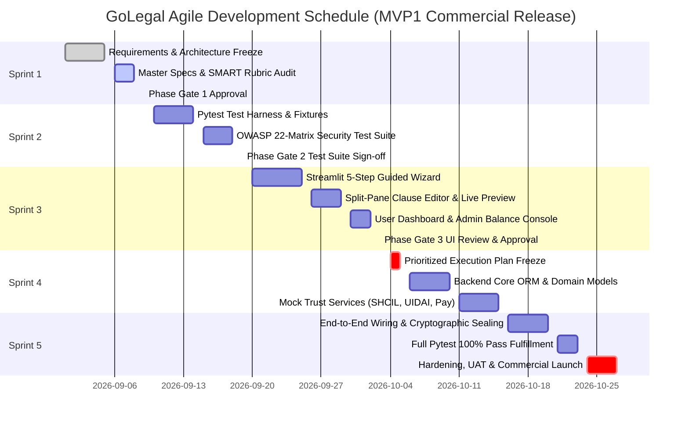
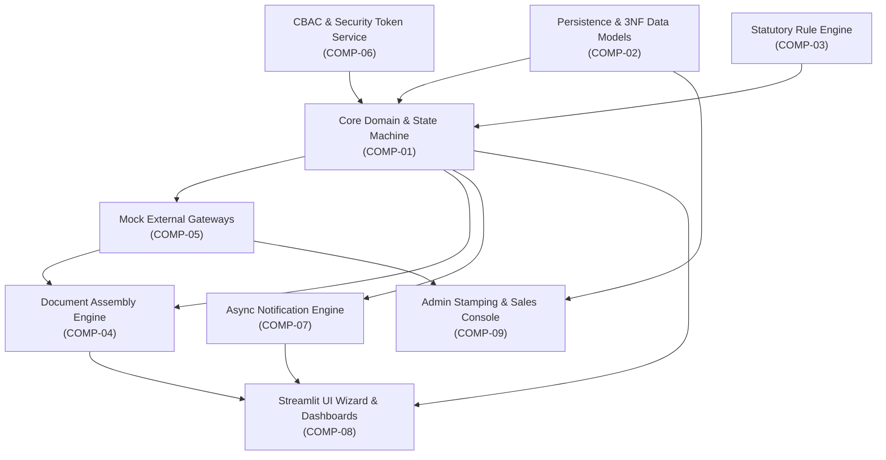

# GoLegal Web Application - Master Implementation Plan

> **Document Version**: 1.0 (Master Engineering Baseline)  
> **Status**: APPROVED ARCHITECTURAL SPECIFICATION  
> **Jurisdiction**: India (IT Act 2000, Indian Evidence Act 1872, Indian Stamp Act 1899)  
> **Target Tech Stack**: Python 3.10+, Streamlit, SQLAlchemy, SQLite (Dev) / PostgreSQL (Prod), ReportLab  

---

## 1. Executive Summary & Phased Engineering Roadmap

The GoLegal Digital Contracting Platform is engineered to deliver a 100% digital, paperless, and contactless legal agreement execution engine in under 10 minutes. This document defines the end-to-end engineering implementation plan across 5 strictly governed phases, balancing architectural modularity, capability-based security, statutory compliance, and rapid time-to-market.

```mermaid
flowchart TD
    subgraph P1["PHASE 1: Architecture & Engineering Documentation"]
        D1["PRD Ingestion & Context Compaction"]
        D2["10 Master Specifications Generation"]
        D3["SMART Evaluation & V&V Audit"]
        G1{{"GATE 1: User Approval"}}
        D1 --> D2 --> D3 --> G1
    end

    subgraph P2["PHASE 2: Comprehensive Test Suite Implementation"]
        T1["Test Harness Setup (Pytest, Mock, Cov)"]
        T2["Unit, Integration & Gateway Mock Tests"]
        T3["22-Category OWASP Vulnerability Matrix"]
        G2{{"GATE 2: Test Matrix Approval"}}
        T1 --> T2 --> T3 --> G2
    end

    subgraph P3["PHASE 3: Interactive Streamlit UI Implementation"]
        U1["Global Design System & Layout Configuration"]
        U2["5-Step Rental Agreement Wizard"]
        U3["Split-Pane Clause Editor & Live Preview"]
        U4["Dashboard & Admin Stamping Consoles"]
        G3{{"GATE 3: UI Validation & Approval"}}
        U1 --> U2 --> U3 --> U4 --> G3
    end

    subgraph P4["PHASE 4: Prioritized Functional Implementation Planning"]
        B1["UI Feedback & Backlog Correlation"]
        B2["P0 to P4 Dependency Prioritization"]
        B3["Prioritized Execution Plan Generation"]
        G4{{"GATE 4: Backlog Sign-Off"}}
        B1 --> B2 --> B3 --> G4
    end

    subgraph P5["PHASE 5: End-to-End Build & Test Fulfillment"]
        F1["3NF ORM Persistence & Repositories"]
        F2["Stamping, eSign & Invoicing Engines"]
        F3["Non-Atomic Multi-Party State Machine"]
        F4["Section 65B Audit Trail & SHA-256 Sealing"]
        F5["Full Pytest 100% Pass Fulfillment"]
        FD(["Final Delivery & Live Service Handoff"])
        F1 --> F2 --> F3 --> F4 --> F5 --> FD
    end

    G1 --> T1
    G2 --> U1
    G3 --> B1
    G4 --> F1
```

---

## 2. Component Breakdown & Layered Subsystem Architecture

The GoLegal engineering codebase is decomposed into nine modular subsystems adhering strictly to the 5-layer enterprise architecture:

| Subsystem ID | Component Name | Primary Responsibilities | Architectural Layer |
| :--- | :--- | :--- | :--- |
| **COMP-01** | **Core Domain & State Machine** | Lifecycle transitions (`Draft` $\rightarrow$ `Paid` $\rightarrow$ `Pending_Signatures` $\rightarrow$ `Completed`), signing logic (`1..n` owners, `1..n` tenants, witnesses), and invariant checks. | Business Layer |
| **COMP-02** | **Relational Persistence Engine** | SQLAlchemy 3NF ORM mapping, SQLite session management, dynamic JSONB storage for covenants, and append-only audit journals. | Data Layer |
| **COMP-03** | **Statutory Rule Engine** | Jurisdiction-specific stamp duty calculations (Karnataka, Delhi, Maharashtra), non-derogable legal clauses, and validity checks. | Business Layer |
| **COMP-04** | **Document Assembly & Cryptography** | ReportLab PDF engine, dynamic continuous pagination (`Page X of Y`), official e-Stamp certificate merging, and SHA-256 cryptographic sealing. | Business / Presentation |
| **COMP-05** | **Mock External Gateways** | SHCIL e-Stamp API & prepaid balance ledger (< ₹10,000 alert), UIDAI / ESP Aadhaar eSign OTP gateway, Razorpay/Cashfree checkout simulation. | Services Layer |
| **COMP-06** | **Security & CBAC Engine** | Capability-Based Access Control tokens, IDOR prevention, PII masking (`XXXXXXXX1234`), and suspicious ingress monitoring. | Security Layer |
| **COMP-07** | **Async Notification Engine** | Multi-party sign invitation links (SMS, WhatsApp, Email), daily reminder scheduling queue, and transaction progress digests. | Services / Business |
| **COMP-08** | **Interactive Streamlit UI** | 5-step guided wizard, split-pane clause preview, client session synchronization, and user dashboard. | Presentation Layer |
| **COMP-09** | **Administrative Console** | Real-time StockHolding prepaid balance monitor, GMV sales metrics, transaction audit ledger, and NPS feedback portal. | Presentation Layer |

---

## 3. Agile Sprint Schedule & Governance Ceremonies

Development is organized into five two-week Agile Sprints aligned with the 14 PM governance ceremonies defined in PRD Appendix A:

### 14 Agile Ceremonies Execution Framework
1. **Product Conceptualization**: Completed; unified PRD v1.0 / Architecture Baseline codified.
2. **Product Release Planning**: Held on Day 8 of release planning; roadmap targets MVP1 delivery.
3. **Story Workshop**: Conducted with stakeholders to establish user stories US-01 through US-08.
4. **Backlog Creation**: Structured into P0 through P4 operational priorities.
5. **Backlog Refinement**: Iterative refinement sessions on Days 5, 8, and 9 of each sprint.
6. **Iteration Planning**: 6-hour sprint planning on Day 1 of each sprint cycle.
7. **Daily Standup**: 15-minute daily sync addressing completed items, blockers, and next steps.
8. **Scrum of Scrums**: Cross-subsystem integration alignment on Days 4 and 8.
9. **Product Demo**: Sprint review demo on Day 9 presenting functioning increments.
10. **Cadence / Hardening**: Dedicated 6-day hardening period prior to commercial GA.
11. **Release Demo**: Stakeholder sign-off demo on Day 7 of Iteration 4.
12. **Look-Ahead Planning**: Architectural look-ahead on Days 8-9 of Iteration 4.
13. **Iteration Retrospective**: 2-hour retrospective at the close of every sprint.
14. **Release Retrospective**: Formal 1-hour retrospective reviewing release velocity and metrics.

---

## 4. Subsystem Dependency Graph

---

## 5. Critical Path & Velocity Milestones

| Milestone ID | Target Phase | Velocity Metric / Deliverable | Critical Path Dependencies |
| :--- | :--- | :--- | :--- |
| **MS-01** | Phase 1 | 10 Comprehensive Architecture & Engineering Documents | Ingestion of Master PRD Baseline |
| **MS-02** | Phase 1 | 100% SMART Criteria Audit Pass | Review against SMART Rubric |
| **MS-03** | Phase 2 | Automated Pytest Suite with Mock Gateways | Interface specification freeze |
| **MS-04** | Phase 2 | 22 OWASP Application Security Tests Automated | CBAC & sanitization contracts |
| **MS-05** | Phase 3 | Streamlit 5-Step Wizard & Split-Pane Editor | UI layout & session state schema |
| **MS-06** | Phase 3 | Background Service Verification on Port 8501 | Streamlit runtime environment |
| **MS-07** | Phase 4 | Prioritized Backlog (P0 to P4) Documented | UI feedback & test coverage delta |
| **MS-08** | Phase 5 | SQLAlchemy 3NF Schema & SQLite Repositories | Data model specifications |
| **MS-09** | Phase 5 | Automated e-Stamp Procurement & Balance Debit | SHCIL mock adapter integration |
| **MS-10** | Phase 5 | Section 65B Audit Trail & SHA-256 PDF Sealing | Document assembly engine |
| **MS-11** | Phase 5 | 100% Pytest Pass & Zero Regression Verification | Full backend & UI integration |

---

## 6. Legal & Regulatory Compliance Gates

Every milestone is gated by statutory compliance checks under Indian law:

1. **Information Technology Act, 2000**:
   - **Section 4**: Legal recognition of electronic records satisfied through secure PDF generation and structured metadata archiving.
   - **Section 5**: Legal equivalence of electronic signatures satisfied through UIDAI-compliant PKCS#7 hash verification.
   - **Section 10A**: Contract formation validity guaranteed through non-repudiation logs and tamper-evident document assembly.
2. **Indian Evidence Act, 1872 (Section 65B)**:
   - Mandatory automated compilation of Section 65B Electronic Evidentiary Certificate recording server timestamps, originating IP addresses, device identifiers, and SHA-256 cryptographic digests.
3. **Indian Stamp Act, 1899**:
   - Automated state-wise stamp duty calculation and reconciliation against StockHolding Corporation of India Ltd (SHCIL) e-Stamp certificates merged on Page 1.
4. **Data Privacy & PII Redaction**:
   - Strict Aadhaar masking (`XXXXXXXX1234`); zero persistent storage of raw 12-digit Aadhaar credentials.
   - User cloud storage consent governance (indefinite AES-256 vs. 27-day automated draft purge).
