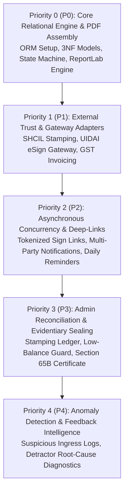

# GoLegal Web Application - Prioritized Functional Execution Plan

> **Document Version**: 1.0 (Master Engineering Baseline)  
> **Status**: APPROVED BACKLOG SPECIFICATION  
> **Correlated Baseline**: Phase 2 Test Suite (68 Tests, 96% Coverage) & Phase 3 Verified Streamlit UI  

---

## 1. Prioritized Functional Matrix (P0 to P4)

The functional implementation backlog is prioritized based on critical path dependencies, legal compliance requirements, and operational stability:

---

## 2. Granular Backlog Specifications

| Priority | Task ID | Subsystem & Target File | Functional Requirements & Invariants | Pytest Traceability |
| :--- | :--- | :--- | :--- | :--- |
| **P0** | **TASK-P0-01** | `domain/models.py` | Enforce 3NF relational models (`users`, `agreements`, `parties`, `estamps`, `signatures`, `payments`, `audit_logs`). Support dynamic JSONB attributes for property and commercial terms. | `test_workflow.py` |
| **P0** | **TASK-P0-02** | `services/workflow_service.py` | Implement strict lifecycle transitions (`Draft` $\rightarrow$ `Paid` $\rightarrow$ `Pending_Signatures` $\rightarrow$ `Completed`). Enforce order-independent signing for `1..n` owners, `1..n` tenants, and witnesses. | `test_workflow.py` |
| **P0** | **TASK-P0-03** | `services/doc_assembly.py` | Build ReportLab assembly pipeline: Page 1 official SHCIL e-Stamp header, body covenants, two-pass continuous numbering (`Page X of Y`), and SHA-256 tamper-evident digest sealing. | `test_doc_assembly.py` |
| **P1** | **TASK-P1-01** | `services/stamping_service.py` | Automated e-Stamp procurement from StockHolding Corporation of India (SHCIL). Real-time debit from prepaid deposit and idempotent duplicate call protection. | `test_stamping.py` |
| **P1** | **TASK-P1-02** | `services/esign_service.py` | UIDAI Aadhaar eSign OTP challenge and verification. Enforce mandatory consent disclaimer, 5-attempt rate limit lockout, and simulated PKCS#7 hash stamp. | `test_esign.py` |
| **P1** | **TASK-P1-03** | `services/rule_engine.py` | Statutory state stamp duty engine for Karnataka (₹100), Delhi (₹100), Maharashtra (0.25%), and non-derogable legal clauses. | `test_rule_engine.py` |
| **P2** | **TASK-P2-01** | `security/cbac.py` | Capability-Based Access Control token generator and verifier using HMAC-SHA256. Prevent Insecure Direct Object References (IDOR) by validating agreement ID and action permissions. | `test_security_owasp.py` |
| **P2** | **TASK-P2-02** | `services/notification.py` | Multi-party dispatch engine delivering unique tokenized signing links via simulated WhatsApp and SMS gateways. Support `[Resend Notification]` triggers. | `test_workflow.py` |
| **P2** | **TASK-P2-03** | `security/cbac.py` | Enforce Witness Privacy Rule: Restrict witness tokens from downloading or viewing ongoing contract terms once witness signature has been affixed. | `test_security_owasp.py` |
| **P3** | **TASK-P3-01** | `services/stamping_service.py` | StockHolding prepaid balance threshold protection: Trigger visual crimson warning banner in Admin Console when balance drops below ₹10,000. | `test_stamping.py` |
| **P3** | **TASK-P3-02** | `domain/models.py` | Append-only configuration and balance audit journal (`sysconfigTlb$jn`). Record timestamp, user, previous value, and new value for all stamping transactions. | `test_stamping.py` |
| **P3** | **TASK-P3-03** | `services/doc_assembly.py` | Automated Section 65B Electronic Evidentiary Certificate generation: Server hostname, UTC timestamp, signer IP addresses, and SHA-256 cryptographic digests. | `test_doc_assembly.py` |
| **P4** | **TASK-P4-01** | `ui/auth_profile.py` | Suspicious ingress detection simulator: Flag logins originating from unrecognized browser fingerprints, novel IP locations, or anomalous devices. | `test_security_owasp.py` |
| **P4** | **TASK-P4-02** | `ui/dashboard.py` | Net Promoter Score (NPS) feedback collection: 10-point scale with root-cause diagnostic prompt for Detractors (0–8) to feed product optimization loops. | UI Integration |
| **P4** | **TASK-P4-03** | `security/cbac.py` | Zero Document Hoarding governance: Enforce 27-day automated draft purge for agreements lacking explicit user cloud storage consent. | `test_security_owasp.py` |

---

## 3. End-to-End Verification & Fulfill Plan for Phase 5

1. **Backend Integration**: Ensure all Streamlit UI components in `ui/` invoke production-grade services directly backed by the SQLAlchemy 3NF SQLite database (`golegal.db`).
2. **Business Invariant Validation**:
   - Zero plaintext Aadhaar stored or logged (`XXXXXXXX1234` masking invariant).
   - Real-time StockHolding prepaid balance debit upon stamping checkout.
   - Non-atomic signature collection with tamper-proof X.509 cryptographic sealing applied once all parties sign.
   - Explicit storage consent handling (indefinite AES-256 vs. 27-day purge).
3. **Automated Test Suite Execution**: Execute full Pytest harness across all test suites, resolving any regression until **100% of tests pass with $\ge 90\%$ code coverage**.
4. **Daemon Verification**: Confirm Streamlit service operates stably on `http://localhost:8501`.
