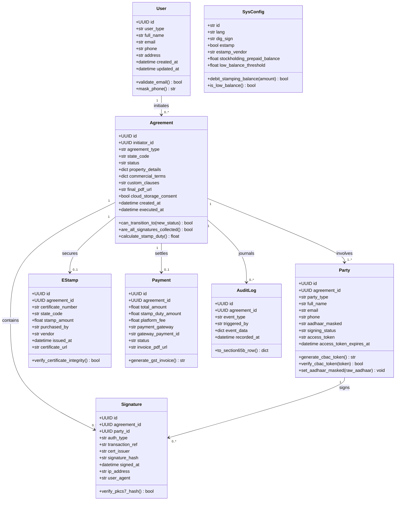
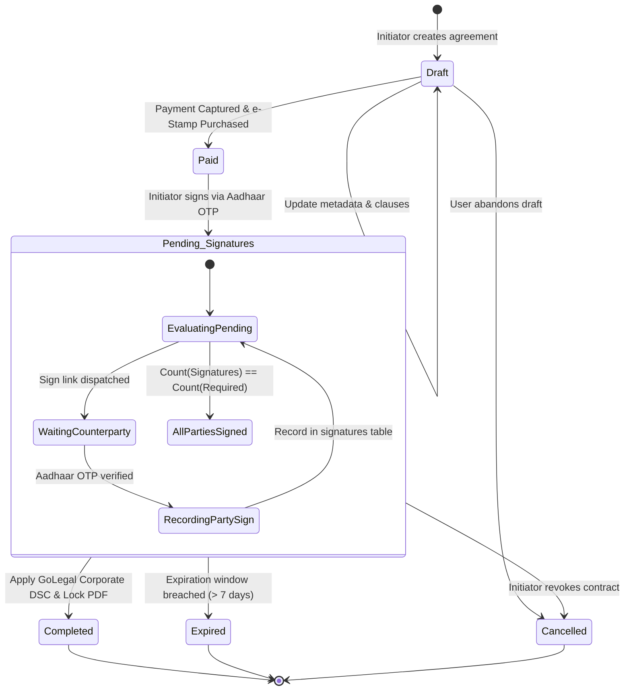
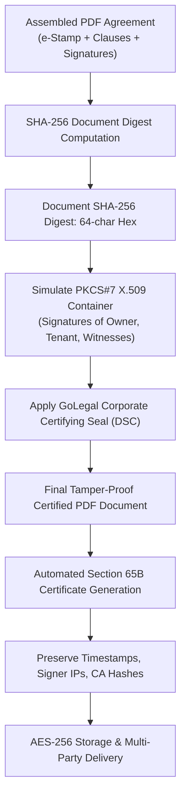

# GoLegal Web Application - Software Design Document (LLD)

> **Document Version**: 1.0 (Master Engineering Baseline)  
> **Status**: APPROVED LOW-LEVEL DESIGN SPECIFICATION  
> **Target Language**: Python 3.10+ (Type Hinted & PEP 8 Compliant)  
> **Cryptographic Standards**: SHA-256 Digest, PKCS#7 X.509 Container Simulation, HMAC-SHA256 CBAC  

---

## 1. Domain Class Hierarchies & Data Models

The system employs typed domain models mapped via SQLAlchemy ORM, enforcing strict business invariants, data sanitization, and PII masking.



---

## 2. Asynchronous Non-Atomic Signing State Machine

Agreements involve multiple independent counterparties (`1..n` owners, `1..n` tenants, `1..2` witnesses) who execute their signatures at arbitrary times without requiring synchronous co-presence.



### 2.1 Concurrency & Idempotency Rules
1. **Idempotent Signing Endpoint**: When a signatory submits their Aadhaar OTP, the signature transaction is wrapped in a database row-level lock on the `parties` record. If `party.signing_status == 'Signed'`, subsequent requests are rejected as duplicates.
2. **Order Independence**: Signatories may execute in any arbitrary sequence (e.g. Tenant $\rightarrow$ Witness 1 $\rightarrow$ Landlord $\rightarrow$ Witness 2).
3. **Atomic Sealing Trigger**: The completion hook checks:
   $$\text{Remaining} = \sum_{\text{parties}} \mathbf{1}_{(\text{signing\_status} \neq \text{'Signed'})}$$
   When $\text{Remaining} = 0$, the system atomically transitions `agreements.status` to `'Completed'` and invokes the cryptographic sealing engine.

---

## 3. Capability-Based Access Control (CBAC) Token Specification

To eliminate Insecure Direct Object References (IDOR), agreement resources cannot be accessed using naked UUIDs alone. Access is mediated by cryptographically signed capability tokens.

### 3.1 Token Format & Signature Construction
$$\text{CBAC\_Token} = \text{base64url}(\text{Payload}) \,\|\, \text{"."} \,\|\, \text{HMAC-SHA256}(\text{Payload}, \text{SecretKey})$$

Where `Payload` contains:
```json
{
  "agr_id": "8f3b2029-...",
  "pty_id": "c1a9420b-...",
  "role": "Tenant",
  "actions": ["VIEW_DRAFT", "EXECUTE_ESIGN"],
  "exp": 1799283600
}
```

### 3.2 Granular Action Privileges & Witness Privacy Rule
- **VIEW_DRAFT**: Permitted for Owners, Tenants, and invited signers before completion.
- **EXECUTE_ESIGN**: Grants access to the UIDAI OTP verification modal.
- **DOWNLOAD_FINAL**: Granted permanently to Owners and Tenants.
- **Witness Privacy Policy**: Once a witness executes their signature, their token capability is downgraded to `COMPLETED_ACK`. Witnesses **cannot** view or download the ongoing contract or party financial records post-execution.

---

## 4. Cryptographic Sealing & Section 65B Evidentiary Certificate



### 4.1 Section 65B Certificate Content Model
The appended evidentiary certificate contains:
1. **System Server Identifier**: Hostname, server clock calibration, and timezone (IST/UTC).
2. **Device & Network Ingress Audit**: IP address, user-agent, and geolocation metadata for each signing actor.
3. **Cryptographic Checksums**: Pre-execution draft SHA-256 digest, individual PKCS#7 signature hashes, and post-sealing final SHA-256 digest.
4. **Statutory Declaration**: Standardized legal certification under Section 65B(4) of the Indian Evidence Act, 1872, signed by the GoLegal System Custodian.

---

## 5. Document Assembly & Pagination Engine

1. **Page 1 (Statutory e-Stamp Header)**: Incorporates the official StockHolding Corporation of India Limited (SHCIL) e-Stamp certificate graphic, state seal, unique certificate number (`IN-KA...`), purchaser name, and duty consideration amount.
2. **Pages 2 to N (Agreement Body)**: Dynamically renders legal clauses, parties' identities, property schedule, and commercial terms using ReportLab flowables.
3. **Continuous Numbering**: Enforces strict two-pass canvas numbering:
   $$\text{"Page "} + str(current\_page) + \text{" of "} + str(total\_pages)$$
4. **Execution Block**: Renders the Section 65B signature table and corporate DSC seal at the terminal page of the deed.
