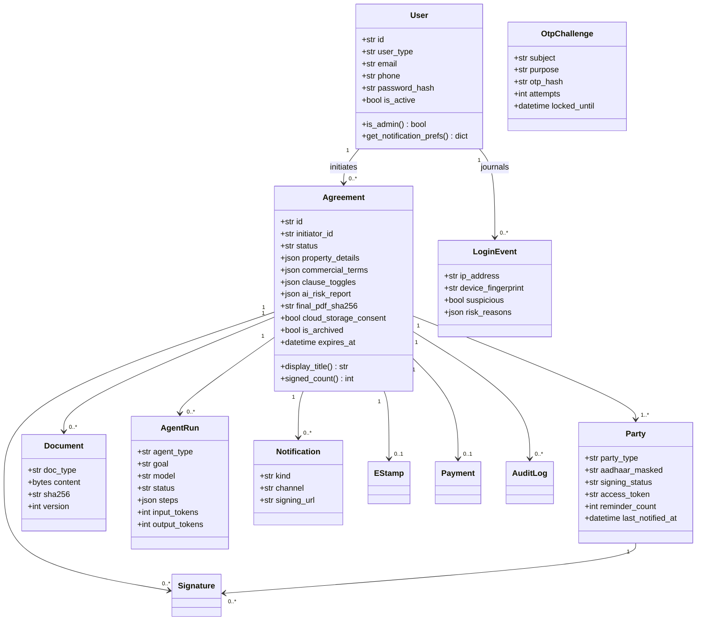
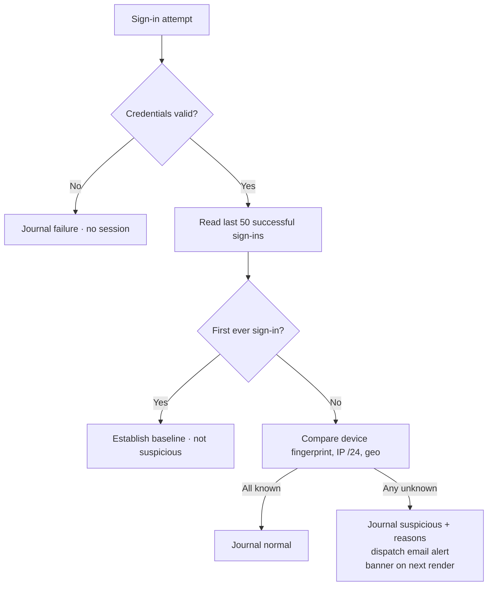
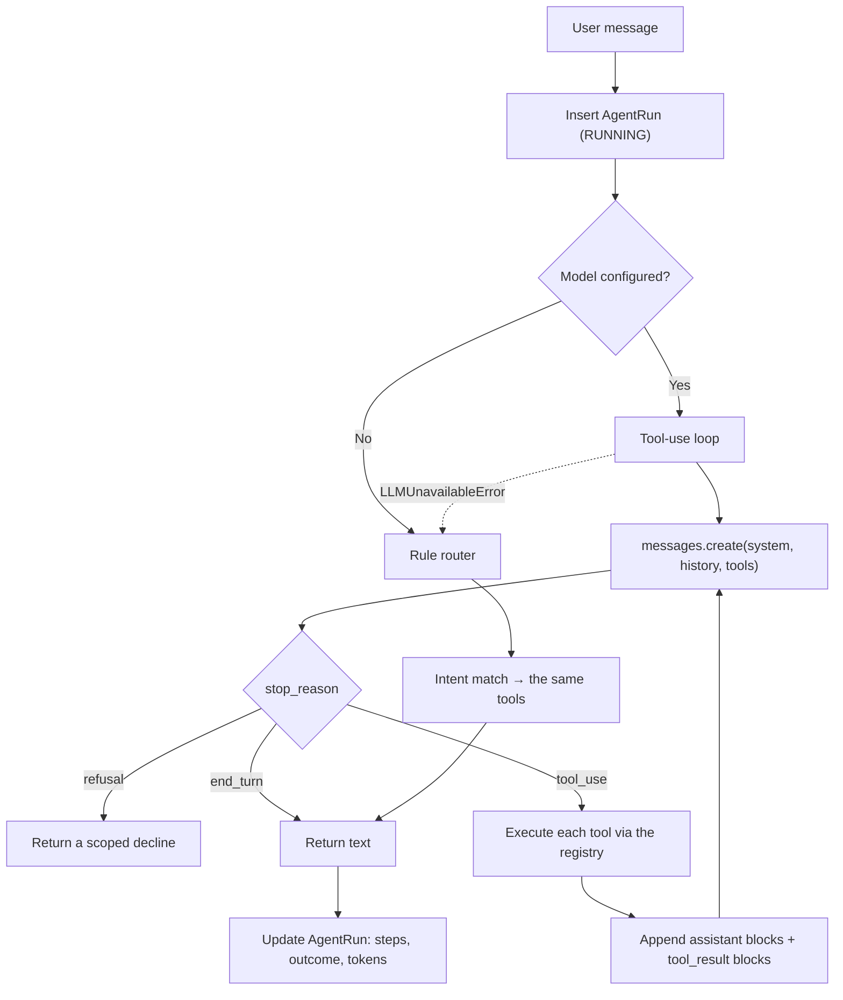

# GoLegal — Software Design Document (low-level design)

> **Version**: 2.0 (agentic baseline)
> **Language**: Python 3.12, type-hinted, PEP 8
> **Cryptography**: SHA-256 digests, HMAC-SHA256 for capability tokens and the corporate seal, PBKDF2-HMAC-SHA256 for passwords

---

## 1. Module map

```
config.py                    every secret, fee, threshold and model setting, from the environment
domain/models.py             17 ORM entities, 3NF, with JSON accessors
persistence/database.py      engine, session factory, additive migrations, demo seeding
security/
  cbac.py                    capability tokens, role→action mapping, XSS sanitisation, purge rule
  auth.py                    passwords, OTP challenges, suspicious-ingress detection
services/
  validation.py              PAN/PIN/email/phone/Aadhaar, party and payload validation
  rule_engine.py             state stamp duty, statutory + optional clause library
  agreement_service.py       draft CRUD, party sync, ownership scoping, archive
  payment_service.py         server-side quote, capture, GST invoice
  stamping_service.py        SHCIL procurement, prepaid ledger, low-balance guard
  esign_service.py           Aadhaar OTP challenge, verification, signature rows
  notification.py            tokenized links, invitations, reminders, completion notices
  document_service.py        content-addressed PDF store with digest verification
  doc_assembly.py            ReportLab: e-Stamp page 1, Page X of Y, § 65B, GST invoice
  workflow_service.py        state machine, dispatch, sealing, expiry, purge, reminder sweep
ai/
  llm.py                     provider gateway + offline null client + JSON extraction
  tools.py                   tool registry with read/write/human tiers and call journaling
  copilot.py                 tool-use loop with a deterministic rule router fallback
  workflow_agent.py          observe → plan → act → journal, portfolio sweep
  clause_intelligence.py     risk scoring, PII redaction, plain-language & vernacular summaries
  contract_ingest.py         existing contract / natural-language brief → wizard payload
  rent_benchmark.py          fair-rent bands and deposit norms per micro-market
ui/                          theme, components, state, and one module per screen
```

---

## 2. Domain model



**Design notes.**

- Aadhaar exists in exactly one column, `parties.aadhaar_masked`, and only ever in `XXXXXXXX1234`
  form. `mask_aadhaar()` is the single entry point; it is idempotent so a re-loaded payload does not
  double-mask or raise.
- `documents` stores bytes plus a SHA-256. A sealed deed is generated **once**; re-sealing returns the
  stored bytes, which is what makes `final_pdf_sha256` a stable evidentiary reference.
- `agent_runs` is append-only in practice: rows are inserted at start, updated once at completion.

---

## 3. Capability-based access control

```
token = base64url(payload) "." HMAC-SHA256(payload, secret)
payload = { agr_id, pty_id, role, actions[], exp }
```

`verify_token(token, required_agreement_id, required_action)` enforces, in order: format, signature,
expiry, **agreement match** (IDOR), action membership, and the witness rule.

| Role | Before signing | After sealing |
| :--- | :--- | :--- |
| Owner | VIEW_DRAFT, EXECUTE_ESIGN, DOWNLOAD_FINAL | same, TTL extended to the retention period |
| Tenant | VIEW_DRAFT, EXECUTE_ESIGN, DOWNLOAD_FINAL | same |
| Witness | VIEW_DRAFT, EXECUTE_ESIGN | **COMPLETED_ACK only** |

The witness downgrade happens in `seal_agreement()`, which re-mints every party token. The signing
page detects the downgraded capability and renders the policy explanation rather than an error.

---

## 4. Asynchronous multi-party signing

Order independence is a property of the data model, not of the code path: a signature is a row keyed
by `(agreement_id, party_id)`, and completion is evaluated as a set predicate.

$$\text{Remaining} = \sum_{p \in \text{parties}} \mathbf{1}_{(p.\text{signing\_status} \neq \text{Signed})}$$

`check_and_complete_signing()` seals when Remaining = 0. Idempotency:

- **Signing** — if the party is already `Signed`, the existing `Signature` row is returned; the OTP challenge is still consumed so a replayed OTP cannot be reused.
- **Stamping** — `procure_estamp` returns the existing certificate without a second debit.
- **Payment** — `checkout` returns the existing successful payment.
- **Sealing** — returns the stored bytes when the digest already matches.

Each of these has a test asserting no double side effect.

---

## 5. OTP and rate limiting

Both login and eSign OTP flows use `otp_challenges`:

| Field | Purpose |
| :--- | :--- |
| `subject` | phone (LOGIN) or masked Aadhaar (ESIGN) |
| `otp_hash` | SHA-256 of `secret:otp` — the OTP itself is never stored |
| `attempts` | incremented on failure; **carried forward** when a new OTP is issued |
| `locked_until` | set on the 5th failure, 15 minutes |
| `expires_at` | 5 minutes |
| `consumed` | single use |

Carrying `attempts` across a re-issued OTP is the detail that makes the lockout real: without it, a
caller could reset the counter by requesting a fresh code.

---

## 6. Suspicious-ingress detection



The fingerprint is derived from user agent + IP subnet, so the same browser on the same network is
recognised across sessions. A random per-session id would alert on every visit, which trains users to
ignore the alert.

---

## 7. Agent tool contract

```python
@dataclass
class ToolSpec:
    name: str
    description: str        # what the model reads
    input_schema: dict      # JSON Schema; validated by the API
    tier: str               # "read" | "write" | "human"
    handler: Callable | None
```

| Tier | Meaning | Enforcement |
| :--- | :--- | :--- |
| `read` | Pure lookup | Always permitted |
| `write` | Mutates the draft or dispatches messages | Refused when `ToolContext.mode == "readonly"` |
| `human` | A personal legal act | `handler is None`; execution raises `ToolPermissionError`, and the tool is omitted from the definitions sent to the model |

Registered tools:

| Tool | Tier |
| :--- | :--- |
| `calculate_stamp_duty`, `list_supported_states`, `get_rent_benchmark` | read |
| `assess_clause_risk`, `explain_legal_term`, `summarize_agreement`, `redact_pii` | read |
| `get_draft_status`, `list_my_agreements`, `get_signing_progress` | read |
| `extract_terms_from_text`, `prefill_agreement`, `save_draft`, `send_signing_reminders` | write |
| `pay_and_procure_estamp`, `aadhaar_esign` | **human** |

Every call is recorded as `{tool, input, output, ok}` and persisted on the `AgentRun`, so a run can be
replayed and audited after the fact.

---

## 8. Copilot execution



The rule router is not a toy: it calls the identical tool registry, so an offline answer about stamp
duty comes from `calculate_stamp_duty`, not from a hardcoded string. Intent precedence matters and is
tested — "what is an e-stamp?" is a definition, "what does an e-stamp cost?" is a price, and "explain
this agreement in Hindi" is a summary.

---

## 9. Clause risk scoring

Two independent passes, merged:

1. **Parameter rules** over the commercial terms — deposit-to-rent ratio against state norms, lock-in versus term, notice period, escalation, and a registration warning at ≥ 12 months.
2. **Pattern rules** over free text — deposit forfeiture, entry without notice, eviction without notice, punitive penalties, unilateral variation, blanket liability waivers, discriminatory restrictions, references to verbal side agreements.

Score = Σ severity weights (high 30, medium 12, low 5, info 0), capped at 100; level is high ≥ 40,
medium ≥ 15, else low. When a model is configured its findings are appended with `source="claude"` and
the same severity vocabulary, so the UI renders both identically.

PII redaction runs first and unconditionally: any Aadhaar, PAN or phone number found in clause text is
masked, flagged as a high finding, and the masked text is written back to the draft.

---

## 10. Document assembly

| Page | Contents |
| :--- | :--- |
| 1 | e-Stamp certificate table (number, duty, article, parties, vendor), the deed title, party recitals, property and commercial schedule, numbered covenants |
| 2..n-1 | Continuation of covenants, header rule from page 2 onward |
| n | **Section 65B certificate**: signature table (name, role, UTC timestamp, signer IP, PKCS#7 hash, status) with the corporate DSC row, a metadata table (custodian, server host, agreement id, certificate number, content digest, HMAC seal, generation time), the evidentiary event log, and the statutory declaration under § 65B(4) |

Pagination uses a two-pass `NumberedCanvas`: page states are buffered, the total is known at `save()`,
and `Page X of Y` is stamped on every page.

The corporate seal is `HMAC-SHA256(dsc_secret, content_digest)` where `content_digest` is a
deterministic SHA-256 over the sorted JSON of the agreement, parties and signature hashes — that is,
over *what the parties agreed*, not over the rendered bytes. Rendering is therefore reproducible and
the seal is stable.
