# GoLegal — Test Strategy & Plan

> **Version**: 2.0 (agentic baseline)
> **Framework**: pytest 9, pytest-cov, pytest-mock
> **Current**: **126 tests passing, 89% coverage** across `services`, `domain`, `security`, `ai`, `config`
> **Principle**: the entire suite runs **offline**. No API key, no network, no external gateway.

---

## 1. Strategy

Three commitments shape this suite.

**Test behaviour, not implementation.** The most valuable test in the suite is
`test_full_lifecycle_with_tokenized_links` — a single test that walks draft → pay → stamp → dispatch →
out-of-order signing → reminder → atomic seal → witness downgrade → terminal immutability, asserting
the audit event set along the way. It would catch a regression in any of eleven modules.

**Every guardrail has a test that tries to break it.** A guardrail nobody attacks is a comment. There
are tests that attempt an IDOR, attempt a witness download, attempt to make an agent pay, attempt to
write in read-only mode, attempt to reset an OTP lockout by re-requesting, and attempt to sneak an
Aadhaar number through the model's tool arguments.

**The AI layer is deterministic under test.** An autouse fixture forces `NullLLMClient`, so the
rule-based paths are what run. The model seam itself is covered separately with a stubbed SDK, and the
tool-use loop is covered with a scripted fake model that asserts the tool-result round trip.

---

## 2. Tiers

```mermaid
flowchart TD
    subgraph T1["1. Unit — pure functions"]
        U1["Validators: PAN, PIN, email, phone, Aadhaar masking"]
        U2["Rule engine: 9 states' duty, fee, GST, clause library"]
        U3["CBAC: token mint, verify, tamper, expiry"]
        U4["Clause risk rules, PII redaction, rent benchmarks"]
        U5["Contract extraction across phrasings"]
    end
    subgraph T2["2. Integration — services against a real DB"]
        I1["Agreement CRUD, party sync, ownership scoping, archive"]
        I2["Stamping ledger, idempotency, low-balance guard"]
        I3["eSign: OTP lifecycle, lockout, idempotent signing"]
        I4["Payment: capture, invoice PDF, audit"]
        I5["Document store: content addressing, digest verification"]
        I6["Auth: passwords, OTP, suspicious ingress"]
    end
    subgraph T3["3. System — end-to-end journeys"]
        S1["Full lifecycle with capability links"]
        S2["Expiry sweep and consent-based purge"]
        S3["Reminder cadence"]
        S4["Agent across the whole lifecycle"]
    end
    subgraph T4["4. Security & agent guardrails"]
        X1["IDOR, witness privacy, token tamper, expiry"]
        X2["Human-tier refusal, read-only refusal, PII stripping"]
        X3["SQL injection via ORM parameterisation, XSS sanitisation"]
        X4["27-day purge rule"]
    end
    T1 --> T2 --> T3 --> T4
```



---

## 3. Modules

| File | Tests | Covers |
| :--- | ---: | :--- |
| `test_validation.py` | 13 | Regex validators, Aadhaar masking, commercial bounds |
| `test_rule_engine.py` | 7 | State duty (flat and percentage), fees, non-derogable clauses |
| `test_stamping.py` | 5 | Procurement, ledger debit, low-balance alert, insufficiency, idempotency |
| `test_esign.py` | 5 | OTP challenge, consent gate, invalid OTP, 5-attempt lockout, idempotent signing |
| `test_workflow.py` | 4 | Transition validity, order independence, atomic completion, progress digest |
| `test_doc_assembly.py` | 3 | PDF assembly, SHA-256 tamper evidence, draft watermark |
| `test_notification.py` | 3 | Tokenized URLs, dispatch, reminder scheduler |
| `test_security_owasp.py` | 7 | IDOR, witness privacy, expiry, tampering, XSS, purge, SQL parameterisation |
| `test_auth.py` | 6 | Password round-trip, registration validation, OTP flow and lockout, ingress detection, password change |
| `test_agreement_service.py` | 6 | Multi-party drafts, re-sync, edit guards, payload round-trip, ownership scoping, soft delete |
| `test_payment_and_flow.py` | 4 | Payment + invoice, **full lifecycle**, expiry and purge, reminder cadence |
| `test_ai_layer.py` | 25 | Ingestion, clause intelligence, benchmarks, tool tiers, Copilot routing, tool-use loop, workflow agent |
| `test_llm_gateway.py` | 8 | SDK response parsing, usage accounting, refusal, error mapping, client selection |

---

## 4. OWASP matrix

| # | Category | Mitigation | Verified by |
| ---: | :--- | :--- | :--- |
| 1 | Information gathering | Server tokens stripped at the proxy | Deployment |
| 2 | Authentication | PBKDF2-HMAC-SHA256, 5-attempt lockout, 5-minute OTP expiry | `test_auth.py` |
| 3 | Architecture | DB in a private subnet, no public IP | Deployment |
| 4 | Encryption | TLS 1.3, HSTS, AES-256 at rest | Deployment |
| 5 | Network segmentation | LB → app → data security groups | Deployment |
| 6 | Cache management | `no-store` on document endpoints | Deployment |
| 7 | Session management | Capability tokens with TTL; server-side session | `test_security_owasp.py` |
| 8 | Logout | Session cleared; tokens expire independently | `ui/state.sign_out` |
| 9 | Server hardening | Minimal image, CI vulnerability scan | Deployment |
| 10 | Directory traversal | Documents addressed by UUID and digest, never by path | `document_service` |
| 11 | Malformed requests | JSON Schema on every tool; payload validation on every form | `test_ai_layer.py` |
| 12 | Credential storage | PBKDF2 120k iterations, per-user salt | `test_auth.py` |
| 13 | XSS | `html.escape` at every render boundary; `_esc` before ReportLab | `test_security_owasp.py` |
| 14 | SQL injection | 100% ORM-parameterised; zero string concatenation | `test_security_owasp.py` |
| 15 | Authorisation (IDOR) | Capability token must name the agreement | `test_security_owasp.py`, `test_payment_and_flow.py` |
| 16 | CSRF | Streamlit posts over an authenticated websocket; `SameSite` at the proxy | Deployment |
| 17 | File upload | `.pdf`/`.txt` only, parsed in-memory, never executed | `contract_ingest` |
| 18 | Open redirects | No user-controlled redirects; links are minted server-side | Design |
| 19 | Error handling | Every failure path renders an actionable sentence; traces stay server-side | UI modules |
| 20 | Hidden field tampering | All pricing computed server-side from the persisted row | `test_payment_and_flow.py` |
| 21 | Source-code secrets | Every secret in `config.py` from the environment | `config.py` |
| 22 | Audit tampering | Append-only `audit_logs`, `sysconfigTlb$jn`, `agent_runs` | `test_payment_and_flow.py` |

---

## 5. Agent-specific test obligations

Any change to `ai/` must keep these passing. They are the difference between an agent and a liability.

| Obligation | Test |
| :--- | :--- |
| An agent cannot pay, stamp or sign | `test_human_tier_and_readonly_guardrails` |
| An agent cannot write in read-only mode | `test_human_tier_and_readonly_guardrails` |
| An agent cannot introduce an Aadhaar number | `test_prefill_strips_aadhaar_and_validates` |
| An agent cannot advance an unpaid agreement | `test_agent_never_bypasses_payment_gate` |
| An agent cannot read another user's agreement | `test_save_draft_and_progress_tools` |
| A tool failure never crashes the loop | `ToolRegistry.execute` catch-all + `test_unavailable_model_degrades_gracefully` |
| Every agent action is journaled | `test_tool_loop_with_fake_model`, `test_plan_and_run_across_lifecycle` |
| The product works with no model | autouse `NullLLMClient` fixture across all 126 tests |

---

## 6. Running

```powershell
# full suite with coverage
.\.venv\Scripts\pytest.exe -q tests/ --cov=services --cov=domain --cov=security --cov=ai --cov=config

# one tier
.\.venv\Scripts\pytest.exe -q tests/test_ai_layer.py -k Guardrail
```

Every test builds its own in-memory SQLite schema, so runs are order-independent and leave no
artefacts. There is no fixture that reaches the network.

---

## 7. Gaps in coverage, stated honestly

| Area | Coverage | Why |
| :--- | ---: | :--- |
| `ai/llm.py` | 90% | The remaining lines are SDK construction against a real key |
| `ai/clause_intelligence.py` | 79% | Model-enriched findings and vernacular translation need a live model |
| `ui/` | untested | Streamlit rendering is verified manually; the logic it calls is fully covered |
| Live gateway adapters | n/a | Mocked by design; the swap points are single classes |

The UI gap is deliberate: `ui/` contains no business logic — it calls services and renders. Testing it
would test Streamlit. Manual verification of the running application is recorded in
`AGENTIC_GAP_ANALYSIS.md` §5.
