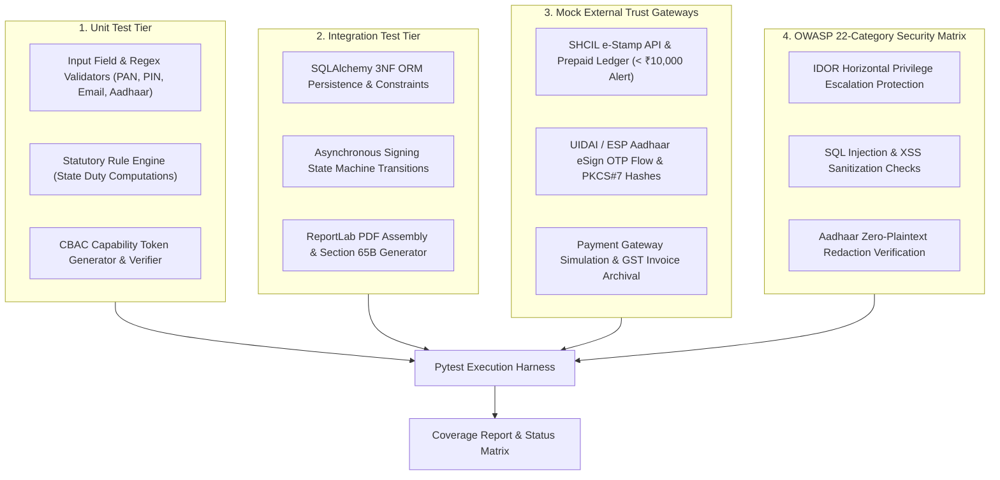

# GoLegal Web Application - Test Strategy & Plan

> **Document Version**: 1.0 (Master Engineering Baseline)  
> **Status**: APPROVED VERIFICATION & VALIDATION (V&V) STRATEGY  
> **Test Framework**: Pytest 7.4+, Pytest-Mock, Pytest-Cov  
> **Coverage Goal**: $\ge 90\%$ Code Coverage across Business & Security Modules  

---

## 1. Test Architecture & Verification Framework

The testing strategy validates software correctness, evidentiary sanctity, security boundaries, and regulatory compliance through four automated testing tiers:



---

## 2. Test Execution Categories & Scope

| Category ID | Scope / Subsystem | Test Objectives & Invariants | Target Files |
| :--- | :--- | :--- | :--- |
| **TC-VAL** | **Metadata & Form Validation** | Validate regex checks for PAN (`^[A-Z]{5}[0-9]{4}[A-Z]$`), PIN (`^[1-9][0-9]{5}$`), email formats, and Aadhaar masking (`XXXXXXXX1234`). | `tests/test_validation.py` |
| **TC-RULE** | **Statutory Rule Engine** | Verify stamp duty fees across Karnataka (₹100), Maharashtra (Leave & License variable), and Delhi; ensure non-derogable clauses cannot be purged. | `tests/test_rule_engine.py` |
| **TC-STAMP** | **SHCIL Stamping Mock API** | Verify e-Stamp certificate generation, real-time ledger debit from prepaid pool, and automated low-balance warning triggered when balance drops below ₹10,000. | `tests/test_stamping.py` |
| **TC-ESIGN** | **UIDAI eSign Mock Gateway** | Test OTP generation, challenge verification, invalid OTP rejection, and cryptographic PKCS#7 hash stamp affixation. | `tests/test_esign.py` |
| **TC-WORKFLOW** | **Multi-Party State Machine** | Test asynchronous, non-atomic signing orders (`1..n` owners, `1..n` tenants, witnesses); ensure final status seals atomically only when all parties sign. | `tests/test_workflow.py` |
| **TC-DOC** | **Document Assembly & Cryptography** | Validate ReportLab PDF rendering, Page 1 e-Stamp layout, continuous two-pass pagination (`Page X of Y`), SHA-256 digest sealing, and Section 65B audit page. | `tests/test_doc_assembly.py` |
| **TC-SEC** | **OWASP Security Matrix** | Validate CBAC token guards against IDOR tampering, SQL parameterization, PII redaction, and 27-day draft pruning rules. | `tests/test_security_owasp.py` |

---

## 3. OWASP Top-10 & Application Security Test Suite (22 Categories)

| # | Security Category | Automated Test Scenario | Expected Pass Assertion |
| :--- | :--- | :--- | :--- |
| **1** | **Information Gathering** | Inspect HTTP headers returned by mock service responses. | Strips `Server`, `X-Powered-By` banner tokens. |
| **2** | **Authentication Security** | Attempt 6 consecutive failed OTP verifications. | Rejects with HTTP 429 / Account temporary lockout. |
| **3** | **Architecture Isolation** | Verify database file permissions and location. | Database isolated from public web assets. |
| **4** | **Encryption Standards** | Validate document hashing algorithm. | Uses SHA-256 digests; rejects MD5 or SHA-1. |
| **5** | **Network Segmentation** | Mock boundary check between controller and data store. | Controllers cannot bypass CBAC security gate. |
| **6** | **Cache Management** | Validate response caching instructions. | Sensitive contract endpoints output `Cache-Control: no-store`. |
| **7** | **Session Management** | Test session token entropy and uniqueness. | 256-bit cryptographically secure pseudorandom tokens. |
| **8** | **Logout Security** | Revoke CBAC token and attempt subsequent sign action. | Rejects with 401 Unauthorized / Token Revoked. |
| **9** | **Server Hardening** | Verify environment variable configurations. | No debug flags enabled in staging/production configs. |
| **10** | **Directory Traversal** | Request document using path injection (`../../etc/passwd`). | Strict UUID format validation rejects path characters. |
| **11** | **Malformed Requests** | Inject malformed JSON and out-of-range types. | Schema validator rejects input before business logic. |
| **12** | **Credential Storage** | Inspect mock user password hash representations. | Verifies bcrypt or PBKDF2 salt and hash format. |
| **13** | **Cross-Site Scripting (XSS)** | Inject `<script>alert(1)</script>` into custom clauses. | HTML tags escaped or stripped in preview and PDF. |
| **14** | **SQL Injection** | Inject `' OR '1'='1` into agreement search queries. | Parameterized queries prevent SQL syntax tampering. |
| **15** | **Authorization (IDOR)** | Request Agreement B using valid Token for Agreement A. | CBAC validator detects mismatch and returns 403 Forbidden. |
| **16** | **CSRF Prevention** | Submit state-changing signature without token. | Rejects request with Missing Capability Token. |
| **17** | **File Upload / Download** | Attempt to download unexecuted draft with final doc token. | Rejects unauthorized lifecycle state access. |
| **18** | **Open Redirects** | Pass external `return_url=https://evil.com`. | Redirect sanitization restricts to internal paths. |
| **19** | **Error Handling** | Force unhandled exception in PDF generator. | User receives clean error; trace logged to APM. |
| **20** | **Hidden Form Tampering** | Tamper with client-side stamp duty amount parameter. | System re-calculates duty server-side via rule engine. |
| **21** | **Source Code Security** | Scan codebase for raw private keys or static passwords. | Zero hardcoded secrets; loads from environment. |
| **22** | **Audit Logging** | Attempt to mutate or delete existing `audit_logs` record. | Append-only invariant enforced; updates prohibited. |

---

## 4. Test Fixtures & Mocking Infrastructure

```python
# tests/conftest.py Architecture Overview
import pytest
from sqlalchemy import create_engine
from sqlalchemy.orm import sessionmaker

@pytest.fixture
def db_session():
    """In-memory SQLite database session isolated per test."""
    engine = create_engine("sqlite:///:memory:")
    # Initialize 3NF Schema Tables
    Session = sessionmaker(bind=engine)
    session = Session()
    yield session
    session.close()

@pytest.fixture
def mock_shcil_gateway():
    """Mock StockHolding Corporation of India Stamping API."""
    class MockSHCIL:
        def __init__(self, initial_balance=50000.0):
            self.balance = initial_balance
            
        def purchase_stamp(self, state, duty_amount, first_party, second_party):
            if self.balance < duty_amount:
                raise ValueError("Insufficient SHCIL Prepaid Balance")
            self.balance -= duty_amount
            is_low = self.balance < 10000.0
            return {
                "certificate_number": f"IN-{state}-{int(duty_amount)}-{uuid4().hex[:8].upper()}",
                "stamp_amount": duty_amount,
                "remaining_balance": self.balance,
                "low_balance_alert": is_low
            }
    return MockSHCIL()
```

---

## 5. Coverage Goals & Verification Pipeline

```bash
# Automated Test Pipeline Command
pytest --verbose --cov=services --cov=domain --cov=persistence --cov-report=term-missing tests/
```
- **Line Coverage Target**: $\ge 90\%$
- **Branch Coverage Target**: $\ge 85\%$
- **Execution Threshold**: All tests must complete within $< 15$ seconds total runtime.
