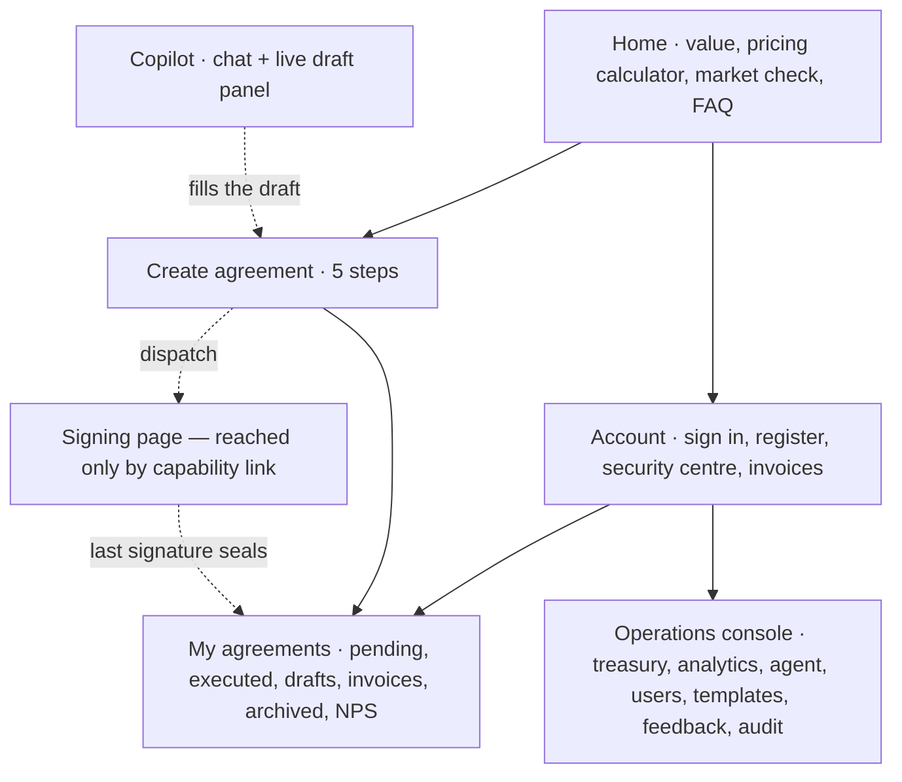

# GoLegal — UI Design & Information Architecture

> **Version**: 2.0
> **Framework**: Streamlit, with a custom design system injected via `st.html`
> **Design thesis**: the product's own artefact is the interface.

---

## 1. The idea

Every digital contracting product looks the same: a blue SaaS shell wrapped around a PDF viewer. The
thing that actually makes GoLegal trustworthy to a landlord in Mahadevapura is the object they already
recognise — **the e-Stamp paper**. Pale green security tint, a serial number in a machine face, a
government header, a red seal.

So the deed is not previewed in a viewer. It *is* the page: a rendered stamp sheet with a guilloche
tint, an engraved inner rule, a certificate block, serif body type, and a wet seal that reads
`DRAFT · NOT EXECUTED` in red and turns green `SEALED · SECTION 65B` at the moment the last signature
lands. That single surface carries the product's credibility; everything around it is deliberately
quiet.

### Tokens

| Token | Value | Role |
| :--- | :--- | :--- |
| ink | `#1E3A8A` | Brand navy — primary actions, headings |
| ink-deep | `#14265F` | Hover |
| paper | `#F7F8FA` | Canvas |
| stamp | `#EEF5EE` | e-Stamp green tint — document surfaces |
| stamp-ink | `#1B5E3A` | e-Stamp green ink — eyebrows, certificate text |
| seal | `#B91C1C` | The wet seal, draft state, critical alerts |
| verified | `#059669` | Signed, sealed, healthy balance |
| slate / muted / line | `#334155` / `#64748B` / `#E2E8F0` | Body, secondary, hairlines |

### Type

| Face | Role |
| :--- | :--- |
| **Newsreader** (serif) | The display headline and the deed body. Editorial-legal, not corporate. |
| **Inter** | All UI chrome. Specified by the PRD. |
| **IBM Plex Mono** | Certificate numbers, SHA-256 digests, transaction refs, tokens. Anything a user might read out or verify character by character. |

Numbering is used only where the content is genuinely a sequence: the five wizard steps
(`STEP 01`…`STEP 05`) and the three-step explainer on the landing page. Nowhere else.

---

## 2. Information architecture



The **signing page is not in the navigation**. It is a separate entry point: the router detects
`?sign_token=` and renders it with no product chrome, no account requirement and no way back into the
app. That is correct — the person on it is a tenant in Mumbai who received a WhatsApp message, not a
user of the platform.

The **Copilot is present on every screen** as a sidebar drawer, and has a full page for longer work.
Both share one conversation and one live draft.

---

## 3. Screens

### 3.1 Home

Hero states the promise as a claim, not a feature list: *"A stamped, signed rental deed. Ten minutes.
No broker, no queue."* Below it, three things a visitor actually needs before trusting a legal
product: how it works, what it costs (a live calculator that also runs a **market check** on the rent
entered), and what the deed contains — the real clause library, with statutory clauses padlocked.

### 3.2 Create agreement (5 steps)

| Step | What it does |
| :--- | :--- |
| 1 · Jurisdiction | Agreement type and state. Shows the statutory article and duty. Warns that a term ≥ 12 months needs registration. Offers ingestion and the demo tenancy. |
| 2 · Parties & terms | Four tabs: owner(s), tenant(s), property & money, witnesses. `1..n` parties with add/remove. Live market check as rent is typed. Storage-consent choice. |
| 3 · Clauses & preview | Split pane. Left: toggles, custom covenants, risk check, plain-language and vernacular summaries, padlocked statutory clauses. Right: the deed as stamp paper, updating live. |
| 4 · Checkout & e-Stamp | Itemised invoice before payment. Duty labelled as pure agent, GST on the fee only. On success the e-Stamp certificate block replaces the treasury card. |
| 5 · Sign & seal | Dispatch, progress ring, per-party status, per-party sign action, link copying, reminders. On completion the seal turns green and the sealed PDF is downloadable with its digest. |

**Ingestion** is available on steps 1 and 2: paste an old agreement, upload a PDF, or describe the
tenancy in a sentence. The extractor reports exactly which field groups it filled.

### 3.3 Counterparty signing page

The screen most likely to be opened on a small phone by someone who has never heard of GoLegal.

- Deed on the left, everything actionable on the right.
- **"Read it in plain words"** with Hindi, Kannada, Tamil and Telugu — placed here, not only in the wizard, because this is where the non-tech-savvy signer actually reads.
- UIDAI consent in English and Hindi, remaining attempts shown before the OTP field.
- After sealing: owners and tenants get the download; witnesses get the policy explained in a sentence.
- Closes with a plain statement that the link is single-purpose and should not be forwarded.

### 3.4 My agreements

Four counters, then tabs for pending, executed, drafts, invoices, archived and NPS. Each card carries
the counterparty names, the property, the money, signing progress and one primary action appropriate
to the state. Details expand to the signatory matrix with signature hashes, the e-Stamp number, the
invoice number, the sealed digest and rename / archive / share.

### 3.5 Operations console

Treasury first, because a depleted stamping pool is the one failure that breaks customer transactions:
balance, duty remitted, remaining ₹100-certificate runway, replenish, and a low-balance simulator.
Then tabs for analytics (funnel, revenue by state, median execution time), the **workflow agent**
(its plan per active agreement, a sweep trigger, and the journal of past runs with their steps), users,
templates and rules, feedback and NPS, and the append-only audit journal.

---

## 4. Component inventory

| Component | Purpose |
| :--- | :--- |
| `deed_preview` | The e-Stamp sheet. Takes payload, clauses, optional e-Stamp, party statuses and a sealed flag. |
| `stepper` | Five-step progress with done / active / upcoming states. |
| `progress_seal` | Conic-gradient ring showing signatures collected, green when complete. |
| `risk_panel` | Findings with severity-coloured left borders, the offending quote in italic serif, and a suggestion. |
| `status_pill` | One vocabulary for every state across every screen. |
| `stat` | Metric tile with danger / ok tones. |
| `party_row` | Name, role, masked Aadhaar, status. |
| `empty_state`, `notice`, `card`, `kv`, `trust_strip`, `how_it_works` | Supporting. |

---

## 5. Accessibility & responsiveness

- Visible keyboard focus (`:focus-visible`, 3px navy ring at 35% opacity).
- `prefers-reduced-motion` disables the fade-in and the button lift.
- Body text ≥ 0.85rem on `#334155` over white — above 4.5:1. Muted `#64748B` is reserved for supporting text at ≥ 0.8rem.
- Status is never colour alone: every pill carries a word.
- The stepper collapses from five columns to two below 720px; the explainer grid collapses to one.
- All user-supplied text is HTML-escaped before rendering.

---

## 6. Session state

```python
st.session_state = {
    "user_id": "usr-owner-001",          # only the id; the User row is re-read each run
    "active_tab": "Create agreement",
    "wiz": {
        "step": 3,
        "payload": {...},                 # owners[], tenants[], witnesses[], property, commercials,
                                          # clause_toggles, custom_clauses, cloud_storage_consent
        "agreement_id": "82808dc1-...",  # set once persisted
        "quote": {...}, "risk": {...}, "summary": {...},
    },
    "copilot_history": [{"role": ..., "content": ..., "actions": [...], "suggestions": [...]}],
    "security_alert": {"reasons": [...], "ip": ..., "location": ...},
    "sign_token": "...", "sign_agr_id": "...", "sign_party_id": "...",
}
```

**Known constraint.** Streamlit session state is bound to the websocket, so reloading the browser
signs the user out. There is no first-party cookie API. Production would put a signed session cookie
in front of the app via the reverse proxy; the code already keeps only an id in the session, so the
change is confined to `ui/state.py`.
