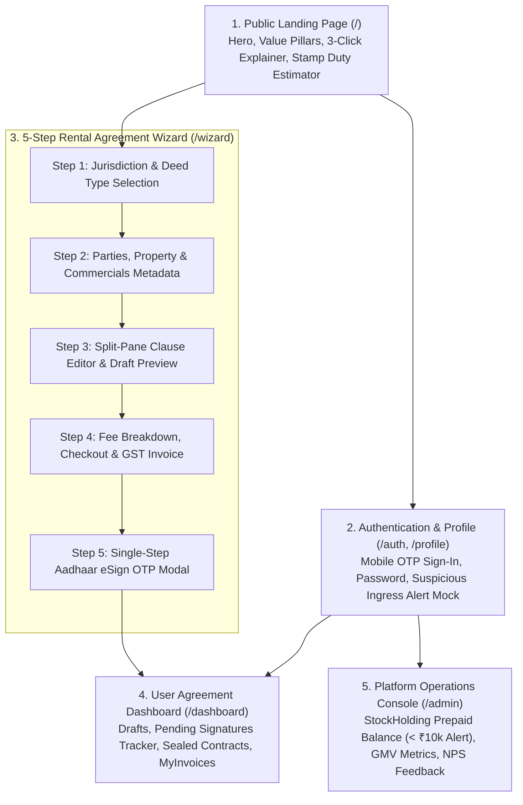
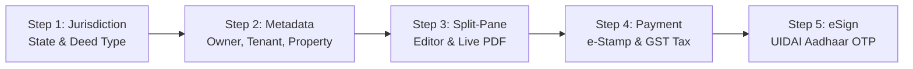

# GoLegal Web Application - UI Design & Information Architecture

> **Document Version**: 1.0 (Master Engineering Baseline)  
> **Status**: APPROVED UI/UX & INTERACTION SPECIFICATION  
> **Target Framework**: Streamlit (Reactive Multi-Page Architecture)  
> **Design Philosophy**: Frictionless 3-Click Flow, Trust-Inducing Legal Clarity, Split-Screen Live Preview  

---

## 1. Information Architecture & Sitemap



---

## 2. Global Design System & Layout Tokens

| Element | Specification / Token | Usage Context |
| :--- | :--- | :--- |
| **Typography** | `Inter`, `Roboto`, system sans-serif | High-contrast legal readability across dense contract clauses. |
| **Primary Brand Blue** | `#1E3A8A` (Deep Trust Navy) | Navbar headers, primary action CTAs (`[Create Agreement]`), active steps. |
| **Success Emerald** | `#059669` (Verified Green) | Statutory compliance badges, eSign verified markers, payment success banners. |
| **Neutral Slate** | `#334155` (Slate Gray) / `#F8FAFC` (Canvas) | Contract clause text, form labels, card backgrounds. |
| **Warning / Alert Red** | `#DC2626` (Urgent Crimson) | Stamping prepaid balance $< \text{₹}10,000$ warning, suspicious ingress banner. |
| **Accent Gold** | `#D97706` (Statutory Gold) | StockHolding e-Stamp watermark and official certificate seal badge. |

---

## 3. Detailed Screen Specifications

### 3.1 Screen 1: Public Landing Page (`/`)
- **Hero Section**: 
  - Headline: *"Borderless, Contactless Contracting — Valid in Court in Under 10 Minutes."*
  - Subhead: Fully compliant with Information Technology Act 2000 & Section 65B Indian Evidence Act 1872.
  - CTAs: Primary `[Create Rental Agreement Now]` $\rightarrow$ triggers Wizard; Secondary `[Estimate Stamp Duty]`.
- **Statutory Trust Badges**: UIDAI Aadhaar eSign Compliant, StockHolding Official e-Stamp Partner, 256-Bit SSL Encrypted, IT Act 2000 Approved.
- **Interactive Stamp Duty Estimator**: Select State (Karnataka, Delhi, Maharashtra) + Enter Monthly Rent $\rightarrow$ Outputs statutory stamp duty + handling fee instantly.

### 3.2 Screen 2: Authentication & Security Profile (`/auth`, `/profile`)
- **Authentication Modes**:
  - `[Continue with Mobile OTP]`: Inputs 10-digit Indian mobile number $\rightarrow$ dispatches 6-digit mock OTP with 60-second cooldown timer.
  - `[Continue with Email / Password]`: Standard authenticated session.
- **Suspicious Ingress Simulation**: Toggle button to simulate a login from an unrecognized device or novel IP location $\rightarrow$ immediately renders a high-visibility alert banner and dispatches mock notification.

### 3.3 Screen 3: 5-Step Rental Agreement Wizard (`/wizard`)



- **Step 1: Jurisdiction & Agreement Type**:
  - Select State (e.g. Karnataka, Maharashtra, Delhi NCR).
  - Select Agreement Type: Residential Rental (11 Months), Commercial Lease, Mutual NDA.
- **Step 2: Structured Metadata Ingestion**:
  - **First Party (Owner)**: Legal Name, Father's/Spouse's Name, Permanent Address, PAN, Phone, Email, Masked Aadhaar.
  - **Second Party (Tenant / Co-Tenants)**: Dynamic `[+ Add Co-Tenant]` form fields with identical validation.
  - **Property & Commercials**: Complete address, PIN code, monthly rent, deposit, lock-in months, notice period, annual escalation rate (5% / 10%).
  - **Witnesses**: Names, contact details of 1 or 2 witnesses (or option for Institutional Witness).
  - **Storage Consent**: Checkbox for indefinite cloud storage consent (vs. 27-day purge).
- **Step 3: Split-Pane Clause Editor & Real-Time Preview**:
  - **Left Pane (Clause Controls)**: Interactive toggles (Pet Policy, Painting Maintenance, Subletting Prohibition) and editable custom covenants text area.
  - **Right Pane (Dynamic Synchronized Preview)**: Live formatted contract draft with prominent watermark: *"UNEXECUTED DRAFT - FOR PREVIEW ONLY"*.
- **Step 4: Checkout & Stamping Payment Simulation**:
  - Transparent itemized cost matrix: State Stamp Duty (e.g. ₹100), GoLegal Platform Fee (₹299), 18% GST (₹53.82) $\rightarrow$ Total: ₹452.82.
  - Simulated payment modes: UPI QR / ID, Debit/Credit Card, NetBanking.
  - Automated generation of GST tax invoice permanently accessible in `MyInvoices`.
- **Step 5: Single-Step Aadhaar eSign OTP Modal**:
  - Mandatory UIDAI consent disclaimer in English and Hindi.
  - Signer enters Aadhaar/VID $\rightarrow$ Triggers OTP verification modal.
  - Affixes digital signature certificate block and dispatches asynchronous signing links to counterparties.

### 3.4 Screen 4: User Dashboard (`/dashboard`)
- **Agreement Status Tabs**:
  1. **Drafts**: In-progress contracts with resume and delete options.
  2. **Pending Signatures**: Real-time counterparty status tracker (e.g., Owner: Signed, Tenant: Pending, Witness: Pending) with `[Resend Link]` action.
  3. **Completed Agreements**: Final sealed contracts with Download Tamper-Proof PDF, Section 65B Certificate, WhatsApp Share, and Soft Delete actions.
- **MyInvoices Tab**: Table of GST receipts with instant download.

### 3.5 Screen 5: Admin Console (`/admin`)
- **StockHolding Prepaid Stamping Balance**:
  - Real-time balance metric widget (e.g., ₹48,500.00).
  - Prominent visual warning alert when balance drops below ₹10,000.
  - Simulated `[Recharge Balance]` action and transaction debit audit ledger.
- **Sales GMV Metrics**: Real-time Gross Merchandise Value, agreement counts by state, stamp size breakdown.
- **Customer Feedback & NPS Console**: Breakdown of 10-point NPS scores (Detractors 0-8 with root causes, Promoters 9-10).

---

## 4. Reactive Session State Schema (`st.session_state`)

```python
# Streamlit Session State Key Structure
st.session_state = {
    "authenticated_user": {
        "id": "usr_01a...",
        "email": "mayank.tripathi@example.com",
        "name": "Mayank Tripathi",
        "role": "Tenant",
        "is_admin": False
    },
    "wizard": {
        "current_step": 1, # 1 to 5
        "state_code": "KA",
        "agreement_type": "Rental_Residential",
        "metadata": {
            "owner": {"name": "", "phone": "", "pan": "", "aadhaar_masked": ""},
            "tenant": {"name": "", "phone": "", "pan": "", "aadhaar_masked": ""},
            "co_tenants": [],
            "property": {"address": "", "city": "Bangalore", "pincode": "560103"},
            "commercials": {"rent": 25000, "deposit": 100000, "escalation_pct": 5.0}
        },
        "custom_clauses": "",
        "storage_consent": True,
        "payment_status": "Unpaid",
        "active_agreement_id": None
    },
    "shcil_balance": 48500.0,
    "security_alerts": []
}
```
