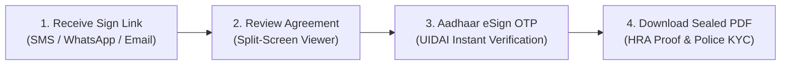
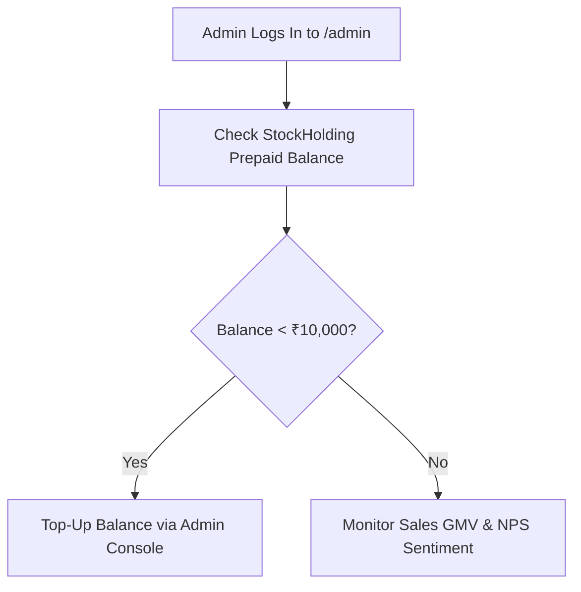

# GoLegal Web Application - Operational & Usage Documentation

> **Document Version**: 1.0 (Master Engineering Baseline)  
> **Status**: APPROVED OPERATIONAL SPECIFICATION  
> **Target Audience**: Tenants, Landlords, Witnesses, and Platform Operations Administrators  
> **Legal Standard**: Information Technology Act 2000 & Section 65B Indian Evidence Act 1872  

---

## 1. Persona Operational Manuals

### 1.1 Tenant Manual (Mayank & Anushka Persona)

#### Step-by-Step Instructions:
1. **Accessing the Agreement**:
   - As an **Initiator**: Click `[Create Rental Agreement]` on the landing page. Select your State (e.g., Karnataka) and Rental Deed type. Enter your details, Landlord details, and Property schedule.
   - As an **Invited Signer**: Open the tokenized execution link delivered to your WhatsApp, SMS, or Email. No cumbersome account registration required.
2. **Reviewing Clauses**:
   - Inspect the populated terms in the document preview: Rent amount, security deposit, lock-in period, and notice period.
   - Check the watermarked sample e-Stamp banner confirming statutory duty coverage.
3. **Executing Aadhaar eSign**:
   - Click `[Sign with Aadhaar eSign]`.
   - Read and accept the statutory UIDAI consent statement.
   - Enter your 12-digit Aadhaar / 16-digit Virtual ID (VID) and click `[Get OTP]`.
   - Enter the 6-digit OTP received on your Aadhaar-linked mobile number and click `[Verify & Sign]`.
4. **Post-Execution Utility**:
   - Once all parties complete their signatures, download the cryptographically sealed PDF.
   - The sealed PDF with Section 65B evidentiary certificate is 100% admissible for corporate HRA tax deductions, bank account opening, and passport address verification.

---

### 1.2 Landlord / Property Owner Manual (Ramakiran Persona)

1. **Initiating Property Lease**:
   - Navigate to `/wizard`. Select your property jurisdiction (e.g. Karnataka).
   - Enter your ownership details and PAN card number for tax reporting.
2. **Customizing Protective Covenants**:
   - In Step 3 (Split-Pane Clause Editor), toggle custom rules:
     - *Pet Policy*: Permitted / Prohibited.
     - *Painting Liabilities*: Fixed deduction upon vacation.
     - *Annual Escalation*: 5% or 10% annual rent increase.
     - *Subletting*: Strictly prohibited without written consent.
3. **Checkout & Instant e-Stamp Procurement**:
   - Review transparent fee breakdown: Government Stamp Duty (₹100) + Platform Fee (₹299) + GST.
   - Pay via UPI QR code or NetBanking.
   - System automatically procures an official StockHolding Corporation of India (SHCIL) e-Stamp certificate and merges it on Page 1.
4. **Monitoring Signatures**:
   - Track live signing progress from your User Dashboard (`/dashboard`).
   - Use `[Resend Link]` if tenants or witnesses have not completed their signing within 48 hours.

---

### 1.3 Witness Manual

1. **Role of Witness**:
   - Indian contracting practice requires two competent witnesses to attest that the deed was executed voluntarily by the parties.
2. **Access & Execution**:
   - Open the personalized execution link received via SMS or WhatsApp.
   - Review the summary of parties and property address.
   - Click `[Execute Witness eSign]`, enter Aadhaar OTP, and submit.
3. **Witness Privacy Boundary**:
   - To protect the personal and financial privacy of the Landlord and Tenant, witness tokens are restricted post-signing. Witnesses receive a confirmation acknowledgment but **cannot** download the complete commercial deed.

---

### 1.4 Platform Administrator Manual

1. **StockHolding Prepaid Stamping Balance Monitoring**:
   - Access `/admin`. The live StockHolding balance widget displays current stamping capital.
   - **Critical Threshold**: If the balance breaches $< \text{₹}10,000$, an urgent crimson alert displays on all admin screens.
   - Click `[Recharge Balance]`, input replenishment amount (e.g., ₹25,000), and verify the balance update recorded in `sysconfigTlb$jn`.
2. **Sales GMV & Velocity Telemetry**:
   - Inspect daily transaction throughput, state-wise revenue distribution, and payment settlement reconciliations.
3. **Customer Feedback & NPS Console**:
   - Review incoming Net Promoter Scores.
   - Inspect Detractor (0-8) root-cause diagnostic feedback logs to identify bottlenecks in the signing funnel.

---

## 2. Frequently Asked Questions (FAQs)

### Q1: Is an online rental agreement with Aadhaar eSign legally valid in Indian courts?
**Yes.** Under Section 10A of the Information Technology Act 2000, electronic contracts formed digitally are valid, binding, and enforceable. Section 5 of the IT Act confers legal equivalence between handwritten wet signatures and licensed electronic signatures (Aadhaar eSign).

### Q2: What is the Section 65B Evidence Certificate?
Under Section 65B of the Indian Evidence Act, 1872, electronic records must be certified by the computer system custodian to be admissible as primary documentary evidence in judicial proceedings. GoLegal automatically appends a cryptographically verified Section 65B Certificate to every completed contract.

### Q3: How does StockHolding e-Stamping work online?
GoLegal connects via backend integration with the Stock Holding Corporation of India Limited (SHCIL), the official Central Record Keeping Agency (CRA). The system procures genuine, uniquely numbered state e-Stamp certificates and electronically affixes them as Page 1 of the deed.

### Q4: Can co-tenants sign at different times from different cities?
**Yes.** GoLegal uses a non-atomic, asynchronous signing engine. Co-tenants and property owners receive independent secure tokens and can review and execute signatures hours or days apart from their respective phones or laptops.
