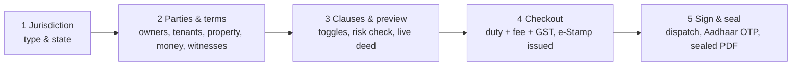

# GoLegal — Usage Guide

> **Version**: 2.0
> **Audience**: tenants, owners, witnesses, platform operators, and engineers running the app locally.

---

## 1. Getting in

| You are… | What you do |
| :--- | :--- |
| Starting an agreement | Register or sign in (mobile OTP, email + password, or a demo persona). Registration is required to initiate. |
| Invited to sign | Tap the link in your WhatsApp, SMS or email. **No account, no app, no password.** The link is your credential. |
| A platform operator | Sign in with an admin account; the Operations tab appears in the navigation. |

Demo accounts, password `GoLegal@123`:

| Account | Role |
| :--- | :--- |
| `ramakiran.reddy@example.com` | Owner / landlord |
| `mayank.tripathi@example.com` | Tenant |
| `admin@golegal.in` | Platform operations |

Mobile OTP in sandbox mode is always `123456` and is shown on screen. In production it is sent to the
number and never displayed.

---

## 2. Owner or tenant: creating an agreement

**Three ways to fill the form.** Type it; paste an existing agreement or upload a PDF into
*"Start from an existing contract or a sentence"*; or describe it to Copilot — *"2BHK in Bellandur,
rent 28k, deposit 1.2 lakh, owner Ramakiran Reddy 9876543210, tenant Mayank Tripathi 9876543211"* —
and it fills the draft and tells you what is still missing.

**Step 2** takes `1..n` owners and tenants and up to two witnesses. As you enter the rent, a market
check tells you whether it sits inside the typical band for that locality. Aadhaar is entered once,
masked to `XXXXXXXX1234` the moment it is stored, and never kept in full.

**Step 3** is the split view. Toggle pet policy, painting deduction, subletting and parking; add your
own covenants. **Check for risk** scores the terms and flags anything unfair, unenforceable or
discriminatory — and masks any identity number you accidentally pasted into the clause text.
**Explain in simple words** produces a plain-language summary; pick Hindi, Kannada, Tamil or Telugu if
that is easier to read. The deed on the right updates as you type, rendered as the e-Stamp paper it
will become.

**Step 4** shows the itemised invoice *before* you pay: state duty, platform fee, GST on the fee only.
Duty is collected as pure agent and remitted through StockHolding. On payment the e-Stamp certificate
is issued and your GST invoice is available immediately.

**Step 5** dispatches a private link to every party. You can also copy the links or re-send them.
Watch the ring fill as signatures arrive. When the last one lands the deed seals itself, the draft
stamp turns green, and the PDF is downloadable with its SHA-256 digest.

---

## 3. Invited signer: signing from your phone

1. **Tap the link.** No account, nothing to install.
2. **Read the deed.** It is shown in full. Tap *Explain this agreement* for plain words, or switch the
   language to Hindi, Kannada, Tamil or Telugu.
3. **Check the progress panel** to see who else has signed.
4. **Sign with Aadhaar.** Read the UIDAI consent (English and Hindi), tick it, request the OTP, enter
   it. Five wrong attempts locks the attempt for fifteen minutes.
5. **Afterwards.** Owners and tenants can download the sealed deed from the same link once everyone
   has signed. **Witnesses cannot** — witnesses attest the execution but do not receive a copy. That
   is GoLegal's witness privacy policy, and it is enforced by the link itself, not by a UI setting.

The link works only for your agreement and only for your role. Do not forward it.

---

## 4. Copilot

Available in the sidebar on every screen, and as a full page.

| Ask it | It does |
| :--- | :--- |
| "Draft: 2BHK in Bellandur, rent 28k, deposit 1.2 lakh, owner …, tenant …" | Extracts the terms, fills the draft, lists what is still missing |
| "How much is stamp duty in Maharashtra for rent 40,000?" | Computes duty, fee and GST from the real rule engine |
| "Is 10 months deposit normal in Bangalore?" | Fair-rent band and local deposit norms |
| "Review my clauses for risk" | Scores the draft and explains each finding with a fix |
| "Explain Section 65B" / "What is a lock-in period?" | Plain-language explanation |
| "Summarise this agreement in Hindi" | Vernacular summary |
| "Who has signed?" / "Remind everyone who hasn't" | Signing matrix; re-dispatches links |

**What it will not do.** Copilot never pays, never buys e-Stamp paper and never signs for anyone.
Those are personal legal acts. It will tell you exactly which screen to do them on. It also refuses to
handle a full Aadhaar number.

Every action it takes is listed under the reply, and recorded in the operations journal.

---

## 5. Your workspace

**My agreements** holds four states plus your invoices and archive.

- **Awaiting signatures** — live progress per party, re-send links, resume signing.
- **Executed** — download the sealed PDF, share on WhatsApp, view the signature matrix with hashes.
- **Drafts** — resume, rename, or sort by date, counterparty or type.
- **Invoices** — every GST invoice, downloadable.
- **Archived** — archiving removes an agreement from *your* workspace only. Counterparties keep full
  access; nothing is destroyed.
- **Rate GoLegal** — the 10-point NPS. A score of 8 or below asks what to fix first.

**Account & security** shows your recent sign-ins with the device, network and location for each. If
GoLegal sees a device, IP network or location it has not seen on your account before, it flags the
sign-in and emails you. *Test the detector* runs a real simulated sign-in from an unknown device in
another country so you can see exactly what the alert looks like.

---

## 6. Platform operator

**Treasury first.** The SHCIL prepaid balance, duty remitted, and how many more ₹100 certificates the
pool can fund. Below ₹10,000 a crimson banner appears and stamping refuses new calls rather than
taking a payment it cannot fulfil. Replenish inline.

**Analytics.** Funnel across the four lifecycle stages — the biggest drop is the step to fix. Revenue
by state, stamp denominations, median draft-to-seal time, conversion.

**Workflow agent.** For each active agreement, the plan the agent intends to execute. Run it for one
agreement, or sweep the portfolio. Every past run is listed with its goal, status, model, token usage
and the full step log.

**Users.** Search, see agreements initiated and security alerts raised, suspend or reactivate.

**Templates & rules.** The clause library with statutory clauses marked locked, the toggles offered to
users, and the state stamp table.

**Feedback & NPS.** Score, promoter/passive/detractor split, root-cause chart, and every comment.

**Audit journal.** Three append-only ledgers: agreement events, the stamping journal
(`sysconfigTlb$jn`, reconcilable against SHCIL statements), and every notification dispatched.

---

## 7. Troubleshooting

| Symptom | Cause and fix |
| :--- | :--- |
| Signed out after refreshing the browser | Streamlit sessions are per-connection. Sign in again; your draft is kept if you saved it. |
| "This link has expired" | Signing links last 7 days. Ask the initiator to re-send from step 5 or the workspace. |
| "Too many failed attempts" | Five wrong OTPs locks the attempt for 15 minutes. |
| "Only drafts can be edited" | The agreement is already paid. Terms are fixed once duty is remitted; cancel and start a new one. |
| Copilot says the AI service is unavailable | No `ANTHROPIC_API_KEY`, or the API is unreachable. Everything still works through the built-in rules; answers stay accurate but less conversational. |
| Stamping fails at checkout | The platform's prepaid pool is depleted. Operations is alerted; no payment is captured. |
| Witness cannot download the deed | Working as intended. Witnesses attest only. |
